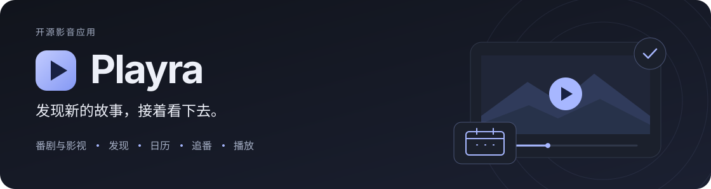
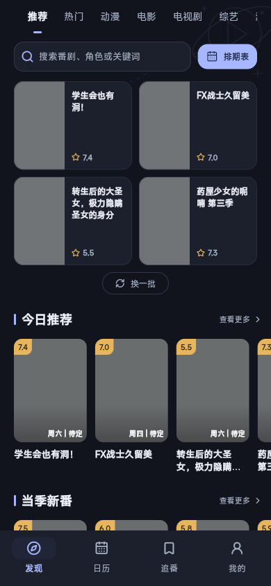
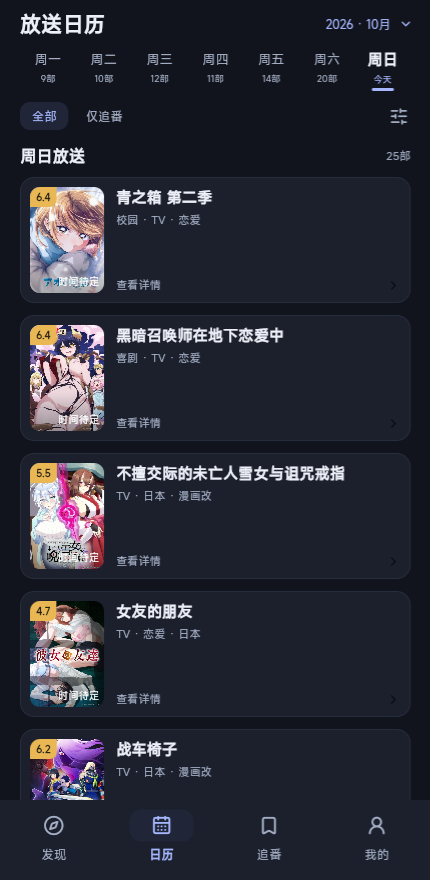
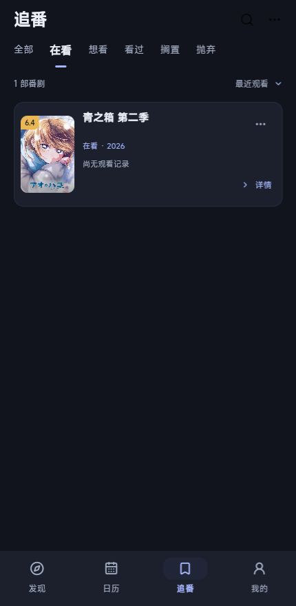

# Playra

<p align="center">
  
</p>

<p align="center">
  <a href="pubspec.yaml"></a>
  
  
  <a href="LICENSE"></a>
</p>

<p align="center">
  <a href="#功能概览">功能概览</a> ·
  <a href="#界面预览">界面预览</a> ·
  <a href="#从源码开始">源码运行</a> ·
  <a href="#分支与官方更新">分支说明</a> ·
  <a href="#文档导航">项目文档</a>
</p>

**Playra 是我们自己的影音应用主线**，基于 [Kazumi](https://github.com/Predidit/Kazumi) 开源项目，使用 Flutter 构建番剧与影视发现、日历、追番、榜单和播放体验，并接入 MioMedia 内容与播放 SDK。

`main` 保存 Playra 的功能、界面与发布改动；`kazumi-upstream` 保存官方原版，便于持续跟进上游。下载、运行和更新本项目时，请使用 **Playra main** 及本仓库的发布入口。

> 当前处于开发阶段，主要联调 Android 与 Web。正式安装包以 [Playra Releases](https://github.com/haigepor/Playra/releases) 为准；尚无正式版本时，可按下文从源码构建。构建附件和测试包的状态见对应交付记录。

## 功能概览

| 模块 | 当前能力 |
| --- | --- |
| 发现与目录 | 番剧推荐与影视分类、搜索、筛选、真实分类榜单，独立加载和重试 |
| 日历与追番 | 放送日历、季度浏览、追番状态和观看记录，统一紧凑深色界面 |
| 播放与选集 | 资料与播放一体页、线路选择、自适应选集、分段/排序与当前集状态 |
| 内容运行时 | Android 内置 Python SDK；Web 使用同源内容服务与媒体网关 |
| 我的与设置 | 历史、下载、规则、同步、外观和播放设置，保留既有数据兼容 |

Bangumi 番剧与 MioMedia 影视保持各自的作品身份和业务能力。已接入的功能与开发计划以源码和[项目文档](#文档导航)为准。

## 界面预览

以下为仓库保存的界面截图；页面会随开发继续完善。

| 发现 | 日历 | 追番 |
| :---: | :---: | :---: |
|  |  |  |

更多设计与实现记录：[播放一体页](docs/design/modern-player-detail.zh.md) · [二级页面](docs/design/modern-secondary-pages.zh.md) · [页面局部细修](docs/design/modern-secondary-polish.zh.md)。

## 从源码开始

### 环境与构建输入

| 环境 | 要求 |
| --- | --- |
| Flutter / Dart | 使用 [pubspec.yaml](pubspec.yaml) 声明的版本；当前 Flutter 3.47.6、Dart ≥3.10.0 且 <4.0.0 |
| Python | 3.11+，用于 SDK 输入工具与 Web 内容服务 |
| Android | Android SDK、JDK 17；应用内 Python 由 Chaquopy 打包 |
| Web | Node.js；当前 CI 使用 Node.js 22，依赖见 [Web 后端](tool/web_backend/package.json) |

MioMedia SDK 属于私有构建输入，公开仓库不包含完整模块和数据资源。开发该功能前，需要准备授权 SDK；操作、完整性要求和 CI 输入见[构建输入说明](docs/release/build-inputs.zh.md)。

以下为 Windows / PowerShell 示例；SDK 路径请替换为自己的实际目录：

```powershell
git clone --branch main https://github.com/haigepor/Playra.git
cd Playra
python tool/miomedia_sdk_input.py sync --sdk-directory "C:/path/to/sdk/python/miomedia"
flutter pub get
```

本仓库的 Windows 启动/构建脚本默认使用 `.tooling/flutter/bin/flutter.bat`。本机工具路径可在忽略的 `.tooling/dev-environment.json` 中配置，仓库内路径相对于检出根目录解析；有配置时启动器会自动使用它。新设备需要分别准备工具与私有 SDK，详见 [多设备路径与开发环境](docs/development/web-android-environment.zh.md)。

### Android

```powershell
.\tool\build-android.ps1 -AndroidSdk "D:/Android/Sdk"
```

默认构建调试包，输出 `build/app/outputs/flutter-apk/app-debug.apk`。传入 `-Release` 可构建 release 模式；正式签名仍须单独配置，release 模式本身不代表正式签名发布。

Android 默认在应用内调用 Python SDK，日常使用无需启动电脑服务。已有安装 ID、数据目录和通信标识保持兼容，系统显示名称为 Playra。

### Web

先在一个终端启动内容服务：

```powershell
python -X utf8 tool/source_runtime/server.py --port 8945
```

再在另一个终端构建并启动 Web：

```powershell
.\tool\start-web.ps1 -Port 8931 -RuntimePort 8945 -Build
```

浏览器地址为 `http://127.0.0.1:8931`。脚本准备 Web 后端依赖并启用同源内容桥接。查看新版移动界面可改用：

```powershell
.\tool\start-home-preview.ps1 -Port 8933 -RuntimePort 8945 -Build
```

这些地址只用于本地开发；Web 运行方式和来源接口见[算法运行时](docs/source-algorithm-runtime.zh.md)与[来源服务](docs/source-http-api.md)。

### 更新另一台设备

在已有检出目录中，先保存自己的未提交改动，确认 origin 指向 Playra，再拉取 main：

```powershell
git remote get-url origin
git switch main
git pull --ff-only origin main
flutter pub get
```

私有 SDK、Android SDK、签名材料和构建产物属于每台机器的环境，需要分别准备。拉取源码后重新使用对应平台的构建命令，不能将旧 APK 或旧 Web 产物当作新提交。

## 分支与官方更新

| 分支 / 远程 | 用途 |
| --- | --- |
| [`main`](https://github.com/haigepor/Playra/tree/main) | **Playra 自有主线**：功能开发、界面定制和发布准备 |
| [`kazumi-upstream`](https://github.com/haigepor/Playra/tree/kazumi-upstream) | 官方源码镜像，仅快进同步，不提交 Playra 定制 |
| `origin` | `haigepor/Playra`，本项目的拉取和推送目标 |
| `upstream` | `Predidit/Kazumi`，用于获取官方更新 |

两条分支保留共同祖先。同步官方镜像与把官方功能整合进 Playra 是两个步骤；看到 ahead/behind 或 “Compare & pull request” 提示时，应结合变更内容判断，不直接将官方分支覆盖 main。

首次配置官方远程：

```powershell
git remote add upstream https://github.com/Predidit/Kazumi.git
git fetch upstream main --no-tags --no-recurse-submodules
```

已有 upstream 时直接 fetch。官方镜像的更新、集成分支和回退方式见 [Git 工作流](docs/git-workflow.md)。Playra 自有版本 tag 使用 `playra/v*`，官方 tag 与自有版本的处理见[版本引用策略](docs/release/tag-policy.zh.md)。

## 文档导航

| 主题 | 入口 |
| --- | --- |
| 新 SDK / 接口接入 | [统一接入规范](docs/development/source-sdk-onboarding.zh.md) · [接入验收模板](docs/development/templates/source-sdk-checklist.zh.md) · [本轮 SDK 实施记录](docs/analysis/sdk-provider-lines-quality-implementation-20261014.zh.md) |
| 构建与发布 | [私有 SDK、正式签名与 CI 输入](docs/release/build-inputs.zh.md) · [版本引用策略](docs/release/tag-policy.zh.md) |
| 多设备开发 | [路径分工、D 盘环境与新设备恢复](docs/development/web-android-environment.zh.md) · [Web/Android 与 SDK 分析](docs/analysis/web-android-sdk-20261013.zh.md) |
| 内容与播放 | [MioMedia 内容/播放接入](docs/miomedia-content-playback.zh.md) · [七天榜单记录](docs/verification/miomedia-seven-day-ranking.zh.md) |
| 运行时与接口 | [算法运行时](docs/source-algorithm-runtime.zh.md) · [来源 HTTP API](docs/source-http-api.md) |
| 界面设计 | [播放详情](docs/design/modern-player-detail.zh.md) · [二级页面](docs/design/modern-secondary-pages.zh.md) · [局部细修](docs/design/modern-secondary-polish.zh.md) |
| 当前交付状态 | [发布准备记录](docs/verification/playra-release-20261013.zh.md) · [接口与播放核验](docs/verification/interface-playback-audit.zh.md) |
| 上游与许可 | [分支维护](docs/git-workflow.md) · [原项目 README](docs/upstream/Kazumi-README.md) · [GPL v3](LICENSE) |

## 开发检查与反馈

SDK 与依赖准备好后，可按需运行：

```powershell
flutter analyze --no-fatal-infos
flutter test
python -m unittest discover -s tool -p test_miomedia_sdk_input.py
python -m unittest discover -s tool/source_runtime -p "test_*.py"
node --test tool/web_backend/runtime.test.cjs
```

构建、SDK 自检、浏览器播放和真机播放分别记录证据。当前红米 K50 / Android 15 的电影播放仍需继续定位，CI 私有输入及正式签名配置也尚待完成；最新边界见[发布准备记录](docs/verification/playra-release-20261013.zh.md)。

请通过 [Playra Issues](https://github.com/haigepor/Playra/issues) 提交问题或建议。播放问题请提供应用版本、设备/系统、网络类型、作品、线路、集数及公开错误提示；日志分享前移除令牌、设备身份和私有配置。

## 许可与致谢

Playra 沿用 [GNU GPL v3.0](LICENSE)。感谢 [Kazumi 原项目及贡献者](https://github.com/Predidit/Kazumi)，并保留原作者及第三方组件版权。

原项目的历史说明保存于 [Kazumi README](docs/upstream/Kazumi-README.md)，其中下载和发布链接属于原项目。Playra 自有安装包、版本和问题反馈均以本仓库入口为准。
