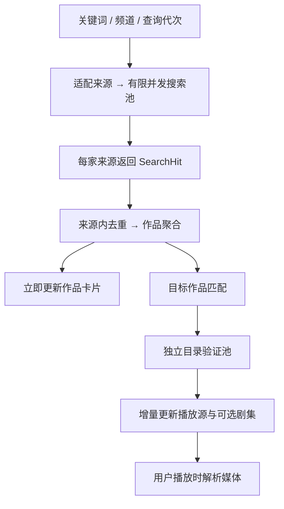

# 四类内容、来源预留与并发聚合搜索方案

日期：2026-10-13。源码基线：`24e04806`。本报告是在[接口规范化分析](source-interface-standardization-20261013.zh.md)基础上，针对本轮产品需求的深入梳理。仅分析与设计，未修改业务代码或创建 OpenSpec。

## 1. 已确认的需求与目标

用户已确认四类：**动漫、影视、漫剧、剧集**。剧集包含国产、港台、日韩、欧美等全部真人连续剧，地区作为筛选项。影视包含电影、综艺、纪录片。

当前接入规划：16 条内置规则作为动漫来源；影视先使用现有 MioMedia Python SDK；漫剧、剧集及更多来源预留统一接入位置。搜索需要并发执行，哪个来源先返回数据就先展示；同一作品在展示上聚合，匹配结果进入其播放源列表。

真正要形成的体验是：**分类明确、来源可扩展、搜索渐进显示、作品聚合、备用来源保留、播放匹配可解释。**

本轮不调整底部“发现/日历/追番/我的”导航。四类应先作为内容频道与搜索范围；它们与应用导航是两个层级。

## 2. 当前代码核验

### 2.1 16 条规则确实全部声明为动漫

结构化读取 `assets/plugins/*.json` 的结果：

| 规则 | 搜索/剧集方式 |
| --- | --- |
| 7sefun、aafun、AGE、akianime、baimao、dalvdm、DM84、ezdmw、giriGiriLove、mgnacg、moonci、mutefun、MXdm、xfdmneo | XPath / XPath，共 14 条 |
| sorani、xfdmnext | API / API，共 2 条 |

16 条均为 `type: anime`，内置 JSON 未另行声明 `sourceId` 或 `sourceConfig.domains`。当前 `SourceProfile` 因 `type` 推导出动漫领域；安装后可由来源管理层持久化稳定身份。

这代表版本库中的内置来源定义，不代表当前用户全部安装/启用，也不代表 16 个站点现在都在线。搜索应选取用户启用且能力适配的来源，而非固定请求全部 16 条。

### 2.2 SDK 已支持多种内容，但四类接入规划尚未统一

MioMedia Runtime 有 11 个受限 operation；Dart `MioKind` 已识别 anime、movie、series、variety、comicDrama、shortDrama、unknown。首页 Controller 当前使用 movie、series、variety、comicDrama 四种 SDK 类型，动漫另有 Bangumi/规则链路。这与用户要求的四个统一产品频道不同。

所以“影视有一个 SDK”在接入技术上成立，但不能推导出该 SDK 只会返回电影。当前 SDK 页面已有剧集和漫剧入口；未来规范化时必须有意识地决定它在新频道中的绑定，不能靠页面名称或 SDK 名称猜测。

本报告按用户当前规划保留：动漫绑定规则池，影视绑定 MioMedia，漫剧与剧集保留后续专属接入位置。**这是拟定配置，不是宣称当前应用的剧集和漫剧已经被移除。** 本轮不改变现有入口。若迁移时需要保留 SDK 已有剧集/漫剧内容，只给同一个 Provider 增加频道绑定，不复制 SDK 或新建同名 Provider。

### 2.3 搜索有三条实现，并未统一

| 当前入口 | 已有行为 | 与新需求的差距 |
| --- | --- | --- |
| 通用 `SearchPageController` | 搜索 Bangumi 资料，按 Bangumi ID 去重 | 没有同时聚合内容来源 |
| `MioBrowsePage` | 单独搜索 MioMedia，按 `miomedia:id` 去重 | 只有一个供应商，未纳入统一搜索会话 |
| 作品详情 `PluginSearchService` | 最多 4 个 worker，并发查询规则；各来源完成后写 ObservableList | 搜索后等待目录准备，再发布结果；面向 Bangumi 目标作品，不能直接承担四类全局搜索 |
| `SourceService.searchAll` / Dart HTTP 聚合检索 | 已有有限并发 | 当前返回最终集合/JSON，调用方不能逐来源接收结果 |

`PluginSearchService` 已具备逐来源更新，不能说它现在完全等待所有来源才显示。真实卡点是：每个 worker 搜索后还会等待 `SourceCandidates.prepare`，而 prepare 内对多个命中的剧集目录逐个查询；一个慢目录会延迟该来源的首批显示，也占用下一家来源的搜索机会。

`SourceCandidates.selectEpisode` 已支持首个准备好的候选提前返回；可复用其取消、缓存和明确集号思路，不需要重写全部播放逻辑。

### 2.4 去重与匹配的现状

- `SourceSheet` 按来源内部 `result.src` 去重，保留来源分组；尚不是跨来源作品聚合。
- Mio 列表按自身 identity 去重，不能与其他来源的不同 ID 合并。
- `SourceCandidates.matches` 对目标名称、中文名与别名做规范化后精确比较。它保留季号字符，但不具备通用的版本/年份/地区匹配模型。
- 自动选源会检查唯一候选、冷却与目标集号，这是正确的限制，应保留。
- `SourceSheet` 的自定义检索入口会把输入加入作品 alias；`SourceCandidates` 又使用 alias 做精确匹配。检索关键词与可信作品别名需要分开，否则一个泛化关键词可能在以后被当成同作品证据。
- 某些列表用“这一页去重后没有新增”提前关闭分页。聚合搜索不能继续沿用这一条件：重复页不等于后面没有新作品。

## 3. 四类应该怎样规范

### 3.1 四类是展示分组，类型和地区是独立属性

| 内容频道 | 归属内容 | 子分类/筛选 | 当前规划的来源 |
| --- | --- | --- | --- |
| 动漫 | 国漫、日漫、欧美动画、动画电影 | 地区、电视动画/剧场版/OVA、年份、题材 | 16 条动漫规则；Bangumi 为资料补充 |
| 影视 | 真人电影、综艺、纪录片 | 电影/综艺/纪录片、地区、年份、题材 | 现有 MioMedia SDK |
| 漫剧 | 来源明确标注的动态漫剧、动画短剧等 | 地区、题材、长短篇 | 专属来源位置预留 |
| 剧集 | 国产剧、港剧、台剧、日剧、韩剧、美剧、英剧、泰剧等真人连续剧 | 地区、长剧/真人短剧、年份、题材 | 专属来源位置预留 |

真人短剧建议进入剧集的 shortDrama 子类型；不因名字包含“短剧”就判为漫剧。普通漫画图片不自动作为可播放漫剧；如果以后接入漫画阅读，应单独定义能力。

分类优先使用上游明确分类、来源受维护的映射、人工确认；不能根据作品标题模糊猜测。信息不足时保留内部 unknown，展示为待分类，并不强行增加第五个主频道。

建议分别保存：`contentGroup`（四类频道）、`contentKind`（电影/剧集/综艺等）、`region`、`format`、`genres`、`rawCategory`、`classificationEvidence`。地区不能代替类型：日本电影属于影视，日本真人连续剧属于剧集，日本动画属于动漫。

当前 `SourceProfile.domains` 只有 anime/screen，其中 screen 包含多种非动漫类型。它是旧来源粗粒度领域，不能直接当成新四频道枚举。新增 `contentGroups` 并建立兼容映射，再逐步迁移路由，避免误将旧 screen 来源限制成只搜电影。

漫剧若与动漫标签重叠，以来源明确的细分类映射决定主频道，并保留原分类；不能让它同时无理由出现在两个主频道。合拍作品可保留多个地区，不强制唯一地区。

### 3.2 Provider 与频道是多对多关系

一个来源可以支持多个频道；一个频道可以使用多个来源。查询执行按 Provider 去重，不因它绑定三个频道就把同一关键词请求三遍。

```text
动漫频道 → 动漫规则池（当前 16 条定义，按用户启用状态执行）
影视频道 → MioMedia Provider → 现有 Python SDK
漫剧频道 → 预留的频道绑定集合
剧集频道 → 预留的频道绑定集合

未来：新 API/规则/SDK Adapter → 登记 Provider → 绑定一个或多个频道
```

MioMedia 的 Provider 身份只有一个。目录/搜索/剧集/解析能力由 Adapter 描述；频道配置决定哪些业务入口使用它，而不是“每个频道创建一个 SDK 实例体系”。

### 3.3 “预留位置”的具体含义

预留公共 Adapter 契约、Provider 注册器、频道到来源的绑定表、分类映射、搜索/匹配状态和能力展示位置。页面只读这些契约，不提前写 `FutureJapaneseService` 等供应商分支。

尚未接入的来源不进入可执行 registry，不发请求、不产生健康成功记录；未配置的频道明确显示“来源尚未接入”。这与来源已经配置但返回空结果、或网络失败，是不同状态。

也不应为预留而让所有 16 条动漫规则去搜索影视、漫剧或真人剧集。允许未来规则声明多个内容领域，但必须经真实来源能力核验。

预留“频道”不等于预留一个固定供应商或只有一个接入口。后续每个频道都可接入多个来源，并采用同一套聚合搜索与播放源匹配。

## 4. 搜索必须区分两种目的

### 4.1 全局关键词搜索：先找作品

输入关键词及可选频道；目标是展示有哪些作品。默认使用当前频道，也可以提供“全部”搜索范围。全部模式按 Provider 去重调度，并将返回内容分流到四个频道；不需要一开始就猜关键词属于哪类。

Bangumi 元数据搜索可以并行作为动漫资料补充，不得成为来源结果显示的前置条件。未取得 Bangumi 资料，也能显示来源作品的标题与已有字段，图片加载也不能阻塞首批结果。

全局搜索阶段不对所有结果预先拉剧集、解析媒体或领取凭证。通常只对可见/高相关候选适量补充详情，用户点击作品后再展开来源匹配与目录验证。

### 4.2 目标作品找源：再找可选播放来源

用户进入作品详情后，目标已确定：名称/别名、频道、季/年份/版本、已有外部 ID。此时查询该频道适配的 Provider，把匹配到的内容引用关联到目标作品。

这条链路才适合后台拉目录、检查线路/目标剧集，将候选逐个加入播放源列表。不要把全局搜索的“出现同一关键词”当成“匹配到该作品”。

如果目标由某个来源卡片直接进入，该来源内容身份是已知锚点；其自身作为初始来源保留，其他来源需要经过跨来源匹配。用户后来切换来源，也不自动改变目标作品身份。

## 5. 并发、先到先显示与调度方案

### 5.1 分成两个独立任务池



搜索 worker 拿到结果后先发布事件并释放搜索槽位；匹配与目录验证另行排队，不在搜索 worker 内等待完整 prepare。单个 Provider 一次返回多条命中时，也按候选发布，不等该 Provider 的所有目录全部完成。

保留有限并发，不默认瞬时打开 16 条规则及全部别名。初始建议沿用现有搜索并发 4；同 host 上限 1–2，目录验证并发 2。参数属于待测起点，不是已验证的最佳值。SDK 总执行预算还要受到当前 Python 4 个执行名额/Android 排队限制约束，不能让各池独立把 SDK 打满。

以近期搜索响应与成功率安排首批来源，按域名分散，保留公平补位；单个来源超时就释放槽位。搜索调度不能只使用播放器首帧统计，因为搜索快与播放快是不同指标。

慢来源仍可补充备用结果，不因第一家返回数据就全部取消。只有用户明确开始一次自动播放任务时，该任务可以在找到合格候选后停止不需要的验证；不要误取消其他页面仍需要的共享读取。

### 5.2 增量事件，而非最后返回一个大 List

建议统一 SearchSession 产生类似事件：

```text
started / providerStarted
hitsUpserted / workGroupMerged
sourceBindingUpdated / directoryUpdated
providerFinished / progress
searchCompleted / enrichmentCompleted / cancelled
```

Controller 合并事件后更新可观察状态，页面持续展示首批已有结果。`Future.wait` 可以作为“全部结束”的记账机制；关键是每个任务完成后已经发布事件，不能把它当唯一返回出口。

首批非空结果立即提交；随后高频更新可按一帧或短窗口合并，避免频繁整页重建。卡片稳定 ID 不依赖到达顺序或排序索引，补充封面/资料后原卡片原位更新，用户已经选择的来源不随迟到结果自动切换。

当前 Flutter 可以共用进程内事件契约，Web 不必因“增量”就新建 WebSocket。若以后正式使用 Dart HTTP 聚合入口，可提供任务轮询或流式响应适配同一契约；保留现有最终 JSON 路由，不能只改客户端就声称它能增量返回。

### 5.3 别名、取消与耗时边界

先用主名称查询。空结果或无严格匹配的来源，再尝试去重后的少量别名；未完成的相同 provider/keyword/page 请求合并，避免 16 条规则乘所有别名的请求爆炸。

主名称失败与明确空结果不同：网络失败优先按来源策略重试，不能通过连续换别名重复攻击同一个不可达服务。别名规范化只用于比较和减少重复请求，发给上游的文本保持可读名称及季号。

用户用于搜索的缩写、系列名或片段关键词保存在 searchTerms，不自动加入可信 alias。只有明确的作品名称别名或经用户确认的关联才用于自动匹配；人工搜到候选也不自动授予以后跨来源换线的信任。

每次提交新关键词/切频道增加 query generation，取消旧任务；UI 与搜索聚合缓存禁止接收旧代次结果。上游非立即可取消时至少丢弃迟到结果。缓存必须包含来源版本、频道/过滤条件、关键词、页号和必要的账号/环境作用域，不用第一家的成功结果替代整个会话的完整性状态。

提供单来源 deadline 与整个会话 budget；具体秒数以规则和 SDK 测量决定。本报告没有远端测速，不能保证某毫秒以内首屏。搜索完成与目录补充完成分别报告，避免结果已显示后仍被一个目录任务维持全屏 loading。

### 5.4 示意时序

以下时间仅解释产品行为，非当前性能实测：

```text
0.0s  启动 A/B/C/D 搜索任务
0.8s  A 命中作品甲 → 显示作品甲，来源 A 标记“待匹配/待目录”
1.1s  C 命中相同作品 → 更新作品甲，追加来源 C，不新增重复卡片
1.4s  A 目录验证完成 → 来源 A 可选，尚未试播
2.0s  B 命中作品乙 → 新增作品乙
3.0s  D 失败 → 标记单来源失败，保留 A/B/C 数据，队列补位
稍后  用户点击 A → 解析媒体 → 首帧成功 → 本次来源状态变为已起播
```

“先显示”是非阻塞展示；不承诺第一家永远排第一，也不意味着它就是最准确或最适合自动播放的来源。

## 6. 去重：合并作品，保留来源

### 6.1 第一层：同一 Provider 内去重

以 `(providerId, stableContentId)` 去重。重复页、不同别名返回同一个条目时更新同一 hit，保留更完整字段。来源未提供稳定 ID 时，由该 Adapter 定义引用提取规则；不能统一删掉 URL 的 query，因为其中可能包含真正的条目 ID。

去重发生在业务层，而非只在列表 widget 中，因此目录验证与播放也能避免重复请求。

### 6.2 第二层：跨 Provider 的作品聚合

同一可信 metadata ID 是强聚合证据；没有 ID 时比较规范标题/已知别名、频道、季号、年份、版本等。关键字段存在冲突必须分开，缺字段不能当成一致。

标题规范化可统一大小写、全半角、空白和已知展示性画质后缀，但保留第二季、Part 2、剧场版、OVA、重制版本等身份信息；不能用“去除所有数字”或通用子串包含判断。

例如同名动画与真人剧不合并；同名的第 1 季和第 2 季不合并；不同年份的翻拍电影不因同名合并。来源只返回 name/src 的场景无法凭空得到年份，证据不足时保持独立“同名候选”，用户确认或取得更多元数据后再关联。

避免让模糊匹配通过传递性合并整批结果：A 与 B 标题接近、B 与 C 标题接近，不证明 A/B/C 是同一作品。新成员必须与作品锚点及所有明确约束一致。

### 6.3 第三层：来源与线路去重

一张作品卡片保存所有成员引用及 SourceBinding，不直接删除后到的来源。一个 Provider 中确有多个版本时保留版本候选；同一版本多个线路作为子节点，不重复计成多家供应商。

```text
作品甲
  ├─ 来源 A / 内容 ID a12
  │    ├─ 线路 1
  │    └─ 线路 2
  └─ 来源 C / 内容 ID c98
       └─ 线路主线
```

不能仅按标题去重后只保留 A，否则“备用源、切线、错误重试、后续下载”都会丢失来源上下文。相同 URL 出现在不同 Provider 也不能直接删除其中一个，除非登记中已证明它们是同一个来源别名。

作品组使用稳定 groupId；后到元数据导致两组能够合并时保留引用迁移/别名映射，不能在用户正在点击或播放时销毁其身份。首次展示的标题与封面可以完善，但选集、来源选择和播放操作保留所属的准确成员引用。

### 6.4 分页特别规则

每个 Provider 保持自己的 page/cursor、hasMore 和错误，不使用一个全局页号推导所有来源。合并后的作品数不等于来源原始命中总数。

一页全是重复项时，仍以来源分页证据判断下一页；必要时受控补读下一页，设置预算与重复页上限防止无限循环。重复页限制达到后返回“本次补读暂停”，不能伪造上游已经没有结果。

## 7. 匹配到结果怎样归为播放源

### 7.1 同时保留三个独立状态

| 维度 | 建议状态 | 含义 |
| --- | --- | --- |
| 作品匹配 | exactId / strictTitle / possible / conflict / userConfirmed | 是凭什么关联到目标作品 |
| 目录 | pending / ready / empty / failed / verificationRequired | 是否取得有效线路和剧集 |
| 播放 | untested / resolving / interactionRequired / started / failed | 本次媒体解析和起播情况 |

strictTitle 是标题规则证据，不能包装为上游 ID 已确认。所谓“播放源”应至少区分候选来源与可选来源：命中且作品匹配后进入候选区；目录有效且具有 resolve 能力后成为可选播放源；真实起播后才标记本次已起播。

对于电影或直接媒体型来源，不强制必须有传统剧集列表；Adapter 可以返回明确的单片播放入口。是否可选按来源播放能力判断，不为凑模型伪造电视剧集数。

### 7.2 匹配规则建议

1. 来源明确提供且经校验的共同外部 ID：优先关联；仍检查冲突类型和季/版本信息。
2. 与目标完整名称或可信别名精确匹配，并符合频道与已知季/版本约束：形成 strictTitle 候选；来源数据稀疏时保留证据等级。
3. 名称近似、缺季号、翻拍年份未知、或同 Provider 有多个同名候选：放到“可能匹配”，让用户确认，不自动切换。
4. 明确频道、季号、版本冲突：不归入目标播放源，但全局搜索中仍可作为另一作品展示。

动画规则声明 anime 仅说明来源适用领域，不证明命中的作品与目标相同。自动播放应只使用唯一且无歧义的合格候选；目录或元数据不足时保留手动选择，而不是为了尽快起播降低身份标准。

### 7.3 集号、缺集与自动换源

同作品不同来源的第 5 集需要按明确集号/唯一完整集名映射，不使用列表第 5 个位置。特别篇、日期名、上下篇和拆分集要有明确的唯一映射，否则人工选集。

目录请求失败不能当成“没有该集”；目录完整且编号明确时才判定缺集，未知则保留候选并提示。当前已有的普通集号与特殊名称保护应继续复用。

“谁先返回”决定展示时机；“谁进入自动播放”由匹配证据、目标集可用性、用户偏好和近期实际播放表现决定。用户手选来源优先，后到结果不能自动抢占正在播放的来源。

搜索期间不预先对所有来源调用 SDK play/exchange、广告任务或媒体解析。除了浪费带宽和运行线程，这些操作可能消费凭证，必须等用户播放或明确的受控播放任务才执行。

## 8. 建议的最小业务模型与职责

以下是职责草案，尚非实现代码；可扩展上一报告的现有 DTO，避免同时建立两套模型。

| 模型/职责 | 关键内容 |
| --- | --- |
| `ContentGroup` | 四个频道；与旧 domains 兼容但语义分开 |
| `ProviderDescriptor` | 稳定 ID、支持频道、Adapter、search/catalog/resolve 等能力、运行条件 |
| `SearchQuery` | queryId/generation、关键词、频道与过滤、来源范围、页信息、预算 |
| `SearchHit` | Provider 与内容引用、标题/封面、分类、可选年份/季/metadataRef、证据 |
| `WorkGroup` | 稳定 groupId、展示字段、可选资料锚点、所有成员引用与匹配证据 |
| `SourceBinding` | 目标作品与来源内容的关联，匹配/目录/播放三维状态 |
| `SearchSession` | 搜索任务池、增量事件、逐来源进度、取消与代次；不依赖 InfoController/BangumiItem |
| `WorkMatcher` | 匹配与合并约束，公共规范化；上游细节在 Adapter 内 |
| `SourceValidation` | 独立目录验证队列、缓存、目标集映射 |

Controller 负责订阅会话与交互，不拼供应商 operation。Provider Registry 决定搜哪些来源；Adapter 决定如何请求和解析；Matcher 决定能否关联；播放器决定媒体是否起播。

### 8.1 现有模块的调整方向

| 当前模块 | 建议方向 |
| --- | --- |
| `SourceProfile/SourceManifest` | 增加四频道绑定、能力、运行条件；保留旧领域兼容 |
| `SourceService` | 复用单源搜索核心，增加逐来源事件；统一 Rule/SDK 的业务输入输出 |
| `PluginSearchService` | 去除对 InfoController 的强耦合；搜索发布与 prepare 分离，原入口作为兼容适配 |
| `SourceCandidates` | 复用缓存、匹配与集号保护；逐候选验证，接入公共 WorkRef，而非只认 BangumiItem |
| `MioMediaService` | 作为受维护 Adapter 的内部实现，转换 SearchHit/分类/播放材料 |
| `SearchPageController/MioBrowsePage` | 逐步订阅统一搜索会话，不继续增加每供应商专用搜索状态 |
| `SourceSheet` | 展示来源增量状态与匹配证据；来源内去重移到业务层 |
| HTTP 聚合检索 | 需要远程增量时增加任务/流式适配，现有最终返回保持兼容 |

Web 与 Android 共用同一 Session、Matcher、分类与去重实现；HTTP、内嵌 Python、WebView、播放器继续使用各自适配。这样同一查询 fixture 应得到相同作品分组与来源关联，不要求两端网络响应时间完全一致。

## 9. 分步落地与验收

| 切片 | 工作 | 验收重点 |
| --- | --- | --- |
| A：频道与注册 | 固定四频道/子类型、现有来源绑定、未来来源空位与未接入状态 | 16 条规则不误搜影视；SDK 不重复注册；无供应商的频道不发假请求；现有入口迁移范围清楚 |
| B：增量搜索 | SearchSession、有限并发、query generation、逐源事件；先只做来源内去重 | 快来源先出现；慢源/失败不清空快源结果；旧关键词不污染新关键词；目录不占搜索槽位 |
| C：作品聚合 | WorkGroup、证据与冲突规则、稳定 groupId、分页状态 | 同一作品一张卡片、多来源保留；同名异季/动画真人/翻拍不误合并；重复页后仍可继续 |
| D：播放源匹配 | 独立目录池、SourceBinding 三维状态、目标集号和手选优先 | 目录失败不当缺集；模糊候选不自动播放；先命中不等于已起播；不在搜索时消费 SDK 凭证 |
| E：平台与扩展 | 两端契约回归，fixture Provider 接入，部署能力说明 | 新增一个测试来源只改 Adapter/登记/fixture，不增加一套页面；Web/Android 分组与匹配一致 |

先固定 A，再做 B/C/D。不要一开始同时重写播放器、账号、历史与下载；它们按上一报告的稳定身份契约后续接入。

契约测试应使用可控 fixture 覆盖：乱序返回、单源永久挂起、空结果、局部失败、同源别名重复、跨源同作品、年份/季号冲突、验证码、迟到取消、长字符串 ID、重复分页和目标集缺失。性能验收记录 firstResultMs、firstSelectableSourceMs、searchCompleteMs、原始/聚合结果数、请求数及取消后的迟到事件数。

一个关键自动验收例：A 在 100ms 返回、B 在 3s 返回，A 应在 B 完成前已发布结果；A 目录慢也不能延迟其原始命中展示。具体生产环境时延目标待测后制定。

## 10. 本轮验证、证据与交付范围

DONE：四频道边界经用户确认；16 条 JSON 结构化解析全部为 anime（14 XPath + 2 API）；AST 提取 SDK operation 为 11；已复核当前并发、目录等待、局部去重与播放源选择代码。

本轮没有重跑上一报告的 18 项测试，也没有实际验证新算法性能。本文的 Session、作品聚合和来源匹配方案尚未实施。站点在线情况、真实延迟与两端运行表现须在实施后单独验收。

| 证据主题 | 文件 |
| --- | --- |
| 内置规则及领域 | `assets/plugins/*.json`、[source_profile.dart](../../lib/services/source/source_profile.dart) |
| 当前 SDK 分类、分页与 ID | [miomedia_service.dart](../../lib/services/source/miomedia/miomedia_service.dart) |
| SDK 首页栏目/分类发现 | [miomedia_home_controller.dart](../../lib/presentation/modern/miomedia/miomedia_home_controller.dart) |
| 详情规则搜索并发与发布时机 | [plugin_search_service.dart](../../lib/services/plugin/plugin_search_service.dart) |
| 目录准备、标题匹配、提前选源 | [source_candidates.dart](../../lib/services/source/source_candidates.dart) |
| 来源内去重与选源 UI | [source_sheet.dart](../../lib/pages/info/source_sheet.dart) |
| 聚合检索最终集合 | [source_service.dart](../../lib/services/source/source_service.dart)、[source_http_server.dart](../../lib/services/source/source_http_server.dart) |
| SDK 单源搜索与分页去重 | [miomedia_browse.dart](../../lib/presentation/modern/miomedia/miomedia_browse.dart) |
| 元数据搜索 | [search_controller.dart](../../lib/pages/search/search_controller.dart) |
| 代次与取消基础 | [async_session.dart](../../lib/utils/async_session.dart) |

只新增 `docs/analysis/content-categories-search-plan-20261013.zh.md`。上一轮分析文档和既有子模块工作区变化均保留，不修改规则、业务配置或用户数据。新文档按严格 UTF-8、无 BOM、LF 验证，并检查源码引用存在性。回退本轮交付只需删除该新增报告。

NEXT：以本报告确定的频道和搜索模型建立正式变更契约，先落地频道注册与增量搜索，再逐步接入作品聚合和播放源验证。实施跨模块改造前建议确认 OpenSpec 范围；当前未创建其工件。
