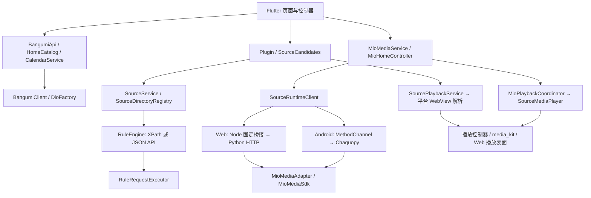
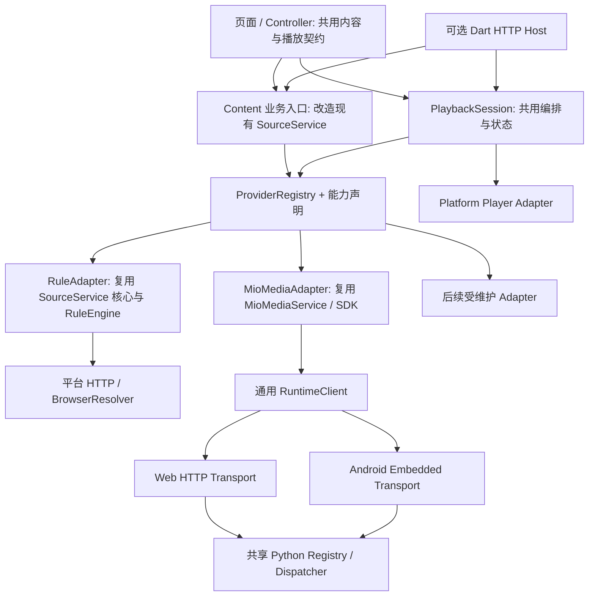

# Playra Web / Android 规则与接口规范化分析

日期：2026-10-13。源码基线：`24e04806`。性质：基于当前代码的分析与设计建议，尚未实施架构迁移。

## 1. 结论与范围

目前已经有共享规则引擎、来源 DTO、来源策略和平台适配，具备继续规范化的基础。主要缺口是：**规则来源与 MioMedia SDK 尚未通过同一个应用业务契约提供内容和播放能力；资料、来源身份和用户数据仍有历史耦合。**

建议采用“统一业务契约 + 按职责登记 Provider + 按平台实现 Transport”的结构。Web 与 Android 共用业务逻辑，但继续使用各自适合的网络、Python、浏览器和播放器实现。

成功标准：新增同类内容来源时，通常只需增加 Adapter、登记 Manifest、补充契约测试；不需要再增加一套首页、搜索、详情和播放状态逻辑。真正增加新的产品能力时，才扩展业务契约和页面。

本轮只新增本报告，不修改源码、规则、私有 SDK、配置或 OpenSpec，不发送账号、收藏、奖励、支付等上游请求。初始已有 `fastlane/.libmpv-android-video-build` 子模块工作区变化，保留原状。

## 2. 当前逻辑：一套 Flutter 业务，多条数据链路

### 2.1 总体关系



另有独立 Dart `SourceHttpServer`，复用 `SourceService` 与 `RuleEngine`，通过 `/api/v1/*` 提供通用规则业务。当前 Flutter 页面没有通过 `SourceHttpClient` 调用它：实例化调用仅见于 `tool/source_api_integration.dart`。因此不能把 Node 的 `/api/v1/*` 路由描述为两端页面现有的统一入口。

### 2.2 两端实际差异

| 事项 | Web | Android | 应统一的内容 |
| --- | --- | --- | --- |
| 页面业务 | 共用 Flutter；新版主要在 `main_home_preview.dart` 入口 | 常规 `main.dart` 支持新版 UI | 业务入口、能力展示与验收口径 |
| 普通 HTTP | `network_adapter_web.dart` 转到同源 `/api/proxy` | 原生网络适配；Bangumi 可使用专用策略 | 请求意图、错误、预算、凭据作用域 |
| 规则搜索/剧集 | Dart 规则引擎，经 Node 访问上游 | 同一个 Dart 规则引擎，原生访问上游 | 输入输出、身份、分页、取消 |
| SDK 运行 | 同源 `/api/runtime/v1/*` → Node → Python | 未配置远程地址时，MethodChannel → Kotlin → 内嵌 Python | 同一 Dispatch、DTO、错误与 capability |
| 视频页解析 | `/api/parse`，后端 Chromium | 平台 WebView | 解析任务与验证上下文契约 |
| 媒体请求 | 同源媒体代理及 HLS 子资源重写 | 原生播放器访问媒体并携带请求头 | 播放材料、过期、header scope、首帧与恢复 |
| 通用来源 HTTP | Node 可转发独立 Dart 服务，进程须单独启动 | 当前普通页面在进程内调用来源层 | HTTP 是可选宿主，不强制成为本地业务前置 |

Web 正式入口和新版预览需要分别验收。当前 `main.dart` 的 `supportsModern` 为 `Platform.isAndroid`，预览为 `true`；Release workflow 常规 `flutter build web` 只打包静态 `build/web`，没有同时发布 Node、Python 或 Chromium。代码存在与部署具备能力是两件事。

### 2.3 三条主要业务链

**Bangumi 资料与规则播放：** Bangumi 查询得到 `BangumiItem`；`SourceCandidates` 根据领域、标题及明确集号寻找规则候选；`Plugin.queryBangumi/queryChapterRoads` 委托 `SourceService`；播放由 `VideoController` 经 `SourcePlaybackService` 获取媒体。资料条目与播放来源已经有部分区分，但播放参数、历史和下载仍大量围绕 `BangumiItem` 组织。

**规则执行：** `SourceDefinition` 将旧 JSON 转成 `SourceManifest` 与 `RuleExecutionConfig`；`RuleEngine` 分别选择 XPath 或 API Strategy；Flutter 默认请求器是 `SourceRuntimeExecutor(PlatformRuleRequestExecutor())`。普通 URL 走来源请求器，特定保留域名才交给 SDK Runtime。独立 Dart 服务则注入 `SourceGateway`，不复制 XPath/JSONPath 引擎。

**MioMedia：** 页面直接持有 `MioMediaService` 和 `MioVideo/MioLine/MioEpisode`。Runtime 暴露 11 个受限 SDK operation；Python 处理签名、设备身份、握手、凭证与媒体身份校验。`MioPlaybackCoordinator` 编排缓存、剧集匹配和换线，详情页负责播放器装载与首帧判断。它没有伪造 Bangumi ID，但也没有接入现有 Bangumi 历史、收藏、下载及弹幕上下文。

## 3. 当前已有基础，应保留

- `SourceRef` 已包含 `providerId`，HTTP 使用不透明 ID，不直接泄漏规则执行引用。
- 规则、目录、API 解析已复用 `SourceService.observe`，支持超时、取消和按操作健康记录。
- `SourcePage` 明确本地分页与上游分页，不强行制造总量。
- `SourceProfile` 区分内容领域与技术类型；`SourcePolicy` 保存用户覆盖及按环境/来源版本划分的统计。
- `Plugin` 兼容入口保留旧规则导入导出和 `Road` 转换，远程更新保留已安装的 `sourceId`。
- SDK operation 与参数有白名单；客户端不能指定任意 Python 模块或脚本。Web 固定转发到 loopback，Android 固定使用原生私有目录。
- 两端已有条件导入和播放器适配，页面具备取消及代次检查，能抑制部分迟到结果。
- 已有 `unify-source-services-http-api` OpenSpec 变更与契约测试。下一次规范化应复用其成果，并准确说明当前扩展到 SDK 后留下的差异。

## 4. 容易造成后续混乱的具体问题

| 优先级 | 当前事实与源码依据 | 新来源增加后的影响 |
| --- | --- | --- |
| P0 | `SourceService` 输入是规则 `SourceDefinition`；MioMedia 使用独立 `MioMediaService`、模型及页面 | 容易继续复制一套来源专用的列表、详情、分页、播放状态 |
| P0 | `History` 持有 `BangumiItem`；key 基于规则名称和 Bangumi ID；续播按 `plugin.name == history.adapterName` 找规则 | 来源改名、非 Bangumi 作品或多来源身份无法自然接入；显示名仍承担稳定身份 |
| P1 | `SourceManifest.capabilities` 使用 `search/episodes/resolve`；Python MioMedia 仅声明 `sdk`，另附 operations | 技术操作与业务能力不在同一层，页面无法统一判断“可搜索、可详情、可播放” |
| P1 | `SourceProfile.adapterKind` 只根据是否存在 `resolveApi` 区分 `http/rule` | XPath/API 搜索、解析策略、SDK 执行位置容易被同一个字段混淆 |
| P1 | `SourceRuntimeClient.accepts/callMioMedia`、Node `runtime.cjs`、Python HTTP、Android bridge 都包含 MioMedia 特例 | 新 SDK 来源需要同时改 Dart、Node、Python HTTP、Android 的路由和登记逻辑 |
| P1 | Python HTTP `health` 返回顶层字段、`adapters` 返回 `data` 列表；Android 分别返回 `data` 对象、`data.adapters` | 当前业务操作能共用，但发现和健康契约已经分叉；直接统一消费会出现结构解析差异 |
| P1 | `SourceException`、`NetworkException`、Runtime error、MioPlaybackOutcome 并存；Mio 播放 catch 后可只剩 `unavailable` | 原始错误阶段丢失，无法稳定决定重试、验证、切线或给用户提示 |
| P1 | 规则候选使用 `SourcePolicy`；Mio 换线使用独立静态 timings/lastSuccess；规则播放与 Mio 的总预算不同 | 排序、冷却和恢复策略会随来源继续复制；3 次尝试也不等于受控总耗时 |
| P1 | `PluginCookieManager` 以规则名称隔离；HTTP `SourceGateway` 以 session/provider 隔离；SDK 以设备文件及会话隔离 | session、用户账号和设备身份容易混用，未来切账号或后台运行难以定义作用域 |
| P1 | `platformResourceUrl` 可把请求头编码进 Web URL；独立 Dart 服务则生成媒体 ticket；Node HLS 重写使用原 `rawHeaders` | 媒体授权有两种实现；重定向后的 header 作用域容易漂移，URL 编码也不等于保密 |
| P2 | `SourceDirectoryRegistry.categories` 固定返回动漫分组；规则目录有 DM84/7sefun 默认配置；Mio 分类由自己的 Controller 发现 | 当前目录抽象仍偏动漫，不能作为任意影视来源分类的通用实现 |
| P2 | HTTP content detail 返回缓存引用，标注 `detailMode: reference`；Mio detail 是完整资料 | 同名“详情”接口实际能力不同，不能在统一后承诺所有来源都有完整详情 |
| P2 | Mio 分类绑定与 `MOD_818368` 识别分别位于 Controller/Service | 来源专有协议知识仍接近页面；其他 SDK 加入后会形成更多硬编码分支 |
| P2 | 导入去重、部分规则替换/删除仍以归一化名称为准，虽然已存在 `providerId` | 新 Manifest 要求稳定 ID 后，旧管理路径还可能发生同名覆盖或改名断联 |

P0/P1/P2 是本次规范化的建议实施顺序，不是对现网故障的判定。表中 HLS 问题基于当前控制流复核：跨 origin 重定向删除了可变 `headers` 中的 Cookie/Authorization，但子资源 URL 仍使用初始 `rawHeaders`。本轮没有进行第三方站点实测或新的安全攻击复现。

还需留意现有 `SourceRef.id` 对完整 `rawRef` 求哈希：它提供隔离和不透明性，但如果引用包含会变化的签名参数，就不能直接把该哈希当成跨会话的稳定历史身份。HTTP 缓存引用、稳定内容 ID 和短期媒体 ticket 必须区分。

## 5. 建议的目标结构

### 5.1 按业务职责规范，不建立一个万能接口

| 职责 | 当前对应 | 统一边界 |
| --- | --- | --- |
| 资料 Metadata | Bangumi 详情、日历、角色、评论读取 | 提供资料及外部身份；不承担任意来源的媒体解析 |
| 内容 Content | 规则目录/搜索、MioMedia 目录/详情/剧集 | 共享目录、搜索、详情、线路、剧集模型；能力可选 |
| 播放 Playback | 规则 WebView/API 解析、Mio SDK play | 共享解析请求、播放材料及播放会话状态 |
| 弹幕 Danmaku | 弹弹play | 独立作品/剧集映射和弹幕读取，映射有依据才关联 |
| 账号 Account | Bangumi Token；未来其他来源账号 | 按 provider/account 管理凭据和账号操作 |
| 用户数据 Library | 本地历史、收藏、下载 | 使用稳定内容/剧集引用，外部同步是独立适配 |
| 辅助 Integration | trace.moe、更新、规则仓库、WebDAV、Syncplay | 各自保持专业接口，共享基础错误、配置和观测规范 |

Bangumi 和 MioMedia 可以出现在同一个发现页，但分别表示“资料条目”和“来源作品”。把它们展示为相似卡片，不代表可以共享原始 ID、Token、评分口径或收藏写入接口。

### 5.2 应用契约与执行方式分离



图中的名称是职责建议，不要求一次性创建所有目录或抽象类。优先改造现有 `SourceService` 和 DTO，把已有两种来源放到真实的 seam 上；不要再包一层只转发原有专用返回值的 Service。Mio 的上游 DTO 可以继续保留，但只在 Adapter 内使用。

**Android 共用契约，不必绕到本机 Node/Dart HTTP。** Web 需要后端处理浏览器限制和运行 SDK，Android 继续使用原生 HTTP、内嵌 Python、WebView。两端都通过同一个业务入口选择 Adapter，平台层只解决执行和资源适配。

### 5.3 注册与用户选择分开

维护者登记 Provider 的 ID、角色、Adapter、协议与能力；规则仓库登记规则定义；用户安装/启用状态单独保存。Python registry 只登记受维护代码，用户导入 JSON 不能变成任意脚本加载。

应用内规则列表与独立 Dart 服务目前分别来自 Hive/内置规则/启动参数，应明确同步策略。可以共享 Manifest 和登记算法，但不能宣称两种进程已经共享用户启用列表；是否读取同一策略文件应作为显式部署选择。

## 6. 需要落地的规范

### 6.1 身份与数据模型

| 对象 | 建议最小约束 |
| --- | --- |
| `ProviderId` | 稳定 ID，显示名和地址变化不改变；存量 `sourceId` 保留 |
| `ContentRef` | `(providerId, contentId)`；contentId 按来源定义为不透明字符串，不统一数字正则 |
| `MetadataRef` | `(metadataProviderId, subjectId)`；可选外部映射，不假造 BangumiItem |
| `LineRef` | 内容范围内稳定线路 ID；列表位置仅用于展示 |
| `EpisodeRef` | 来源作品、线路和来源剧集 ID；真实集号、排序、标题分别存储 |
| `ContentSummary/Detail` | 标题、封面、分类、可选简介/外部映射；reference detail 与完整 detail 明确区分 |
| `Category/Filter` | 来源分类 ID 与规范分类分开；记录原分类及证据，无法确定为 unknown |
| `Page` | 保留当前 SourcePagination；区分 upstream/local，可选 cursor，total/hasMore 可未知 |
| `PlaybackMaterial` | 来源/内容/线路/剧集引用、媒体定位、格式、授权句柄或受限请求头、过期、确认程度 |

来源返回的长数字 ID 全程使用字符串；规则 URL 引用只作 Adapter 内部执行材料。若站点没有稳定 ID，由该 Adapter 按已知站点结构定义稳定提取规则，不能通用地删除所有 query 参数。存量哈希需要建立旧引用映射，不能一次性重算覆盖历史。

元数据关联应记录方式与证据，例如用户确认、来源明确提供 ID、已验证映射。标题搜索可生成候选，但不能自动证明同一季、同一特别篇或同一集。来源内部的 selection 校验也不能冒充跨来源身份认证。

历史与收藏应逐步改成引用 `ContentRef`，附可选 `MetadataRef` 和展示快照。跨来源统一为同一“作品”是另一层显式映射；初期优先保留各来源记录，避免误合并。下载和续播按 `EpisodeRef` 定位，保存原始可重新解析引用，不长期保存临时媒体 URL。

本地收藏与 Bangumi 收藏同步分开：只有具备有效 Bangumi 映射且用户启用同步时才写 Bangumi；不能把非 Bangumi 来源收藏自动变成该远端收藏。

### 6.2 Manifest、能力与版本

建议扩展现有 `SourceManifest`，为 SDK 和规则提供一致的业务描述。技术层保留自己的 operation 清单，但不让页面消费 `sdk/qualities/exchange` 等底层操作。

示意结构，属于建议契约，当前代码尚不支持直接导入：

```json
{
  "manifestVersion": 1,
  "providerId": "miomedia",
  "name": "MioMedia",
  "roles": ["content", "playback"],
  "adapterKind": "sdk",
  "domains": ["anime", "screen"],
  "adapterVersion": "1.0.0",
  "contractVersion": 1,
  "capabilities": {
    "search": {"pagination": "upstream"},
    "catalog": {"pagination": "upstream"},
    "detail": {"mode": "full"},
    "episodes": {},
    "resolve": {}
  }
}
```

能力至少要表达详情完整度、分页方式、是否需要浏览器/运行服务、平台限制和是否需要账号。`ranking`、`calendar`、`comments`、`download` 都是可选能力；获取到媒体 URL 不等于允许下载或已经支持下载业务。

分别管理 Manifest 格式版本、业务契约版本、规则 API level、规则内容版本、Adapter/SDK 版本。Runtime 协议版本也保持独立，避免把当前规则 `api: 8` 当成 `/api/v8` 或 SDK 版本。

运行时区分：声明能力、已实现能力、当前平台执行条件、按操作的健康及实测记录。临时远端故障不能抹去已实现能力；`unknown/未测` 不能自动展示为在线。

### 6.3 规则标准与专有逻辑归属

保留现有旧 JSON，通过兼容转换生成规范内部定义。新规范分别描述 Manifest、search/chapter/catalog/resolve 执行配置；搜索与剧集继续允许 XPath/API 混合。目录分类由来源配置或 Adapter 提供，不能给所有来源固定返回国漫/日漫/动漫电影。

规则 JSON 适合描述请求、XPath/受限 JSONPath、分页、目录、解析及验证声明。签名、解密、设备握手、凭证消费、复杂协议由受维护 SDK Adapter 实现。公开客户端 header 可以保留，用户 Token、Cookie、SDK 私有身份与秘密通过凭据引用加载，不写进可导出的规则。

Mio 分类名称/分类 ID、热榜模块识别、原始响应兼容等知识移到 Mio Adapter；Controller 只处理标准分类、榜单和分页结果。榜单名称、时间窗和指标按来源证据返回，未知统计字段保持未知。

导入、更新、删除和去重优先按稳定 `providerId`，名称只作为旧格式兼容索引。新增规范规则导入前完整验证；存量更新保持 ID，并对新 schema/能力不兼容给出明确错误，不能静默改成另一种执行模式。

### 6.4 Runtime 与 Transport

先把 Python HTTP 和 Android 的请求分派抽成共享 Dispatcher：共同负责 registry 查询、参数验证、预算、错误、响应限制和公开字段清洗。HTTP 仅处理 HTTP 编解码；Android 仅处理 requestId、线程、私有目录与 MethodChannel 编解码。

随后用通用 `adapterId + operation + payload` 入口替换 `callMioMedia` 与各层 Mio 特例。Adapter 仍有白名单和各自 schema；不因入口通用而允许任意 URL、模块名、eval 或上游端点。Node 保持固定 runtime 目标。

先保持当前 SDK 业务响应兼容，补上两端 health/adapters 的一致性测试。旧路径短期继续映射到新 Dispatcher，当前客户端迁移完成后再移除；不并行维护两套业务校验。

### 6.5 错误、预算与播放状态

业务错误建议统一为 `code/providerId/operation/stage/retryable/requestId` 加安全说明。保留上游安全错误码；堆栈、请求头、原始响应和签名地址留在受控日志中并脱敏。旧 `NetworkException` 在 Adapter 边缘转换，页面不反向解析异常文字。

播放结果用明确类型表达 ready、verificationRequired、interactionRequired、unavailable；异常表达真正失败。广告要求与验证码要求属于不同交互条件，不能统一静默重试。元数据为空、搜索无结果、服务失败必须区分。

建议业务会话状态：

```text
idle → loadingEpisodes → resolving → loadingMedia → playing
                            ↓             ↓          ↓
                    awaitingVerification / awaitingUser / recovering
任意运行状态 → cancelled / failed；解析 ready 不等于 playing。
```

共享的是会话状态、取消、代次、总 deadline、允许恢复范围与结果通知；SDK 内部凭证协议继续归 SDK，规则 WebView 继续归规则 Adapter，播放器硬件配置继续归平台实现。

一次选集操作分配总预算，握手、选集、解析、换线及首帧等待都消耗剩余预算；跨进程传递 remaining budget，排队耗时也扣除，进程内用单调时钟。取消必须传到底层，迟到结果不得安装到新选择；取消不算来源故障。

重试按 operation 的副作用语义登记，而非只按 GET/POST 判断：Mio 查询上游也可能使用 POST。只读操作允许受控重试；exchange、凭证消费、收藏写入等默认不自动重放，除非适配器明确提供幂等保证。

规则与 Mio 可以共享排序/冷却的存储和调度框架，但统计维度保留 platform/provider/version/line/operation，且分开记录解析成功、首帧成功和持续播放失败。不同协议的匹配约束不能被统一算法抹掉。

### 6.6 会话、凭据和媒体

明确四种独立概念：请求生命周期、来源验证 Cookie/UA、用户账号授权、SDK 设备身份/握手会话。HTTP sessionId 不是账号；Mio 设备身份不是 Bangumi 用户 Token。Web SDK 当前身份作用域为本地服务，多浏览器可能共享同一后端身份；Android 是本机安装私有目录。未来多账号/多用户部署要显式设计隔离，不能默认沿用单机作用域。

规则 Cookie 按稳定 provider + 所属会话/账号隔离，并保留 host/path/expiry 与绑定 UA。Provider 范围不等于允许将 Cookie 转发给该 Provider 使用的所有 CDN。Cookie 和 Token 不进入普通历史同步或规则导出。

Web 逐步复用现有媒体 ticket 思路：随机有时效引用，凭据留在后端；其持有者访问权限、过期、撤销、来源 host scope 要有明确规则。Android 使用本地材料和受限 header，不为统一而启动 HTTP 媒体代理。HLS 子列表、分片、密钥、Range、HEAD 都通过平台媒体适配处理。

跨 origin 重定向必须重新决定可转发的 header；HLS 派生请求继承最终允许的上下文，不能重新带回原授权。不要声称 base64 编码能保护 URL 中的凭据。

### 6.7 应用入口、部署与文档

先明确新版 Web 是否成为正式产品入口，再调整入口和部署。这是产品范围决定，本报告没有代为更改。静态 Web 包、带 Node 网关的 Web、带 SDK Runtime 的 Web 分别列出可用能力；Dart 来源 HTTP 服务按是否启用列为可选进程。

Node `/api/health` 只表示网关存活。业务 readiness 分别报告浏览器解析、Python SDK、可选 Dart 服务及各 Provider 的条件；第三方短暂故障与本地依赖缺失分开。端口仅是环境配置，不进入 Provider 身份。

形成三类可维护文档：业务契约与 schema；Provider/operation 登记表；平台启动/部署/验收表。接口数量由登记代码生成，记录“已实现、页面已用、已配置、当前健康、实测时间/平台”。自动生成文件标为生成产物，历史核验快照继续保留，不作为当前能力来源。

## 7. 实施顺序：每步保持旧路径可用

| 切片 | 内容 | 验收 | 回退 |
| --- | --- | --- | --- |
| 1：固定契约 | 扩展现有 Manifest、内容/剧集引用、能力、错误和播放材料 DTO；写兼容转换与 fixture | 旧规则可导入导出；长 ID 不丢精度；未知能力不虚报；两端 schema 一致 | 停用新映射，保留旧入口；不改用户持久数据 |
| 2：统一一个真实页面链路 | RuleAdapter 与 MioAdapter 进入共享业务入口；先迁移搜索/目录中的一个入口及其详情导航 | 两类来源均工作；新增 fixture Provider 只登记 Adapter，不增加供应商页面分支 | 页面切回原调用；Adapter/DTO 不破坏旧功能 |
| 3：统一播放会话 | 复用现有播放器与解析实现，集中代次、预算、错误和恢复；修正媒体作用域 | 快速换集、取消、特殊集名、身份不符、过期、验证、跨域 HLS、起播后失败 | 返回旧协调器；保留旧参数转换，不重写播放器 |
| 4：统一 Runtime 宿主 | 抽共享 Python Dispatcher/registry，通用 SDK 调用入口与平台 transport | 同 fixture 经 HTTP 和 Embedded 返回同 DTO/错误；BUSY/超时/取消一致；未知 operation 拒绝 | 旧 SDK 路径作为兼容别名；保留旧发行包可恢复 |
| 5：用户数据迁移 | 新 ContentRef/EpisodeRef 历史、收藏、下载；可选 MetadataRef；Bangumi sync 适配 | 老 Hive/WebDAV 数据可读；规则改名仍续播；无映射不写远端；重复迁移安全 | 旧字段/旧读取器及迁移前备份保留；新数据降级能力显式说明 |
| 6：部署与接入规范 | 正式 Web 范围、readiness、生成清单、CI 合约检查与接入模板 | Web/Android 功能矩阵与实包吻合；缺后端给明确能力状态 | 回到上一发行构建与部署配置 |

建议先实施切片 1、2，再扩展第二个 SDK 来源。若即将先加 SDK，应优先提前切片 4；若即将做 Mio 历史/收藏，应先完成相应身份契约再做切片 5，避免先把 Mio ID 填进 BangumiItem。

这是跨模块 L 级变更，后续实施建议建立一份新的 OpenSpec change，并引用现有来源服务变更。当前只形成设计建议，未创建或修改 OpenSpec 工件。

## 8. 每个新来源的接入检查表

1. 确认它提供资料、内容、播放、弹幕还是账号能力；复用已有角色，不以供应商名字新增业务体系。
2. 登记稳定 providerId、Adapter、版本、平台条件、能力及是否有写入/凭证消费副作用。
3. 定义内容、线路、剧集的稳定身份及原始引用；无资料映射时保持独立身份。
4. 选择规则声明或受维护 SDK；验证输入和上游响应，不把私有配置放进页面或可导出规则。
5. 在 Adapter 内把原始数据转换为公共 DTO，保留 unknown、空结果和 reference detail 等真实差异。
6. 按业务副作用定义重试、预算、取消和凭据作用域；媒体携带过期与确认信息。
7. 同一份 fixture 检查 Web/Android transport 输出；检查旧规则、新来源和用户数据兼容。
8. 更新生成接入表，分别填写实现状态、页面状态、运行条件和实测证据。

建议的工程约束：页面可以选择 provider 或内容领域，但不直接拼 SDK operation、上游路径、模块 ID、签名或私有 header；平台判断集中在 transport、resolver 和 player。允许平台 UI 布局不同，来源业务规则应共用。

## 9. 本轮证据与验证边界

### 9.1 当前运行的本地检查

| 检查 | 结果 | 能证明什么 |
| --- | --- | --- |
| `node --test tool/web_backend/runtime.test.cjs` | PASS，5 项 | 固定桥接、错误路由、请求转发、超时、断开取消、超限与重定向拒绝 |
| 在 `tool/source_runtime` 执行 `py -3 -X utf8 -m unittest test_server test_android_bridge` | PASS，13 项 | fixture HTTP 契约、Embedded 请求限制/取消/公开字段，以及相关本地身份路径行为 |
| 新报告 UTF-8、LF、BOM、引用文件存在性与变更范围 | PASS，38 个文件引用有效 | 严格 UTF-8、无 BOM/替换字符、LF；本轮只新增报告，已有子模块变化作为基线例外保留 |

以上是本轮重新执行结果。没有重建 Web/APK、没有打开浏览器完成页面流程、没有启动 Android 真机，也没有把旧报告中的测试总数当成本轮结果。历史报告只用于定位既有设计和问题，本文架构判断以重新读取的源码为依据。

### 9.2 源码与既有设计定位

以下路径相对仓库根目录；行号为本轮读取基线，后续修改后可能变化。

| 主题 | 定位 |
| --- | --- |
| 规则定义与业务服务 | [source_service.dart](../../lib/services/source/source_service.dart)，`SourceDefinition:15`、能力生成 `:54`、`SourceService:81` |
| 来源模型、哈希引用及剧集 | [source_models.dart](../../lib/services/source/source_models.dart)，`SourceContext:21`、`SourceManifest:48`、`SourceRef:73`、`SourceEpisode:181` |
| 旧规则兼容入口与身份 | [plugins.dart](../../lib/plugins/plugins.dart)、[plugins_controller.dart](../../lib/plugins/plugins_controller.dart)，`_replacePlugin:253` |
| 规则导入去重 | [plugin_import_parser.dart](../../lib/services/plugin/plugin_import_parser.dart)，名称去重 `:75` |
| 目录与固定分类 | [source_directory.dart](../../lib/services/source/source_directory.dart)，`SourceDirectoryRegistry:21`、`categories:29`；[rule_directory_config.dart](../../lib/services/source/rule_directory_config.dart) |
| 独立来源 HTTP 与客户端 | [source_http_server.dart](../../lib/services/source/source_http_server.dart)，`SourceHttpServer:60`、reference detail `:440`；[source_http_client.dart](../../lib/services/source/source_http_client.dart)、[source_api.dart](../../tool/source_api.dart) |
| SDK 专用 DTO 与 operation | [miomedia_service.dart](../../lib/services/source/miomedia/miomedia_service.dart)，`MioVideo:103`、`MioPage:184`、`MioMediaService:264`、热榜模块 `:315`、`play:376` |
| SDK 首页、播放与页面 | [miomedia_home_controller.dart](../../lib/presentation/modern/miomedia/miomedia_home_controller.dart)、[miomedia_playback_coordinator.dart](../../lib/services/source/miomedia/miomedia_playback_coordinator.dart)、[miomedia_detail_page.dart](../../lib/presentation/modern/miomedia/miomedia_detail_page.dart) |
| 规则播放与平台播放器复用 | [source_playback_service.dart](../../lib/services/source/source_playback_service.dart)、[video_controller.dart](../../lib/pages/video/video_controller.dart)、[source_media_player.dart](../../lib/services/player/source_media_player.dart) |
| Runtime 白名单与条件 transport | [source_runtime.dart](../../lib/services/source/runtime/source_runtime.dart)，`accepts:66`、`callMioMedia:80`；[runtime_endpoint.dart](../../lib/services/source/runtime/runtime_endpoint.dart)、[runtime_endpoint_web.dart](../../lib/services/source/runtime/runtime_endpoint_web.dart) |
| Python registry 与 HTTP 分派 | [adapters.py](../../tool/source_runtime/adapters.py)、[server.py](../../tool/source_runtime/server.py)，health/adapters `:144`；[miomedia_adapter.py](../../tool/source_runtime/miomedia_adapter.py)，`OPERATIONS:25`、`MioMediaAdapter:393` |
| Android 内嵌分派及 Kotlin 宿主 | [android_bridge.py](../../tool/source_runtime/android_bridge.py)，`AndroidRuntime:14`、不同响应结构 `:69`；[SourceRuntimeBridge.kt](../../android/app/src/main/kotlin/com/example/kazumi/SourceRuntimeBridge.kt) |
| Web 代理、解析与媒体 | [server.cjs](../../tool/web_backend/server.cjs)、[runtime.cjs](../../tool/web_backend/runtime.cjs)、[network_adapter_web.dart](../../lib/request/core/network_adapter_web.dart)、[resource_url.dart](../../lib/services/platform/resource_url.dart)、[video_webview_browser_impl.dart](../../lib/webview/video/impl/video_webview_browser_impl.dart) |
| 历史身份及续播 | [history_module.dart](../../lib/modules/history/history_module.dart)，`History:82`、`legacyKey:123`；[history_playback_service.dart](../../lib/services/player/history_playback_service.dart)，按名称找规则 `:66` |
| 正式/预览入口与组装 | [main.dart](../../lib/main.dart)、[main_home_preview.dart](../../lib/main_home_preview.dart)、[core_module.dart](../../lib/core_module.dart)、[release.yaml](../../.github/workflows/release.yaml) |
| 既有来源设计 | [已有 OpenSpec design](../../openspec/changes/unify-source-services-http-api/design.md)、[tasks](../../openspec/changes/unify-source-services-http-api/tasks.md) |

## 10. 交付与回退

DONE：两端实际链路、现有统一基础、风险和规范建议已形成；18 项本地契约检查通过。NEXT：选择首批切片，确认正式 Web 范围，并为实施建立 OpenSpec。

修改文件仅本报告，作用是提供下一阶段设计与验收依据，不影响业务行为。报告为新增文件，回退位置即 `docs/analysis/source-interface-standardization-20261013.zh.md`；删除该新增报告即可撤销本轮文档交付，不需要重置源码或子模块。
