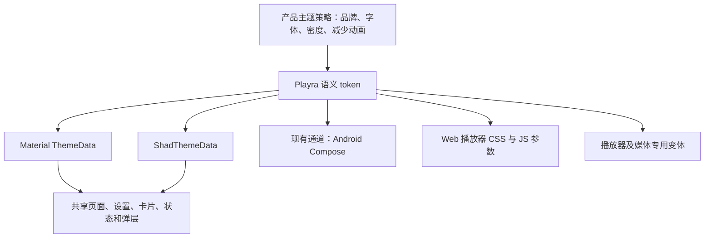

# Playra 全页面样式体系审查与 Flutter 组件库选型

日期：2026-11-03。性质：当前工作区审查、官方资料研究、重构建议；不是已经实施的样式规范。

## 1. 结论

建议保留现有深色背景、淡紫强调色、海报内容和紧凑底栏，建立由项目持有的统一 token，再把 Material、已有的 `shadcn_ui`、Android 原生底栏和 Web 播放器接到同一套规则上。当前最适合的实施路线是 **Flutter Material 3 + 现有 shadcn_ui + Playra 自有语义 token**。

如果决定更换组件体系，**Forui 是优先做原型验证的候选**，它对触摸/桌面密度、组件状态和组件动效的组织更符合这次全面整理的目标。但目前还没有它与本项目播放器、FlutterModular、原生底栏混用的编译及运行证据，因此不建议直接全仓库替换。

这里的“统一”是同一个用途采用同一项规则：普通卡片、按钮、弹窗各有明确规格。页面、播放器、海报和胶囊不应全部变成同一个圆角；紧凑的视觉尺寸也不应通过压缩触摸范围实现。组件库提供控件，项目仍须拥有布局、安全区、业务状态、原生桥接和动效策略。

本轮只新增这份报告，没有修改应用代码、依赖、用户数据或设备设置。

## 2. 审查基线与证据边界

### 2.1 当前代码

- Git HEAD：`763f1ae283785c27d0c53ba3a5e87d7e627d3a21`，**包含审查开始时已有的未提交改动**，不能只用这个提交重建完整现场。
- 冻结快照时间：2026-11-03 14:52:37 UTC；保存了 324 个相关源文件和依赖文件的快照及 SHA-256 清单。
- 本轮按当前双来源接入中的实现分析；不把历史报告中的“仅 Lumina”当作当前业务契约。
- [2026-10-14 审查](all-pages-style-audit-20261014.zh.md)和[当时的修复记录](all-pages-style-fixes-20261014.zh.md)只作为历史背景。它们的浏览器、模拟器和播放成功记录没有计入本轮验证结果，已修复问题也没有自动重新登记。

### 2.2 覆盖口径

| 项目 | 本轮范围 | 不能由此推出的结论 |
|---|---|---|
| UI 源文件扫描 | `lib/pages`、`lib/presentation`、`lib/bean`、`lib/plugins`，排除生成的 `.g.dart`，共 319 个 Dart 文件 | 不是逐行人工审完所有第三方代码 |
| 产品与支持代码 | 上述范围中 266 个文件；另分出 53 个组件展示相关文件 | 展示页数量不等于业务组件采用程度 |
| 页面清单 | 按公开 Widget 的 Page/Screen/Settings 等页面命名识别出 52 个文件、53 个页面类 | 不包含所有无 Page 后缀的弹层、图片预览和播放器表面 |
| 导入关系 | 其中 38 个文件进入从 `main.dart` 出发的导入链，14 个未进入 | 导入可达不等于当前路由可达，更不等于真机逐页验证 |
| 深入核对 | 路由注册、现代四个主页面、搜索、SDK 播放详情、设置基础组件、弹层、主题层级、原生底栏及 Web 播放器样式边界 | 没有逐一触发所有页面的全部数据状态 |
| 现有聚焦测试 | 4 个文件，28 项通过 | Widget/通道 mock 测试不能证明原生 Compose 实际绘制或全站视觉一致 |
| 新组件兼容性 | 临时副本中的真实依赖解析，见第 7 节 | 解析通过不等于 API 兼容、构建通过或运行效果通过 |

本轮没有重新启动全套 Web/ADB 页面巡检，没有改字体、重启手机、清理后台、执行同步、删除收藏或下载。运行结论限于第 10 节列出的检查。

## 3. 技术栈与现有样式架构

### 3.1 实际技术栈

| 层次 | 当前实现 | 对样式重构的约束 |
|---|---|---|
| 工具链 | 本地 Flutter 3.47.6、Dart 3.13.5 | 以实际工具链与包约束为准，不能直接照搬最新官网的全部 API |
| 页面与路由 | Flutter、Material 3、FlutterModular 7.1、`MaterialApp.router` | 保留现有返回栈、嵌套设置页和深链 |
| 状态与数据 | MobX、局部 ChangeNotifier/State、Hive | 样式组件不接管业务状态和持久化 |
| 组件库 | `shadcn_ui: 0.57.1` 已是直接依赖 | 业务页主要仍为 Material；不是已经全站采用 Shadcn |
| 图标与字体 | Lucide + Material 图标；MiSans/系统字体偏好 | 字体、字号、图标角色与原生字体资源需同时检查 |
| 视频 | media_kit、SDK 播放状态、原生/网页播放表面 | 换按钮不能替换播放生命周期、全屏、弹幕及线路状态逻辑 |
| Android 特例 | Kotlin / Compose 原生液态底栏；其他情况下使用 Flutter 底栏 | Dart token 不会自动进入 Kotlin |
| Web 特例 | `HtmlElementView`、Artplayer JS/CSS | Flutter 组件主题不会自动改变 HTML 控件 |
| 新旧界面 | 现代界面当前开放给 Android、iOS、Web；原生桌面仍回退旧版 | 宽屏 Web 检查不能代替 Windows/macOS/Linux 原生检查 |

来源：`pubspec.yaml`、`pubspec.lock`、`lib/presentation/interface_style.dart:18`、`lib/app_widget.dart:324`、`lib/services/player/web_player_surface_web.dart:87`。

### 3.2 主题存在多个所有者

当前主题主要来自以下位置：

1. `lib/app_widget.dart:168`：全局 Material 主题、用户字体、种子色/动态色、OLED；按钮和 Chip 默认胶囊。
2. `lib/presentation/modern/modern_theme.dart:4`：现代页面基础 AppBar、卡片、导航规格。
3. `lib/presentation/modern/home/home_theme.dart:35`：现代品牌色与一批 Material 组件样式；`:196` 的 `ModernHomeScope` 再创建局部 ShadTheme。
4. `lib/presentation/modern/settings/modern_settings_scope.dart:52`：重新计算现代主题并覆盖字体、输入框、按钮、开关、Slider、菜单与弹层。
5. `lib/presentation/modern/secondary/secondary_theme.dart:16`：二级页面嵌套 HomeScope 和 SettingsScope。
6. `lib/presentation/modern/player/player_theme.dart`：播放器在二级页面主题之上继续覆盖操作尺寸和颜色。
7. `lib/utils/constants.dart`、局部 Widget、Kotlin 与 CSS：仍有各自的尺寸、转场和颜色。

这些层并非全部错误。比如播放器需要不同的表面颜色，设置页需要表单密度。问题在于同一种样式规则在多层重复定义，缺少明确的继承和覆盖边界。

**现代固定深色是已有产品策略。** `ThemeSettingsPage` 已显示“新版使用深色背景与淡紫色强调”，并在现代界面隐藏旧版的明暗、动态色和 OLED 配置。本轮不把这个行为登记为“切换主题失效”。建议保留它作为明确的 theme policy，把重复的 `forceDark: true` 收敛到策略入口；是否将来开放现代浅色是另一项产品变更。

### 3.3 现有 Shadcn 的采用程度

排除展示文件后，源文件中可识别到约 10 处 `ShadButton` 构造和 1 处 `ShadInput` 构造；这个数量包含未进入当前应用导入链的页面。大部分主界面仍是 Material 与自绘组合。

业务层 `ModernHomeScope` 目前主要对齐 Shad 颜色、字体 family 和默认 radius，没有把所有按钮高度、字体角色、弹层和 motion 都做成同一映射。相对完整的 `ShadApp.custom + MaterialApp + ShadAppBuilder` 集成在开发组件实验室 `shadcn_gallery.dart` 中，不能当成业务根节点已经完成的集成。

官方支持在 Material 应用中逐步采用 Shadcn，也支持 Router；这条路径可以保留 FlutterModular，无须为了换外观重建路由。[Shadcn 官方集成文档](https://mariuti.com/flutter-shadcn-ui/)

## 4. 样式分散的实际规模

以下是对 266 个产品/支持文件的字面量扫描，包含旧版和暂未接入的实现，数值不是缺陷数量。

| 项目 | 匹配次数 / 不同取值 | 解释 |
|---|---|---|
| 圆角 | 248 / 21 | 常见 12、16、20、10、28；缺少语义分组，不能将所有取值统一替换为 12 |
| 显式字号 | 186 / 16 | 同类标题和辅助字存在局部定义；播放器时间、品牌字不应按普通正文处理 |
| 显式毫秒 Duration | 100 / 24 | 包含 UI 转场、计时及防抖，不能把 100 处都当成动画问题 |
| `maxWidth` | 43 / 21 | 520、640、760、880、1120 等部分对应不同用途；应命名用途而非强制一个宽度 |
| 显式 `minimumSize` | 61 / 19 | 48×48 最常见；40 高视觉控件若有 padded 触摸区，不等于触摸目标只有 40 |
| `KazumiDialog.show` | 31 处 | 已有生命周期和所有权管理，应保留 |
| `showDialog` | 4 处 | 需要按入口确认是否采用同一 theme/motion |
| `showAdaptiveBottomSheet` | 15 处 | 已有可复用入口，但没有覆盖所有新页面 |
| `showModalBottomSheet` | 9 处 | 其中 1 处是 adaptive 入口内部实现；其余分布在业务页，含未接入页面 |
| 项目自定义 ThemeExtension | 0 | 目前没有可承载全站语义样式的 ThemeExtension |

统计不覆盖所有表达形式。例如变量形式的圆角、逐边圆角、常量间接引用不会全部被数字正则计入。它用于确定整合方向，不用于评判代码质量分数。

## 5. 应优先解决的共同问题

### F01 · 高优先级：统一规则没有唯一入口

**已确认。** 全局 Filled/Outlined 按钮采用 StadiumBorder；Home TextButton 为 10 圆角；Settings Filled/Outlined 为 12；Shad 默认为 12；卡片又有 16、20、24。部分差异合理，但目前是按所在 Scope 改变，而不是按“主要按钮、普通按钮、筛选胶囊”等角色决定。

影响：同一动作跨页面时可能更换形状、字号或视觉高度；更新某个 theme 也无法保证其局部覆盖跟随。

建议：根节点先产生语义 token；Material 与 Shad 主题都是它的消费者。Home、Settings、Player Scope 只保留真正的角色差异，不继续各自拥有一套完整品牌主题。

### F02 · 高优先级：根级弹层可能越过局部主题

**机制已确认，受影响画面需逐入口验收。** `KazumiDialog.show` 在未提供 context 时回退根 Navigator context，再通过 `InheritedTheme.capture` 捕获主题。若调用发生在局部现代深色页面，但未传局部 context，捕获起点可能已经是根级旧版/种子色主题。

证据：`lib/bean/dialog/dialog.dart:57`、`:65`；下载等页面仍有省略 context 的调用。Toast 使用根 ScaffoldMessenger，宽度与主题也有独立规则。

建议：保留现有 DialogHandle、路由观察、dismiss 和 owner 取消机制，只统一呈现和 context 传递；根 Navigator 与 ScaffoldMessenger 同时能取得正确的产品主题。不能仅把 `AlertDialog` 改成某个第三方 Dialog 就认为问题解决。

### F03 · 高优先级：同类弹层的规格与运动不一致

**已确认。**

| 入口 | 当前宽高/表面策略 | 当前动效策略 |
|---|---|---|
| 公共 adaptive sheet | 手机竖屏全宽；其他情况为窗口 72%、上限 640；高 75%，短横屏 90%；圆角优先主题，否则顶部 28 | 路由 250/200ms，另外叠加表面入口弹簧；支持减少动画 |
| 首页“查看更多” | 上限 1120；可拖动，初始 82%、最大 94%；适合内容浏览 | 直接 Material route 默认行为 |
| 日历筛选/季度 | 可指定宽度；高约 80%/84%；部分内容指定 600 高 | 自有 `_sheet`，直接 Material route |
| 追番排序/布局等 | 上限 520；高 80%；标题/关闭区局部定义 | 自有 `_sheet`，直接 Material route |
| SDK 线路 | 上限 640；采用线路专用内容 | 显式 260/200ms，支持减少动画 |
| SDK 简介/全部选集 | 显式圆角 24、遮罩 0.65，简介 75% 高，选集按内容计算 | 未采用与线路弹层相同的显式 AnimationStyle |

证据：`adaptive_bottom_sheet.dart:35`、`modern_home_view.dart:1273`、`modern_calendar_view.dart:702`、`modern_library_view.dart:579`、`sdk_player_detail_page.dart:1075`、`:1235`、`:1332`。

建议统一标题、关闭区、手柄、安全区、键盘避让、遮罩、圆角和 motion 入口；保留“操作型 520 / 线路型 640 / 内容浏览型 1120”三个有用途的变体。不要把可拖动的内容浏览弹层硬塞进 640 宽的操作弹层。

adaptive sheet 的路由运动和表面弹簧是两段真实叠加的运动，不等价于一个 Duration。重构时应明确保留还是简化，并整体检查进出场，不对数字做全局替换。Flutter 自带 `sheetAnimationStyle` 已支持正反向时长及无动画，不必先增加动效库。[Flutter 弹层 API](https://api.flutter.dev/flutter/material/showModalBottomSheet.html)

### F04 · 高优先级：部分弹层使用窗口宽度计算受限容器布局

**静态风险，尚未在本轮运行复现。** SDK 全部选集在 `sdk_player_detail_page.dart:1347` 附近用 `MediaQuery` 窗口宽度计算列数、tileWidth 和长集名分类。Material 3 弹层在宽窗口下可能仍被限制到约 640 宽，此时这些计算使用的宽度大于真实内容宽度。

这不代表 GridView 必然越界：GridView 最终仍受真实约束。主要风险是列数过多、长标题被误判为紧凑规格，导致文字过密或不必要截断。建议将这些计算放到弹层内容的 LayoutBuilder 中；用 1440 窗口、受限弹层、2 倍文字和长集名组合验证。

同样的原则适用于嵌入设置面板和播放器：页面断点使用窗口，组件列数与文字测量使用容器约束。Flutter 官方也建议根据实际可用空间适配，避免仅依赖设备类别或横竖屏。[Flutter 自适应建议](https://docs.flutter.dev/ui/adaptive-responsive/best-practices)

### F05 · 高优先级：Flutter 与原生底栏的辅助设置契约不同

**已确认代码差异，原生效果本轮未实测。**

- Dart 传入 `reduceMotion`，但 `LiquidNavigationHost.kt` 没有读取该字段。无法通过这条信号保证 Compose 装饰动画跟随 Flutter 的减少动画策略；不能仅凭 Dart 单测判定原生通过。
- Dart 发送的 textScale 上限为 2.0，Kotlin `:136` 又限制到 1.3。两条渲染路径对大字体的处理不同。
- Kotlin 标签颜色、字号、图标字体与液态高光独立定义；Flutter Shader 的 tint 参数也来自局部硬编码。

建议使用现有 MethodChannel 明确传递高度、图标尺寸、字体/文字比例、前景/选中/表面颜色和 motion policy，并由 Kotlin 实际消费。这个边界无法由引入 Forui 或 Shadcn 自动解决。

### F06 · 中优先级：底栏已经变小，但旧主题规格仍存在

**已确认。** 实际 Flutter 和原生宿主常规高度已经是 60，图标 20、文字 11.5；`modern_theme.dart:13` 和 `home_theme.dart:164` 的 NavigationBarTheme 仍为 72，后者默认 icon 21 / label 12。

实际控件中的覆盖使当前底栏可以保持较小，但增加了后续组件复用时恢复旧尺寸的风险。

建议将用户已确定的 **60 / 20 / 11.5** 作为导航角色 token；大字体时允许扩高，安全区与外边距另算。不能为了“统一”恢复到 Material 默认大底栏，也不能强制大字体始终塞进 60。

### F07 · 中优先级：标题、字号和图标规则依赖页面位置

**已确认。** 设置页标题 22，搜索 AppBar 标题显式 20；SettingsDetailScaffold 工具栏现代 52、旧版嵌入 64，而基础现代 AppBar 为 56。正文与辅助字也有 11、12、13、14 等局部覆盖。

这些值需要按页面标题、区块标题、正文、说明、导航文字命名，而非一律删除。阅读页的行高 1.8、播放器时间和海报角标可以是明确例外。图标推荐普通操作采用现有 Lucide、状态/平台动作允许 Material，但需统一大小角色、描边视觉、语义名称与间距。

### F08 · 中优先级：响应式已有局部成果，缺少共同密度策略

**已确认。** `modern_layout.dart` 已针对宽 <380 或高 <700 的视口提供紧凑判断，首页和轮播已消费；轮播常规高度 176/206 并随字体增加。其他页面仍各自决定 16/20/24 边距、宽度和列表密度。

建议分开管理三件事：窗口布局断点、紧凑视觉密度、组件容器约束。SafeArea、键盘 `viewInsets` 和文字比例参与最终可用尺寸，不能仅按屏幕宽度缩放整页。

### F09 · 中优先级：已有可复用组件尚未成为统一出口

**已确认。** `SettingsList`、`SettingsDetailScaffold`、`TonalCard`、`SplitListGroup`、`StateActionButton` 已解决部分共享行为，应该优先整合这些消费者。

`ModernPageScaffold` 目前未找到实际使用点。继续添加一个没有页面迁入的新壳层，不会降低真实差异。建议扩展已有可用出口，让每一项 token 都有直接消费者；只在现有组件确实无法表达时新增组件。

### F10 · 中优先级：错误页、退役入口和非 Flutter 表面需要纳入规范

**已确认入口差异。** `SourceUnavailablePage` 自身使用普通 Scaffold，无现代 Scope；在不同宿主下显示可能不同。它的“仅保留 Lumina”文案也与当前工作区新增来源不一致，需后续按业务事实更新，不能仅换皮肤。

`StorageErrorPage` 已有现代分支，不能根据旧报告再次声称 iOS 缺失现代处理；该页尤其不能依赖已经初始化成功的 Hive 才能显示。`RouteErrorPage` 也已有现代/旧版处理，应复用而非重写。

Web 播放器的 CSS、原生 Compose 和离线播放器控制层需要单独映射 token；第三方组件库不会覆盖这些表面。

### 额外待验证：小屏液态底栏背景条纹

用户此前截图有竖向条纹。当前紧凑屏使用 `extendBody: false`，底栏可能位于 body 背景捕获范围外；Shader 采样又将坐标 clamp 到纹理边界。这提供了“边缘像素被延伸”的可能原因，**本轮没有运行复现，不能定为最终根因**。

验收时应检查捕获范围与坐标；捕获不足时采用清晰的静态表面降级，而不是为了消除条纹一律增大底栏或增大模糊半径。

## 6. 全页面清单与迁移归属

下表是源码和路由层清点，不是 52 个页面已经逐页跑过。路径均相对于仓库根目录。A 表表示进入应用导入链；其中包含旧版和开发工具，须结合“入口情况”理解。

### A. 进入应用导入链的 38 个页面文件

| 文件 | 入口情况 | 应统一的内容 / 需保留的行为 |
|---|---|---|
| `lib/pages/index_page.dart` | 新旧主导航宿主 | 底栏、背景、安全区；保留 Tab 状态与返回栈 |
| `lib/pages/init_page.dart` | 启动 | 启动/准备/失败状态模板；保留存储初始化顺序 |
| `lib/pages/route_error_page.dart` | 参数与路由错误 | 复用现有现代失败视图；统一返回动作和间距 |
| `lib/pages/source_unavailable_page.dart` | 多个退役入口 | 统一错误页主题、长文滚动、安全区；业务文案另按当前来源校准 |
| `lib/presentation/modern/pages/discover_page.dart` | 现代发现 | Header、频道、轮播、海报、列表状态、内容弹层；不恢复收录数量 |
| `lib/presentation/modern/pages/calendar_page.dart` | 现代日历 Tab | 日期/季度/筛选、封面、状态和弹层；保留更新日期语义 |
| `lib/presentation/modern/pages/library_page.dart` | 现代追番 Tab | 输入、分类、布局/排序弹层、海报；保留收藏身份与筛选状态 |
| `lib/presentation/modern/pages/profile_page.dart` | 现代我的 Tab | 账户/来源信息、快捷动作、设置分组与阅读顺序 |
| `lib/presentation/modern/pages/content_search_screen.dart` | 当前主搜索/标签搜索 | 标题、搜索框、状态、结果卡圆角；保留 IME 和增量结果流程 |
| `lib/presentation/modern/pages/sdk_player_detail_page.dart` | 当前 SDK 详情和在线播放 | 播放面板、线路/画质/选集/简介、全屏、状态提示；保留请求代次与播放身份 |
| `lib/pages/about/about_page.dart` | 关于与兼容地址 | 品牌卡片、图标、动作；允许品牌头图采用专用大圆角 |
| `lib/pages/about/product_information_page.dart` | 帮助/隐私等产品说明 | 阅读宽度、标题、正文；保留阅读用行高 |
| `lib/pages/collect/collect_page.dart` | 旧版追番 | 由同一 token 的旧版适配消费；不顺带迁移收藏模型 |
| `lib/pages/download/download_page.dart` | 下载队列 | 队列卡、进度、848 限宽、确认弹窗；保留删除与本地文件语义 |
| `lib/pages/error/storage_error_page.dart` | 存储初始化失败 | 独立可用的错误主题；禁止依赖正常存储读取 |
| `lib/pages/history/history_page.dart` | 历史 | 列表、封面、清理确认、空状态；保留恢复播放入口 |
| `lib/pages/logs/logs_page.dart` | 开发构建日志 | 日志阅读宽度、筛选、复制反馈；不为普通用户新增入口 |
| `lib/pages/my/my_page.dart` | 旧版我的 | 设置入口与旧版导航尺寸；保留现有平台行为 |
| `lib/pages/onboarding/onboarding_page.dart` | 首次引导 | 步骤、长文、固定动作区、大字体；不改变同意和保存条件 |
| `lib/pages/settings/settings_page.dart` | 设置壳与 SettingsIndexPage | 分栏/单栏、分组、转场、标题；保留表单草稿和嵌套路由 |
| `lib/pages/settings/interface_settings.dart` | 界面设置 | 下拉、开关、分组；保留现代/旧版切换及启动页行为 |
| `lib/pages/settings/theme_settings_page.dart` | 外观设置 | 保留现代固定品牌说明与系统字体；旧版主题偏好不擅自移除 |
| `lib/pages/settings/displaymode_settings.dart` | 刷新率 | 平台能力、选项行、选中/禁用状态 |
| `lib/pages/settings/player_settings.dart` | 播放设置 | 标准设置行、开关、滑块、说明与操作弹层 |
| `lib/pages/settings/decoder_settings.dart` | 解码 | 选择器、说明、选中状态；不改解码策略 |
| `lib/pages/settings/renderer_settings.dart` | 渲染 | 选项组和平台能力说明；保留平台差异 |
| `lib/pages/settings/super_resolution_settings.dart` | 超分辨率 | 模型/倍率选项、忙碌状态与提示；不改模型行为 |
| `lib/pages/settings/download_settings.dart` | 下载设置 | 输入、并发/目录选择、帮助文本与保存反馈 |
| `lib/pages/settings/keyboard_settings.dart` | 快捷键 | 操作行、键帽、焦点与录入弹窗；保留键盘语义 |
| `lib/pages/settings/storage_settings.dart` | 存储 | 容量、清理、确认弹窗、不可用状态；不自动执行清理 |
| `lib/pages/settings/update_settings.dart` | 更新 | 状态、操作按钮、日志弹窗；不触发安装或远程发布 |
| `lib/pages/video/video_page.dart` | 当前为离线播放路径 | 播放控件、系统栏、全屏与菜单；不把退役在线入口当现役页面 |
| `lib/pages/settings/danmaku/danmaku_shield_settings.dart` | 弹幕屏蔽 | 标签、输入、规则行、确认；保留规则身份与同步边界 |
| `lib/pages/settings/proxy/proxy_settings_page.dart` | 网络代理 | 状态、空态、选择行；保留平台能力说明 |
| `lib/pages/settings/proxy/proxy_editor_page.dart` | 代理编辑 | 字段、校验、保存中/失败、键盘避让 |
| `lib/pages/settings/sync/sync_settings_page.dart` | 同步设置 | 同步说明、入口、忙碌/失败与统一动作按钮 |
| `lib/pages/settings/sync/webdav_server_page.dart` | WebDAV 编辑 | 表单、密码显示、校验、保存动作与键盘避让 |
| `lib/pages/settings/sync/webdav_sync_page.dart` | WebDAV 同步 | 空态、同步进度、结果与确认；不拿真实远端写入作样式测试 |

### B. 未进入当前应用导入链的 14 个页面文件

“未进入”是本轮静态导入分析结果；不是允许删除的清单。它们可保留为旧实现，未来恢复入口时再按统一规则迁移。

| 文件 | 本轮处理建议 |
|---|---|
| `lib/presentation/modern/pages/content_work_page.dart` | 暂不列入首批替换；恢复时接入二级页与状态规范 |
| `lib/presentation/modern/pages/modern_player_detail_page.dart` | 不是当前 SDK 详情入口；不要优先在此修改播放器样式 |
| `lib/pages/info/character_page.dart` | 资料角色页，保留记录，恢复时统一阅读与卡片 |
| `lib/pages/info/info_page.dart` | 旧来源详情，避免与 SDK 详情形成两项正在维护的规范 |
| `lib/pages/plugin_editor/plugin_editor_page.dart` | 旧规则编辑；恢复时统一表单而非仅标题 |
| `lib/pages/plugin_editor/plugin_shop_page.dart` | 旧规则商店；恢复时统一卡片/加载状态 |
| `lib/pages/plugin_editor/plugin_test_page.dart` | 旧规则测试；恢复时统一日志/结果/执行中状态 |
| `lib/pages/plugin_editor/plugin_view_page.dart` | 旧规则管理；恢复时统一列表与动作弹层 |
| `lib/pages/popular/popular_page.dart` | 旧推荐实现；当前现代发现来自另一套视图 |
| `lib/pages/search/image_search_page.dart` | 当前截图识别入口为不可用说明页 |
| `lib/pages/search/search_page.dart` | 旧搜索，不等于当前 ContentSearchScreen |
| `lib/pages/timeline/timeline_page.dart` | 旧时间表，不等于现代手工构建的 Calendar Tab |
| `lib/pages/settings/danmaku/danmaku_settings.dart` | 旧独立弹幕设置页；现有播放器弹层需另算 |
| `lib/pages/settings/sync/bangumi_sync_page.dart` | 当前相关路由为 SourceUnavailablePage |

### C. 不能遗漏的非页面 UI

| 类别 | 具体范围 | 统一要求 |
|---|---|---|
| 图片预览 | ImageViewer、Hero、图片失败 | 返回/缩放/语义和系统栏；不强加普通页面卡片外观 |
| 主页面附属弹层 | 频道更多、季度、筛选、排序、布局、收藏状态 | 共享 header、表面、关闭、滚动、安全区与 motion |
| 播放附属弹层 | SDK/线路/画质、选集、简介、弹幕、同步播放、下载 | 共用弹层规格，保留各自业务状态及返回值 |
| 对话框与通知 | 确认、输入、错误、Toast/SnackBar | 局部主题能到根 Overlay；统一按钮顺序、宽度和焦点 |
| 内容状态 | Skeleton、空内容、加载失败、封面失败、不可用入口 | 页面级/区块级/图片级分开；不能都套一个满屏空态 |
| 播放表面 | Flutter 控件、原生全屏、Web DOM | token 显式桥接；键盘、系统返回和全屏状态优先 |
| 开发组件实验室 | 53 个展示相关文件 | 用作实现参考；后期增加 Playra 配置示例，不作为先批量换皮对象 |

## 7. 官方资料深度检索与组件库比较

### 7.1 检索方法

使用官方文档、维护者仓库、pub.dev 包元数据/变更记录及 Context7 官方文档索引，检索主题、Material 混用、Router、弹层、移动端密度、辅助设置与动效。包版本按 2026-11-03 查询结果记录，后续实施时应再次核对。

没有以博客的“最佳组件库”排名、Star 数或演示图数量作为决策依据。官网文档也存在版本滞后：例如 Forui 入门页仍有较早 Flutter 门槛描述，而当前包元数据更高。因此最低版本以对应发布包的 pubspec 为准。

### 7.2 主候选

| 候选 | 查询到的版本 / SDK 门槛 | 本项目适配价值 | 成本与结论 |
|---|---|---|---|
| Flutter Material 3 + `shadcn_ui` | 当前 0.57.1；最新 0.57.4，Dart ≥3.11 / Flutter ≥3.41 | 已在项目内；Material/Router 混用路径明确，保留现有业务；可由统一 token 输出两套组件主题 | **推荐当前路线。** 需真正整合主题和共享组件，升级包本身不会统一所有页面。[包](https://pub.dev/packages/shadcn_ui)、[集成](https://mariuti.com/flutter-shadcn-ui/)、[版本元数据](https://pub.dev/api/packages/shadcn_ui) |
| `forui` | 0.27.7，Dart ≥3.13.0-0 / Flutter ≥3.47.0-0 | touch/desktop 变体、表单/列表/导航/弹层、组件 style 与 motion，组织方式符合统一密度需求 | **新体系首选原型。** 现有页面主要 Material，仍要逐步迁移；最新集成涉及 `material_ui`，需要在本地 SDK 上验证主题与祖先组件边界。[包](https://pub.dev/packages/forui)、[主题](https://forui.dev/docs/concepts/themes)、[版本元数据](https://pub.dev/api/packages/forui) |
| `shadcn_flutter` | 0.0.55，Dart ≥3.13 / Flutter ≥3.47 | 独立组件体系、token、可渐进嵌入，组件覆盖广 | **次选。** 与当前 `shadcn_ui` 是不同库；需要命名空间和 Material interop 验证，不能按同名升级处理。[包及互操作说明](https://pub.dev/packages/shadcn_flutter)、[元数据](https://pub.dev/api/packages/shadcn_flutter) |
| Serverpod `shad` | 1.0.2，Dart ≥3.11 / Flutter ≥3.41 | 样式预设覆盖颜色、间距、圆角与控件；支持可选 Material 混用 | **观察候选。** 是独立包，当前并存解析存在真实 Lucide 版本冲突，不能直接叠加。[包](https://pub.dev/packages/shad)、[元数据](https://pub.dev/api/packages/shad) |

这些包均标记支持多个 Flutter 平台，但平台标签不能代替本项目各平台的编译/真机验收。

### 7.3 为什么当前优先整合 shadcn_ui

- 现有品牌风格已经成立，Shad 与 Material 都已使用；换成第三套主题之前应先结束重复所有权。
- 当前需要解决的根问题还包括 Kotlin、Shader、HTML 与根 Overlay，它们不会因为改用另一套 Flutter Button 自动一致。
- 官方 Material 混用方式可以保留现有 Router、播放器与设置状态，不必为视觉重构改数据层。
- 最新 0.57.4 相对当前 0.57.1 有 RadioGroup 重复通知、ContextMenu 互斥、Tabs 约束相关修复，值得作为独立升级评估。这些修复不表示 Playra 当前已经触发了全部缺陷。[官方变更记录](https://pub.dev/packages/shadcn_ui/changelog)
- 该库官方清单仍有 Carousel、Skeleton 等未提供项；Playra 的轮播、内容骨架和媒体组件应继续由项目持有，消费同一套 token。[官方组件范围](https://pub.dev/packages/shadcn_ui)

建议未来先单独升级到 0.57.4 并跑相关检查，再实施 token 消费迁移；不要把升级、来源接入、播放器行为修改和全站换皮合进一次难以定位的改动。

### 7.4 Forui 值得验证的地方与真实限制

Forui 官方提供 touch 和 desktop 主题变体，并把颜色、字体、图标、组件样式和组件 motion 组织在主题中。这比只为每个 Widget 设置 radius 更接近本次目标。[平台与密度](https://forui.dev/docs/concepts/responsive)、[主题结构](https://forui.dev/docs/concepts/themes)

它可以放在 MaterialApp/CupertinoApp/WidgetsApp 下，不要求先重写业务路由。但官方 `toApproximateMaterialTheme()` 是近似映射，不能保证 Material 与 Forui 的每个控件尺寸和圆角自动一致；现代固定深色策略也仍由应用决定。[集成说明](https://forui.dev/docs/getting-started)

当前包依赖 `material_ui`、`cupertino_ui`，而仓库主要导入 `package:flutter/material.dart`，当前应用 package_config 中没有 material_ui。**依赖解析通过之后，仍须验证 ThemeData 类型、Navigator、ScaffoldMessenger、弹层 Localizations 与播放器祖先组件的混用。** 本轮没有编译这个原型，因此不能宣称可以无改动接入。

原型应选择三种具有代表性的真实组合：设置表单、带输入与长列表的弹层、播放器上方的线路/画质交互。用当前品牌色和用户字体完成；默认演示主题好看不能作为通过标准。

### 7.5 其他包的定位

| 包 | 定位 | 本轮建议 |
|---|---|---|
| `mix` 2.3.1 | token、样式组合和变体的样式层，非完整业务组件库 | 当前先用 ThemeExtension 和已有主题出口即可；没有证据表明需要再引入一套样式 DSL。[官方说明](https://pub.dev/packages/mix) |
| `flutter_animate` 4.5.2 | 组合淡入、缩放等效果 | 已通过 shadcn_ui 间接存在。若未来业务直接 import，应声明直接依赖；它不替代 motion policy，也不负责减少动画的产品决策。[包](https://pub.dev/packages/flutter_animate) |
| Flutter 官方 `animations` 3.0.0 | 容器变形、共享轴、Fade-through 等语义转场 | 仅在明确需要卡片到详情/步骤转场时评估。基础弹窗/Sheet 先用现有 AnimationStyle；该版本也涉及 material_ui，尚未在本项目解析/编译验证。[包](https://pub.dev/packages/animations) |

不建议为圆角和间距加入与现有 token 并行的全局缩放体系。固定比例缩放不能代替容器布局、大字体和键盘避让；对紧凑屏应减少装饰与间距，必要时变为单列，保留关键操作。

### 7.6 真实依赖解析结果

在临时副本复制当前 `pubspec.yaml`、`pubspec.lock`，只将 3 个本地 path 依赖改为仓库绝对路径；没有改主仓库依赖。先使用在线包元数据，再以本地 Dart Pub 的 dry-run 做解析。

| 操作 | 结果 | 证据解释 |
|---|---|---|
| 当前依赖中升级 shadcn_ui →0.57.4 | **通过，退出 0**；预计变化 2 项 | 证明当前锁定依赖允许这个升级，不证明源码 API 和运行效果已验证 |
| 保留当前 shadcn_ui，新增 Forui 0.27.7 | **通过，退出 0**；预计变化 6 项 | 包含新的主题/图标相关依赖；没有构建或运行原型 |
| 保留当前 shadcn_ui，新增 shadcn_flutter 0.0.55 | **通过，退出 0**；预计变化 5 项 | 未包含其可选 Material interop 包的完整集成验证 |
| 保留当前 shadcn_ui，新增 shad 1.0.2 | **失败，退出 65** | shad 要求 `lucide_icons_flutter ^4.0.1`，当前 shadcn_ui 要求 `<4.0.0`，不能同时满足 |

初次通过 Flutter wrapper 执行 dry-run 时，前三项已解出依赖，但后处理因临时目录缺少 `.dart_tool/package_config.json` 返回 1；随后改为直接 Dart Pub 调用，得到上表的退出 0 结果。另一次 Forui 离线调用的参数形式解析失败，改用本地帮助明确的 `forui@0.27.7` 后通过。没有把这些失败记成构建成功。

干净复核命令形式：设置 `FLUTTER_ROOT` 指向项目 `.tooling/flutter`，在对应临时副本执行 `dart pub add --dry-run --offline --no-example <package>@<version>`。结束后 4 个副本的 lock 均与原锁文件一致，pubspec 仍只保留原有 `shadcn_ui: 0.57.1`。

`shad` 的冲突不意味着该库永远不可用；它意味着必须按替换迁移处理，不能通过 dependency_overrides 强行压过图标 ABI/字体资源差异。原生底栏还引用 Lucide 字体，迁移时必须一起检查。

## 8. 建议的统一 token 与组件边界

以下是可实施的初稿，不是已经写入代码的最终值。Flutter 尺寸用逻辑像素，Android 对应 dp；系统安全区不包含在控件自身高度里。

### 8.1 单一来源

建议在 `lib/presentation` 内建立一个产品级主题入口，命名可为 `PlayraTokens` / `PlayraTheme`，不要继续放在 home 目录中由其他业务页反向依赖。



Material 侧使用 Flutter 官方 `ThemeExtension` 承载品牌自定义字段，并实现 `copyWith`/`lerp`；标准组件仍通过 ThemeData 内的组件主题消费。Shad 和原生参数从相同已解析值生成，不能各复制一份十六进制颜色。[ThemeExtension API](https://api.flutter.dev/flutter/material/ThemeExtension-class.html)

不要求引入 JSON token 管线或生成框架。当前先用有类型的 Dart 定义和已有通道即可。若后续确需跨语言自动生成，再按真实重复量决定。

### 8.2 空间、圆角、尺寸与排版

| 类别 | 建议规格 | 使用边界 |
|---|---|---|
| 间距阶梯 | 2 / 4 / 6 / 8 / 12 / 16 / 20 / 24 / 32 | 用途命名优先，如字段间距、分组间距；图形细节不机械套阶梯 |
| 页面边距 | 紧凑 16，常规 20，宽面板 24 | 用实际容器约束；主内容与弹层内部可以不同 |
| 圆角 | 小缩略图 8、输入/按钮/海报 12、普通卡片 16、Hero/对话框/Sheet 20 | 胶囊为 full；品牌大卡片可有具名大规格；短线端点/圆形图形单独处理 |
| 边框/表面 | 常规边框 1；surface/base、surface/raised、surface/overlay 明确角色 | 选中、焦点、错误分别有状态色；不按页面散落 alpha 值 |
| 按钮 | 常规视觉最小高 40，重点动作 48；触摸范围至少 48×48 | 大字体用内容扩高，不用固定高截断；桌面紧凑是独立密度变体 |
| 输入框 | 常规最小高 48；多行按内容增加 | label/helper/error 有固定间距，键盘弹出后动作可达 |
| 列表行 | 常规最小高 56；双行按内容增长 | 带开关、文字换行和大字体时不锁死整行高 |
| AppBar | 紧凑/设置嵌入 52，普通页面 56 | 桌面拖动区和 macOS 标题偏移保持平台处理 |
| 底部导航 | 常规高 **60**、icon **20**、label **11.5** | 保留用户确认值；放大文字可扩高，外部 SafeArea/底部 12 间距另算 |
| 操作图标 | 普通 20、紧凑 18、突出状态 24+ | 图标自身大小与点击范围分开 |
| 字体 | 页面标题 22、区块 18/20、正文 14、阅读正文 16、说明 12、导航 11.5 | 字重与行高按角色固定；MiSans/系统字体从同一入口继承 |
| 阅读节奏 | 普通正文约 1.5；长篇说明可 1.65–1.8 | 不为“统一”压低帮助/协议的可读性 |

48×48 操作目标和大字体可用性采用 Flutter 官方建议；实际验收看可交互区域和操作结果，不只检查 `minimumSize` 字符串。[Flutter 辅助功能建议](https://docs.flutter.dev/ui/accessibility)

### 8.3 布局规格

| 用途 | 建议规则 |
|---|---|
| 窗口布局 | compact <600；medium 600–839；expanded ≥840，沿用现有主要断点并统一归属 |
| 紧凑视觉密度 | 保留已有宽 <380 或高 <700 的产品判断；可根据键盘后的可用空间调整装饰，不压缩操作区 |
| 设置表单 | 保留约 760 的内容上限；一栏/两栏由设置宿主控制 |
| 长文阅读 | 约 880 上限；合理文本行长优先 |
| 内容海报与目录 | 按容器宽度和最小卡片宽度定列；内容浏览可到 1120 |
| 操作型弹层 | 上限 520；线路等复杂选择上限 640 |
| 内容型弹层 | 上限 1120，可拖动；不能继承操作弹层的固定宽度 |
| 高度 | 普通 Sheet 约可用高度 80%；短横屏可放宽到约 90%，减去键盘和安全区后仍可滚动 |

具体 520/640/760/880/1120 可以继续沿用现有合理用途，重点是由布局角色持有，不再由每页重复定义。播放器使用自己的可用容器尺寸；“窗口宽于高”不能直接等价于“所有内容都该进入全屏”。

### 8.4 弹窗与运动规格

| 场景 | 建议初稿 | 减少动画时 |
|---|---|---|
| 按压/选中 | 120ms，轻微颜色或透明度反馈 | 保留即时反馈，去除缩放/弹性 |
| 状态切换 | 200ms，避免整个长列表逐项飞入 | 立即切换或短淡变 |
| 对话框 | 220ms 进入 / 180ms 退出，轻淡入与小幅缩放 | 取消位移和缩放 |
| Sheet | 250ms 进入 / 200ms 退出；若保留弹簧只保留一套有命名的组合 | 路由与内容层同时关闭装饰运动 |
| 普通页面导航 | 约 280ms，保持平台返回手势及现有路由语义 | 使用统一策略，不能遗漏自定义 Modular 转场 |
| 轮播/骨架 | 自动切换时机与装饰动画分开；隐藏页面停止无意义动画 | 停止自动轮播与 shimmer 等装饰运动，保持状态可理解 |
| 原生液态底栏 | 指示器、按压、变形分别有明确角色 | Kotlin 必须消费 Dart 策略，不能只发不读 |

这是体验建议，不是 Flutter 官方规定的固定时长。弹层的 header、关闭动作、点击遮罩、系统返回、焦点恢复、键盘避让、销毁取消也属于规范，不能仅统一圆角与曲线。

现有 `SecondaryTabs` 的外部选中更新处理了 disableAnimations，但 TabController 默认仍有 260ms；直接 TabBar 点击路径应单独验收，不因文件内出现一次辅助设置判断就判定覆盖完整。

### 8.5 共享组件应负责什么

| 出口 | 统一责任 | 不接管 |
|---|---|---|
| 页面/设置 Scaffold | 标题、返回、背景、内容宽度、安全区 | 业务路由状态与数据 |
| 现有 SettingsList / SplitListGroup | 行高、分隔、图标、说明、禁用/选中 | 设置保存语义 |
| 按钮/输入框 | 视觉变体、触摸区、焦点、校验/忙碌呈现 | 请求和表单业务模型 |
| TonalCard / 海报卡 | 角色圆角、封面比例、边框、错误图 | 内容身份和点击去向 |
| 弹层入口 | 主题、尺寸、遮罩、motion、header、焦点/键盘 | 已有 DialogHandle 与 owner 生命周期 |
| 状态视图 | 页面/区块/图片三个级别的视觉规格 | 把“无数据”和“请求失败”混为同一种状态 |
| 播放器专用组件 | 颜色、触达、选中/缓冲/失败呈现 | 播放代次、集号、线路、画质、媒体生命周期 |

## 9. 重构顺序与验收范围

### 9.1 建议分批交付

1. **主题和 token。** 先明确现代固定深色、旧版用户偏好、播放器表面的继承规则；将 Material/Shad/原生共用值收敛。保持已有 UI 状态和路由不变。
2. **共享基础控件。** 整合 SettingsList、TonalCard、SplitListGroup、StateActionButton、输入与状态模板。先让设置和搜索实际消费，避免只新增无人使用的 tokens 文件。
3. **弹层与通知。** 保留生命周期能力，统一 Dialog、Sheet、Toast 的主题与 motion；把现有各页 `_sheet` 迁入有用途的变体。
4. **主页面。** 发现、日历、追番、我的、搜索。保留首页已确认的小屏布局、移除收录文案和小底栏，不混入来源业务重写。
5. **播放与跨语言表面。** SDK 详情/选集、离线播放器、Android 原生底栏、Web 控件。分别验证内容约束和系统行为。
6. **错误、引导、阅读与旧版消费。** 补齐边缘入口；旧版桌面可消费相同语义 token，但不因样式整理自动开启尚未支持的现代桌面布局。未接入页面和开发实验室最后处理。

若选择 Forui，先在隔离原型完成第 7.4 节的三种真实组合，再决定是否让它替代当前 Shad 组件。迁移期间要有终点，不长期维持三套独立完整主题。

### 9.2 完成标准

- 同一种角色只有一个规格来源，Material/Shad/原生/Web 消费的数值可追溯。
- A 表每个实际入口都能到达并检查主要布局；有数据页面使用受控样例核对加载、成功、空内容、失败、忙碌和禁用等适用状态。
- 320×640、360 宽小屏、390×844、844×390，及 760/1440 宽面板，检查内容和关键动作可达。
- 文字 1.0 / 1.6 / 2.0；多行标题、长集名、键盘弹出、底部安全区不遮挡主要动作。
- 现代固定深色符合当前说明；旧版 light/dark/system、字体和现有 OLED/动态色能力不回归。是否开放现代浅色另行决定。
- 减少动画能覆盖 Modal、Tab、轮播、骨架和 Kotlin 消费端；不可只靠检查源码关键词。
- Android 旧版 Flutter 底栏分支与 API 33+ 原生底栏分别验证。已有 Android 9 手机不能证明 API 33+ 绘制通过。
- Web DOM 播放器单独看小容器、键盘和全屏；原生桌面单独看标题栏拖动和焦点。iOS 未实测时明确标记。
- 复用有价值的现有测试，不为每个圆角加一份只复述实现的测试；跨主题弹层、播放身份、返回栈、长标题/大字体容器等真实风险才增加回归覆盖。

## 10. 本轮验证、文件与证据

### 10.1 已通过

执行现有 4 个测试文件：

```text
flutter test --no-pub --reporter expanded
  test/modern_settings_foundation_test.dart
  test/modern_shell_layout_test.dart
  test/modern_ui_motion_test.dart
  test/native_liquid_navigation_test.dart
```

结果：**28 项通过，退出 0**。包含设置控件 320/390/760 宽与 1/2 倍字号、设置嵌套状态、现代主题弹层颜色、轮播与 Shell 布局、原生通道同步等既有覆盖；不表示所有页面或 Compose 真机均通过。

另完成三个候选方案的真实 dry-run 解析和一个明确的版本冲突复现，结果见第 7.6 节。

### 10.2 未运行

- 没有对任何新组件库进行全项目编译、包体积比较、帧耗时比较或真机混用验证。
- 没有逐页重跑当前 Web/ADB 应用，也没有重新构建 Android/iOS/桌面安装包。
- 没有运行全量测试，也没有为了本次文档审查修复无关测试或业务代码。
- F04 的受限弹层布局、条纹原因和原生辅助设置的真实视觉后果仍需运行验收。

### 10.3 本机证据位置

```text
C:/Users/haige/AppData/Local/Temp/playra-ui-audit-20261103-inventory.json
C:/Users/haige/AppData/Local/Temp/playra-ui-audit-20261103-pages.json
C:/Users/haige/AppData/Local/Temp/playra-ui-audit-20261103-packages.json
C:/Users/haige/AppData/Local/Temp/playra-ui-audit-20261103-baseline-tests.log
C:/Users/haige/AppData/Local/Temp/playra-ui-audit-20261103-jn15v139/
  snapshot-manifest.json
  ui-source-snapshot.zip
  resolver-results.json
  shadcn_ui/direct-resolver.log
  forui/direct-resolver-at.log
  shadcn_flutter/direct-resolver.log
  shad/resolver.log
```

临时证据可能随系统清理消失；本报告保留关键结果、命令、清单和来源。`resolver-results.json` 保存初次 wrapper 结果，最终退出 0 以对应 direct-resolver 日志和本轮命令结果为准。

本轮仓库内新增文件只有本报告。应用源码与依赖保持审查基线；保留用户已有改动。撤销本次文档交付只需移除此新增报告，不能用 reset/checkout 覆盖其他正在进行的工作。
