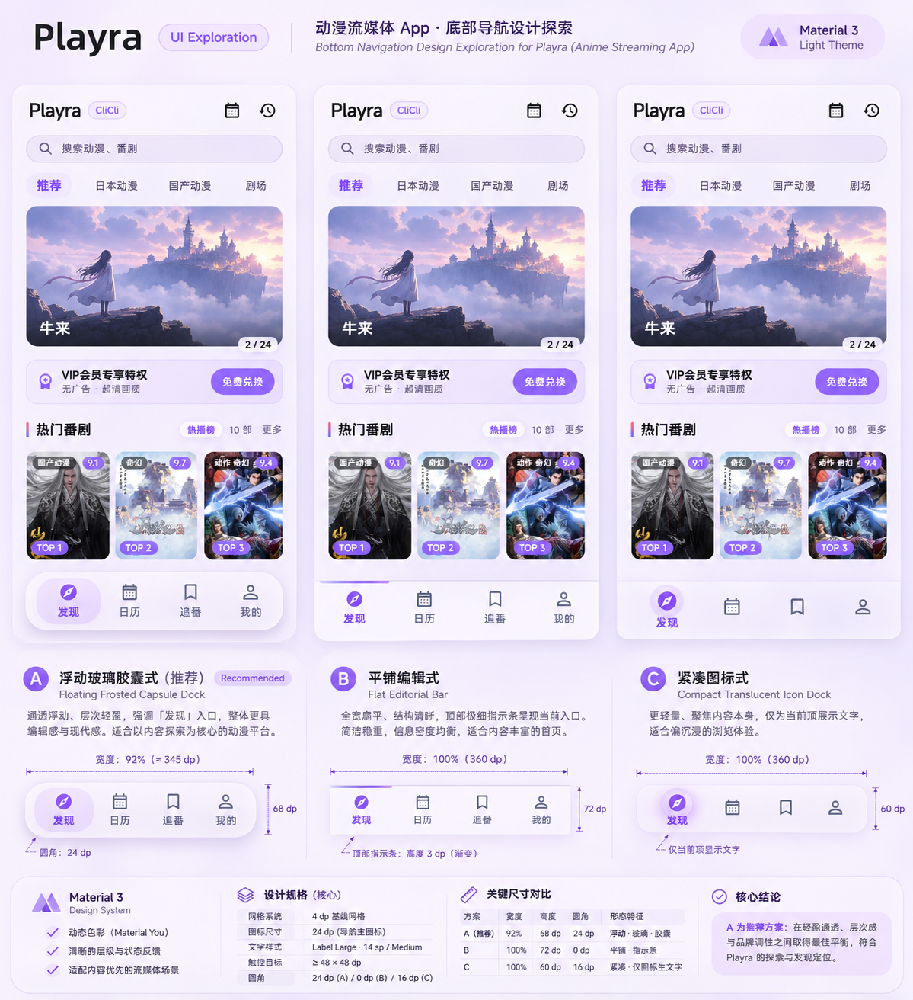

# Playra 底部导航栏设计规格（2026-11-18）

> 设计稿：`docs/design/navigation/`  
> 实现位置：`lib/shell/native_liquid_navigation.dart`、`android/app/src/main/kotlin/com/example/kazumi/LiquidNavigationHost.kt`、`lib/shell/playra_bottom_nav.dart`

## 1. 设计结论

Android 13+ 使用 **AndroidLiquidGlass 官方 `LiquidBottomTabs`**：外层 48dp、Tab 40dp，真实 blur / lens / highlight / shadow。  
自适应宽度按 `min(screenWidth - 44dp, 400dp)` 计算；`LiquidNavigationHost` 内部保留 48dp 的 lens 溢出采样边距，绘制时再收回，因此视觉宽度与 Flutter 占位一致。  
Web、非 Android 与低版本 Android 使用 Flutter 回退 **A. 浮动玻璃胶囊**：

- 底部左右各留 22dp，底部安全区额外留 8dp；
- 回退胶囊高度 **48dp**，圆角 **20dp**；
- 背景为淡紫/深紫半透明玻璃，`BackdropFilter` 28dp 模糊；
- 页面使用 `Scaffold.extendBody: true`，让内容真正滚到玻璃层后方；首页/追番/我的页增加 `bottomNavReserved` 底部留白；
- 1dp 低对比边框 + 柔和阴影；
- 4 个入口等宽：发现 / 日历 / 追番 / 我的；
- **选中项不再使用整块白色/淡紫色胶囊底色**，只保留紫色圆形图标底 + 紫色文字；
- 未选中项使用次级灰色，图标比选中态略小；
- 每个入口点击区域不小于 48dp。

平板不使用底部导航，继续使用 72dp 左侧栏。

## 2. 三种方案对比

| 方案 | 名称 | 高度 | 特征 | 结论 |
|---|---|---:|---|---|
| A | 浮动玻璃胶囊 | 48dp | 88% 宽、20dp 圆角、半透明模糊、无白色选中底 | **推荐并已实现** |
| B | 平铺编辑式 | 72dp | 100% 宽、顶部细分隔线、选中态渐变指示条 | 备选，信息密度更高 |
| C | 紧凑图标式 | 60dp | 图标为主、仅选中项显示文字 | 适合更沉浸的浏览场景 |

## 3. 视觉规格

| 属性 | Light | Dark |
|---|---|---|
| 胶囊背景 | `#EEEBF3` 30% + `#E1DAF7` 16% | `#2B2340` 28% + `#211A30` 16% |
| 边框 | `#D9CFEA` 38% | `#3B2F50` 52% |
| 选中图标圆形底 | `#9966FF` | `#B18CFF` |
| 品牌紫 | `#9966FF` | `#B18CFF` |
| 未选中文字 | `#6B6478` | `#B4A7C4` |
| 阴影 | 黑色 8%，blur 20，offset (0,8) | 黑色 32%，blur 20，offset (0,8) |

字体使用 `PlayraType.small`，选中 `FontWeight.w700`，未选中 `w500`；未选中图标 18dp，选中圆形底 26dp / 内部图标 16dp。

## 4. 设计稿

- [三种方案总览](bottom-nav-variants-20261118.png)
- [浅色完整首页效果](bottom-nav-floating-light-20261118.png)
- [深色完整首页效果](bottom-nav-floating-dark-20261118.png)
- [浅色毛玻璃 Dock 特写](bottom-nav-frosted-light-20261118.png)
- [AndroidLiquidGlass 原生实机截图（亮色）](native-liquid-bottom-nav-20261118.png)
- [AndroidLiquidGlass 原生实机截图（深色）](native-liquid-bottom-nav-dark-20261118.png)

## 5. 实机验证

- `.analysis/screens/home-redesign-20261117/bottom-nav-light-v7.png`
- `.analysis/screens/home-redesign-20261117/bottom-nav-light-v7-scrolled.png`
- `.analysis/screens/home-redesign-20261117/bottom-nav-frosted-v3-dark.png`
- `.analysis/screens/home-redesign-20261117/bottom-nav-calendar-active2.png`
- `.analysis/screens/home-redesign-20261117/bottom-nav-light-360x800-font130.png`

### 小屏幕高度优化

手机高度 `< 720dp` 时自动进入 `phoneCompact`：

- 品牌行 `44dp → 38dp`，搜索框 `48dp → 40dp`，分类行 `48dp → 40dp`；
- 顶部/行间距 `8dp → 6dp`；
- Hero 高度范围 `170–240dp → 145–190dp`；
- VIP 高度 `52dp → 44dp`，按钮 `40dp → 36dp`；
- 栏目间距 `28dp → 22dp`。

## 6. AndroidLiquidGlass 集成

参考并集成 [Kyant0/AndroidLiquidGlass](https://github.com/Kyant0/AndroidLiquidGlass)（Apache-2.0）的官方 `LiquidBottomTabs` 组件：

- Android 13+：`lib/shell/native_liquid_navigation.dart` 通过 `com.predidit.kazumi/liquid_navigation` 通道驱动原生 Compose `LiquidBottomTabs`；
- 原生端使用 `PixelCopy` 将 FlutterSurfaceView 画面作为 Backdrop，真实实现 blur / lens / highlight / shadow；
- `lib/shell/playra_bottom_nav.dart` 保留为 Web、非 Android 和低版本 Android 的 Flutter 回退实现；
- 入口图标改用 `forui_lucide` 的 `FLucideIcons`，与原生 Lucide 字体一致。

## 7. 验收

- 360×800、390×844 下 4 个入口完整显示；
- 文字缩放 1.3 倍无溢出；
- 浅色/深色背景与选中态对比清晰；
- 每个入口点击区 ≥48dp；
- 页面内容不被悬浮胶囊遮挡。
