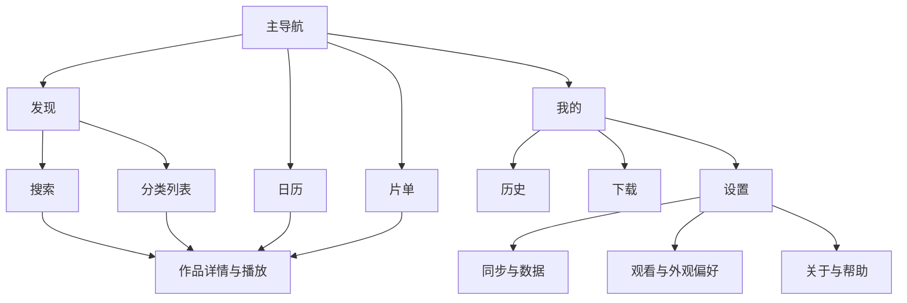

# Playra 全页面样式与布局分析

日期：2026-11-07。分析基线：`57c63c29`，应用声明版本 `2.4.3+20403`。

目标：手机端优先，兼顾 Web 和桌面。本文交付页面盘点、问题证据和重设计建议，未修改应用代码。

## 1. 结论

建议保留 Playra 的深色背景、淡紫强调色、海报和四个主导航，重新统一控件、信息层级与页面结构。已有 `PlayraTokens`、公共卡片、设置容器和业务控制器可继续使用，无需再引入组件库或另建一套页面系统。

优先解决的是下面五项，而不是逐页增加装饰：

1. **公共控件偏小且主按钮文字不清晰。** 默认按钮和图标按钮仅 32 高；浅紫色主按钮硬编码白字，颜色对比度约 1.93:1。
2. **主导航与页面能力不一致。** 日历在新版手机分页中是完整功能页，在普通路由中却是“数据源已移除”。
3. **底部悬浮导航侵入内容。** “我的”页滚动到底后，版本信息处于导航覆盖区，“关于应用”行底部也有重叠。
4. **首页频道混合不同分类维度。** 推荐、热门、电影、动漫、短剧和红果短剧共处十项横向导航，内容类型与来源名称混用。
5. **页面仍有过时的产品表述。** 多源首页与“仅保留 Lumina”、搜索入口“Lumina 动漫”、帮助中的 Bangumi 同步等描述不一致。

### 证据边界

- 全量结构盘点覆盖 `lib/pages`、`lib/presentation/modern/pages`、主导航、路由模块、设置子页及播放器面板；历史页面与开发页面单列。
- 当前源码成功构建 Web 预览，并实际操作了四个主导航、搜索、历史、下载、主要设置、WebDAV 表单、关于和帮助等页面。
- 实测视口为 390×844、320×568 和 1440×900，分别用于主页面、窄屏搜索/工具页及宽屏个人页/设置观察；不是每个页面都检查了三个尺寸。
- 浏览器的手机尺寸**不等同于 Android 原生端**。连接的手机安装的是 2.4.2，且锁屏，因此没有将其作为当前源码的视觉或播放验收证据。
- 当前预览没有验证成功播放、有数据的收藏/历史、真实同步、下载任务、软键盘、大字体、读屏和原生横竖屏行为。相关条目属于源码分析或待验证建议。
- 仓库旧截图和旧设计文档不作为当前页面已实现效果的证明。

## 2. 已确认的共性问题

| 优先级 | 位置与证据 | 用户影响 | 调整方向 |
| --- | --- | --- | --- |
| P1 | `playra_controls.dart:172`：按钮高度 28/32/40；`:311`：图标按钮默认 32。搜索实测主按钮 54×32，首页排期按钮 32×32 | 手机点击容错低，标签和文字偏小 | 公共触摸区域至少 48×48；视觉图标可以维持 20～24，视觉胶囊可小于热区；主操作高 48、文字 14～16 |
| P1 | `playra_controls.dart:182`：主按钮文字固定 `Colors.white`；深色 primary 为 `#A7B7FF` | 搜索、保存等主操作白字发虚 | 使用已有 `onPrimary / primaryForeground`。当前 `#182142` 与该底色的计算对比度约 8.13:1 |
| P1 | `modern_shell.dart:65` 使用 `extendBody: !compact`；个人页底部只留 24。390×844 实测导航 y=772～832，滚动到底版本 y=802～820、关于行 y=729～778 | 内容落在悬浮导航下，最后一行不完整 | 页面底部留白由壳层提供，包含导航高度、安全区与额外间隔；避免每页写独立常数 |
| P1 | `modern_tab_pages.dart:19` 打开 `ModernCalendarPage`；`timeline_module.dart:9` 打开 `SourceUnavailablePage`；`tab_shell.dart:155` 按平台选择分支 | 同一“日历”在不同平台或入口下代表不同能力 | 统一日历路由生产者和手机分页生产者。保留手机已有日历，核验数据能力后统一入口，不能只删除导航掩盖分叉 |
| P1 | Web 首页实测“当前平台尚不支持 Lumina”仍提供“重试”，下方有空的推荐区 | 不支持与临时失败混淆，用户重复点击无效操作 | 区分不支持、网络失败、内容为空；不支持时提供可用频道入口或明确平台说明，网络失败才给重试 |
| P2 | `modern_home_view.dart:1004` 的频道列表有 10 项；390 宽时后几项在可视区域之外 | 分类难记，用户需要横滑找入口；“短剧”和“红果短剧”关系不清 | 一级只保留聚合与主要内容类型；来源放进筛选或频道说明，低频类型收进“全部分类” |
| P2 | 首页搜索提示“搜索动漫或关键词”；个人页搜索副文案为“Lumina 动漫”，但首页已连接 Whisklet/Hongguo | 应用究竟支持哪些内容不清楚 | 面向用户统一为“搜索作品”；可用范围按当前平台与来源能力呈现 |
| P2 | 个人页同时有 WebDAV 入口、全部同步设置；追番更多菜单仍写 `WebDAV / Bangumi`；帮助仍称 Bangumi 可配置 | 重复入口和过时承诺增加理解成本 | 个人页只显示一个同步状态入口；同步页作为详情与配置的唯一入口；校准文案与实际路由 |
| P2 | `modern_shell.dart` 在 1440 宽仍使用底部最大宽 440 的导航；内容页各自使用 760/900/1120/1200 等宽度 | 宽屏仍像拉宽手机页，页面切换左右边界跳动 | 统一内容宽度类别，宽屏导航改侧栏；设置已有双栏，可作为继续完善的基础 |
| P2 | 公共按钮动画固定 160ms，未使用 `PlayraMotion.duration` | 系统减少动画设置不能统一传递到控件 | 动效由公共层决定；选中状态、加载和禁用状态仍需保留清楚反馈 |

P1 表示第一批应处理的可用性问题，P2 表示结构与一致性改进；不是线上事故等级。

当前强制深色是源码中明确的设计选择，不把它当作意外缺陷。浅色模式可以后续作为独立需求；第一轮应先让深色模式完整、一致、可读。

## 3. 全页面盘点与逐页优化方向

状态说明：**实测**表示当前 Web 预览到达并观察了指定状态；**静态**表示读取实现与入口，尚未完成该页当前原生行为验证；**兼容**表示入口已替换为停用说明或其他页面；**遗留**表示文件存在，但本次未发现其被当前主流程作为页面打开。实测页面仍有未覆盖状态。

### 主流程

| 页面 / 页面族 | 当前入口与状态 | 推荐布局与优化重点 | 顺序 |
| --- | --- | --- | --- |
| 发现首页 | `/tab/popular`；实测 Web 缺源/空内容；主实现 `modern_home_view.dart` | 品牌+搜索 → 主要频道 → 有历史时的继续观看 → 一组精选 → 分类货架。限制同时出现的视觉重点；失败只影响对应区域，不把首屏全部变成空态 | 第一批 |
| 频道与分类列表 | 首页进入 `ModernCategoryListPage`；静态 | 标题与返回 → 一行筛选/排序 → 海报网格。分类页承担深入浏览，首页不重复完整目录 | 第二批 |
| 放送日历 | 手机分页 `ModernCalendarPage`；普通路由为停用页；分叉已确认 | 标题+季度 → 星期 → 今日更新/仅收藏 → 列表。当前日期、更新进度与收藏状态优先；季度选择低频化，不抢首屏 | 第一批修入口，第二批改布局 |
| 追番 / 片单 | `/tab/collect`；实测空态；SDK 与旧收藏合并展示 | 建议显示名改为“片单”，覆盖电影/剧集/动漫；标题+搜索 → 观看状态标签 → 排序+布局 → 作品。每项统一封面、标题、进度、更新状态、续播入口 | 第二批 |
| 我的 | `/tab/my`；实测空态与滚动到底 | 紧凑标题+设置 → 精简观看概况 → 历史/下载 → 同步状态 → 关于。把外观、播放等详细偏好收敛到设置，减少首页式重复入口 | 第一批修遮挡，第二批简化 |
| 作品搜索 | `/search` 与关键词路由；实测初始态、320 宽布局 | 返回+输入+搜索同一顶栏 → 分类筛选 → 搜索结果。当前标题栏加输入栏占两层；弱化背景插画。选中筛选要有可见状态，不能只有语义 selected | 第一批修公共按钮，第二批布局 |
| SDK 作品详情与播放 | `/info` 接受 `SdkPlaybackEntry` → `SdkDetailPage`；静态 | 手机：播放器/封面 → 标题+收藏 → 简短信息 → 当前来源 → 选集 → 可折叠简介。一个清晰的播放入口；保留现有线路、画质、续播与分段能力 | 第二批重点 |
| 通用视频播放页 | `/video`，参数校验后打开 `VideoPage`；静态 | 统一与 SDK 播放页的控制布局；横屏按观看任务组织，选集/设置通过侧面板或抽屉，不覆盖核心传输控件 | 第二批 |
| 竖屏短剧播放 | SDK 播放页内 `PortraitEpisodePager`；静态 | 单独适配竖屏视频画布；返回、集数、选集、播放状态保持稳定位置。不要把短剧播放和横屏番剧强行做成同一纵横比例 | 第二批 |

### 个人内容与工具页

| 页面 / 页面族 | 状态 | 推荐布局与优化重点 | 顺序 |
| --- | --- | --- | --- |
| 历史记录 | `/settings/history`；实测空态，列表静态 | 顶栏+管理 → 今天/昨天/更早分组 → 封面、标题、上次看到、续播。管理态提供明确完成入口；删除与续播分离 | 第二批 |
| 下载管理 | `/settings/download`；实测空态，任务态静态 | 顶栏+设置 → 下载中/已完成/失败 → 作品分组和分集。进行中突出速度与暂停，失败突出原因与重试，完成态突出播放和空间 | 第二批 |
| 图片预览 | `ImageViewer` 独立路由；静态 | 保持全屏黑底与缩放；返回、页码、必要操作有安全区与清楚对比，不套通用卡片布局 | 第三批 |
| 首次使用 | `/onboarding`；静态，当前欢迎与更新两步 | 一页一个决定，进度和继续操作固定；避免加入与当前内容源无关的规则安装说明 | 第三批 |
| 初始化 | `/` → `InitPage`；静态 | 轻量品牌与具体准备状态；耗时后给出可理解原因，不能仅无限转圈。首次权限与平台提示按需要出现 | 第三批 |
| 初始化失败 / 存储错误 / 路由错误 | `/error`、`StorageErrorPage`、`RouteErrorPage`；静态 | 标题说明发生什么，正文说明影响，提供恢复/返回；涉及本地数据时明确保留范围，不用泛化“出错了” | 第一批统一状态规则 |
| 来源不可用 | `SourceUnavailablePage`；实测日历分支 | 使用统一停用说明模板，针对具体功能说明原因与替代入口；不能所有功能都写“仅保留 Lumina” | 第一批 |

### 设置页

| 页面 | 当前状态 | 推荐布局与优化重点 |
| --- | --- | --- |
| 设置首页 | 实测，11 个分类、4 个分组 | 分为观看、外观与交互、数据与网络、应用信息。手机用紧凑分组列表；宽屏保留现有类别侧栏与内容双栏 |
| 外观设置 | 实测新版深色说明与字体项 | 提供真实效果预览与实际可用选项；如果只支持固定深色，就不要把入口描述为可自由配色。后续浅色模式另立验收范围 |
| 界面设置 | 实测页面版本、启动页面、片单布局 | 聚合导航、默认页面和列表密度。开发期版本切换降低优先级；不在多个页面重复放“页面样式” |
| 屏幕帧率 | `/settings/theme/display`；静态、平台相关 | 当前值+可用帧率单选+应用结果，系统限制用短说明；不支持平台隐藏入口 |
| 播放设置 | 实测 Web 分支，原生选项静态 | 常用的续播、连播、后台播放放前；解码、渲染、超分收进高级组。每页只给一个“恢复本页默认” |
| 硬件解码器 | `/settings/player/decoder`；静态 | 单选列表显示推荐与当前值；一段简短兼容提示，不堆叠同等级警告卡片 |
| 视频渲染器 | `/settings/player/renderer`；静态 | 与解码器共用设置模板；把专业解释放次要说明，平台能力决定可选项 |
| 超分辨率 | `/settings/player/super`；静态 | 效果等级/方案单选+性能成本说明；缺少前置能力时给明确条件，避免选择后无可见反馈 |
| 低内存模式 | 设置项和弹窗，不是独立整页；静态 | 明确当前模式、适用情况和保存结果；与播放器高级设置一致，不扩大为新页面 |
| 操作设置 | 实测键盘映射页面 | 手机默认低优先级，清楚标明“键盘快捷键”；触摸手势若要统一入口，必须区分触摸与键盘，不直接混排 |
| 弹幕设置 | `/settings/danmaku`；静态 | 来源、显示、样式分组；常用参数可在播放弹层快速调节，完整设置页保留低频项。先核验实际支持来源，再调整入口文案 |
| 弹幕屏蔽列表 | `/settings/danmaku/shield`；静态 | 搜索/新增 → 规则列表 → 编辑/删除；关键字与正则清楚区分 |
| 弹幕屏蔽编辑 | 编辑组件/弹层；静态 | 输入、类型、校验、保存闭环；软键盘出现时按钮可达，避免把校验信息挤出弹层 |
| 下载设置 | 实测 Web 视图，原生目录选择静态 | 保存位置优先；并发项归入高级，说明修改影响新任务。页面名称与“离线缓存/下载管理”统一术语 |
| 同步总览 | 实测未配置状态 | 状态、上次结果、同步内容、配置入口为主体。当前只有 WebDAV 时，减少总览与管理页的重复介绍 |
| WebDAV 管理 | 实测未配置/禁用状态 | 配置状态 → 同步内容 → 明确的手动操作与结果；不能用“开关开启”代表最近一次同步成功 |
| WebDAV 服务器表单 | 实测空表单，没有提交 | 表单标签始终可见；键盘不遮挡保存；测试中/失败/成功在同一区域反馈，保留输入 |
| 网络设置 | 实测 Web 分支，原生静态 | 普通用户先看到连接状态和可理解选项，代理/ECH 等细节折叠。按平台解释有效设置，避免用户调整无效项 |
| 代理编辑 | `/settings/proxy/editor`；静态 | 与 WebDAV 共用表单规则；地址、端口、认证分组，保存与测试状态明确 |
| 更新设置 | 实测页面，内容由源码确认 | 当前仍有“规则更新”开关，但规则模块路由已停用，应先核验是否仍有产品意义；只保留真实有效的更新选项 |
| 存储管理 | 实测 0 MB 缓存状态，没有清除 | 空间数字+用途说明+清理操作。保留现有“视频、记录和设置不会删除”的确认信息 |
| 日志 | `/settings/storage/logs`，开发开关控制；静态 | 搜索/等级筛选/复制，长文本等宽显示；普通用户默认隐藏 |
| 关于 | 实测 | 品牌、版本、检查更新、帮助、隐私；减少大面积品牌区占高，检查更新状态可感知 |
| 使用帮助 | 实测 | 按发现、播放、记录、同步等任务组织；修正仍宣称 Bangumi 同步可配置的段落 |
| 隐私说明 | 注册路由与正文静态 | 沿用阅读模板，明确标题层级、行距和最大宽度；内容是否需要改变由真实行为决定，本次不作法律审查 |

### 历史入口、历史页面和开发界面

| 对象 | 当前判断 | 本次重设计处理 |
| --- | --- | --- |
| `/search/metadata`、`/search/image` | 路由指向来源停用页 | 统一兼容入口说明，不把旧搜索/截图识别页面当成现行功能来重画 |
| `/settings/bangumi` | 路由指向来源停用页 | 修正其他页面对其可用性的承诺，保留用户已有数据；不擅自恢复旧服务 |
| `/settings/plugin` 及 shop/test/editor | 四个路由均指向来源停用页 | 旧规则管理、规则仓库、测试、编辑表单留在历史清单；只处理现行入口与说明 |
| `InfoPage`、`ModernPlayerDetailPage`、角色资料页及相关评论视图 | 当前 `/info` 已选择 `SdkDetailPage`，角色页来自旧资料链 | 不作为本轮主播放页的改造目标；若以后恢复资料功能，独立确认入口和数据契约 |
| `ContentWorkPage` | 文件保留；当前内容搜索通过 SDK 播放入口打开作品 | 不新增一套竞争性的作品详情设计 |
| `SearchPage`、`ImageSearchPage`、旧 Popular/Timeline 页面 | 当前入口已被新页面或停用说明替代 | 不按文件数重复计算重设计工作量 |
| 旧 Collect/My 页面与 `LegacyNavigation` | 仍由旧界面分支使用 | 保留用户数据与行为；第一轮共享控件修复需检查这些直接消费者，独有布局不全面重写 |
| 关于的 legal/credits/license 旧地址 | 转到产品关于页 | 保留路由兼容，不新增重复页面 |
| Forui 组件实验室 | `/ui/components` 受开发开关控制 | 用于公共控件验收，不作为用户主导航；upstream 示例页不逐个进行产品设计 |
| `main_shadcn_preview.dart`、Shadcn Gallery | 开发预览入口 | 仅作为样式检查工具，不按正式功能交付 |

### 播放器与操作弹层

选源/选线/画质、分集选择与下载选择、收藏状态、排序筛选、季度选择、作品简介、弹幕参数/来源/屏蔽/偏移、剧集评论、截图、一起看、退出和删除确认都属于页面范围，但不应各自创造独立视觉语言。

- 简短选择：底部弹层，标题、关闭、当前项、选项列表；长列表支持搜索或分段。
- 多步骤配置：完整页面；不要在小弹层里塞进长表单。
- 播放中操作：保留视频上下文；横屏用侧面板，竖屏用底部弹层。
- 破坏性操作：对象、影响、取消、确认清楚分离；不增加与当前操作无关的二次确认。
- 当前集、已看集、不可播放、加载中必须有不同表现；仅换颜色不足以表达全部状态。
- 来源、线路、画质是三个层次。面向普通用户显示“自动选择”“线路”“清晰度”，内部 SDK 名称放必要的诊断信息中。
- 上述弹层本轮为结构分析，没有宣称所有播放面板已在当前原生设备成功打开。

## 4. 推荐的新页面结构

保持四个一级目的地：**发现 / 日历 / 片单 / 我的**。其中“片单”是对“追番”的建议显示名，已有收藏状态和数据结构不因此迁移；是否正式改名应在实施前确定。



以下是信息顺序草图，不是已实现的新界面：

```text
发现                         作品详情与播放
Playra    [搜索作品      ]    [返回]                [更多]
推荐 动漫 电影 剧集 全部      [      视频 / 封面         ]
[继续观看：作品 + 进度]       作品名称                收藏
[一组精选推荐]               年份 · 类型 · 更新信息
动漫推荐              更多   [继续播放 / 播放第 1 集]
[海报] [海报] [海报]         来源：自动              切换
电影推荐              更多   选集          正序 / 全部
[海报] [海报] [海报]         [01] [02] [03] [04]
                             简介                    展开

片单                         我的
片单        [搜索] [更多]    我的                    设置
全部 在看 想看 已看 …        [简短观看概况 / 继续观看]
共 N 部        最近观看 ▾    历史记录              下载
[封面] 作品标题              同步状态              管理
       第 8 / 12 集   续播    关于与帮助
       更新状态              [底部留出完整导航安全空间]

日历                         搜索
放送日历       当前季度 ▾    [返回] [搜索作品    ] 搜索
一 二 三 四 五 六 日         全部 动漫 电影 剧集 …
今天更新      仅收藏 / 筛选   搜索前：最近搜索（若保留）
[封面] 标题 / 更新信息       搜索中：已出现结果 + 进度
       收藏状态 / 可用操作    搜索后：[封面] 标题/年份/更新
```

首页频道数不必机械固定为上述五项；原则是一级按用户要看的内容组织，来源不与内容类型并列。“继续观看”只在有有效记录时出现，无数据时让内容货架上移，不保留大块占位。

## 5. 样式与响应式规则

| 维度 | 推荐规则 | 与现状的关系 |
| --- | --- | --- |
| 色彩 | 沿用深色背景与淡紫主色；背景、普通表面、弹层三层足够 | 复用 `PlayraTokens`；主操作文字必须消费对应语义色 |
| 字号 | 页面标题 22～24、分区 18、作品标题 15～16、正文 14、次要说明 12～13 | 10～11 的字号只用于极少量非关键装饰信息，不承载操作名称或播放状态 |
| 间距 | 手机左右 16～20；相关控件间 8～12；分区间 24～32 | 复用已有间距 tokens，优先修复页面内混用常数 |
| 控件 | 主要操作高 48；图标热区至少 48；标签与选集根据文字增长 | 32 可以是视觉尺寸，不能同时作为唯一点击区域 |
| 圆角 | 海报 12、普通容器 16、重要大容器 20；避免所有元素都胶囊化 | 复用已有半径，减少重边框、发光和多层套卡 |
| 海报卡 | 封面比例固定，标题最多两行，状态位置固定，加载与失败保持尺寸 | 首页、分类、片单、搜索分别保留网格/列表差异，共享基础规则 |
| 背景插画 | 只在品牌或空态中适量使用；输入、筛选、列表区域尽量干净 | 实测搜索页大片插画与中央空态并存，可减少一种装饰 |
| 选择状态 | 文字、指示线/背景、语义状态共同表达；键盘焦点可见 | 首页当前显式关闭 hover/focus/press 底色，应补足焦点反馈 |
| 动效 | 页面/状态转换约 160～220ms，遵循减少动画偏好 | 通过 `PlayraMotion` 统一，避免单个控件硬编码 |
| 底部导航 | 保留四项，图标与标签清楚；可保留轻微半透明，但布局必须预留空间 | 液态效果是可选装饰；不以其为由牺牲点击区域和内容可见性 |

建议响应式分工：

- **小于 600**：单栏、底部导航、底部弹层；320 宽仍能完成搜索、选集和保存。
- **600～839**：内容增列而非等比放大；表单保留易读宽度。
- **840 及以上**：侧栏导航；内容目录自适应网格；设置双栏；播放页可采用播放器与选集并排，优先保证视频比例。
- 使用已有 `compactWidth=600`、`expandedWidth=840` 作为统一定义。当前 `isCompact()` 还承担短屏/小屏密度判断，不能简单把它当作所有布局的唯一断点。
- Web 可用内容依赖实际平台能力；不能为了让页面好看而展示不存在的推荐、评分、集数或成功状态。

## 6. 实施顺序与最小验收

### 第一批：公共基础与入口一致性

范围：`playra_controls.dart`、`playra_tokens.dart`、`modern_shell.dart`、个人页底部间距、日历路由与手机分页入口，以及相关过时文案。

交付效果：所有主要触摸控件可点、主按钮可读、最后一行可见、同一导航的能力一致、无效重试入口被准确状态替代。

验收：390 与 320 宽检查搜索/保存/选项；实际测量按钮热区；个人页滚动到底；Android 与 Web 分别进入日历；检查减少动画；公共控件变更要覆盖旧界面直接消费者。现有 `playra_components_test.dart`、`mobile_tab_navigation_test.dart`、`modern_shell_layout_test.dart` 可作为针对性参考，不等于本轮已运行。

### 第二批：核心观看流程

按“发现 → 搜索/分类 → 详情 → 选集播放 → 收藏/历史续播”的顺序改，随后处理日历、片单、我的和下载。先完成一个可运行的端到端样式切片，再推广共享卡片。

验收：有内容/空/失败/加载四类状态；长标题；多来源；大量剧集；横竖视频；返回后筛选和滚动状态；续播不丢进度。需要可用的 Android 当前构建和隔离测试数据，Web 预览不能代替原生播放验收。

### 第三批：设置、辅助页与宽屏

复用一套设置行、表单、弹层和阅读页。最后调整宽屏导航和双栏比例，检查键盘焦点、软键盘遮挡、大字体、读屏名称及长列表。

不建议第一轮同时重写两套业务控制器、迁移收藏数据库、替换 Flutter 框架、重新引入 UI 库，或恢复已移除内容源。它们不是这次样式与布局优化的必要条件。

## 7. 运行记录与交付范围

- `flutter build web --no-pub --target lib/main_home_preview.dart --output build/ui-audit-preview --no-wasm-dry-run`：成功，编译日志报告 104.4 秒。
- 首次带依赖解析的构建长时间停在 `Resolving dependencies...`，停止后复用已有依赖缓存构建成功；未将其记为源代码编译失败。
- 预览使用独立端口 8947 与独立浏览器存储，服务和审查标签页已关闭。
- 浏览器有字体资源连接失败、第三方请求 CORS 错误；首页无内容不能全部归因于布局，也不能由此判断 Android 内容源失效。
- 未运行全量测试，未修改应用代码、依赖、配置、版本或数据；保留原有子模块脏状态。
- 本报告与[审查证据](../verification/ui-audit-20261107/evidence.md)是本轮新增交付。原始截图保存在证据目录；查看时遵守当前 image-guard 预览规则。

本轮完成的是**全页面结构分析和关键页面视觉检查**，不是“所有页面在所有平台的功能均已验证”。实施时应以第一批公共基础问题为起点，再完成主观看流程。
