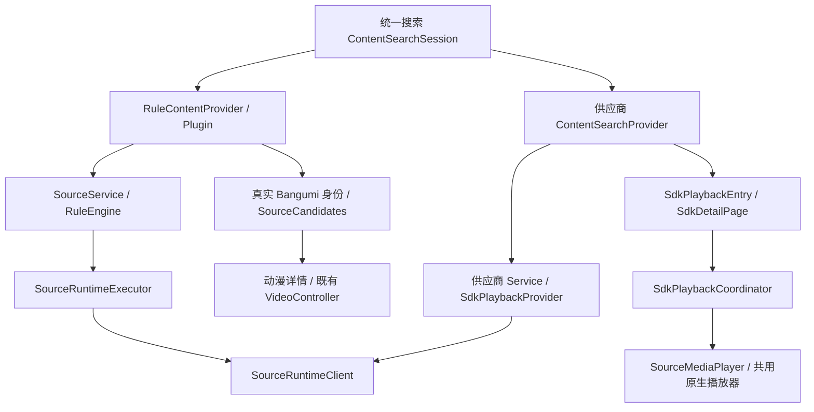

# Playra 统一 SDK 接入规范

版本：1.4；更新：2026-10-15；适用：新增 SDK、内容 HTTP API、动漫规则和资料源。本文是唯一接入入口；[接入记录模板](templates/source-sdk-checklist.zh.md)是每次交付的必填附件。历史分析说明背景，不代替本文或当前源码。

本文中的“必须”为新增接入的验收条件；“当前实现”为代码现状；“待补齐”为尚未实现或尚无验证证据的事项。规范更新不表示对应业务代码已自动升级。

## 1. 当前接入盘点与架构结论

按 SDK 家族计，当前有 **MioMedia、AniFive 两套 SDK**；按可执行运行适配器计，有 **5 个**。HTTP 注册表另有 `template` 占位，不能计入可播放来源。Bangumi 是资料提供方，不是第 3 套播放 SDK。

| 家族 / 来源 | Python adapterId | Flutter 业务身份 | 当前路径与能力 |
|---|---|---|---|
| MioMedia | `miomedia` | `miomedia` | `ContentSearchProvider` + `SdkPlaybackProvider`；11 个受限 SDK 操作 |
| AniFive A / DM84 | `anifive-a` | 默认 `dm84` | 动漫规则；search / episodes / resolve |
| AniFive B / MXdm | `anifive-b` | 默认 `mxdm` | 同上 |
| AniFive C / akianime | `anifive-c` | 默认 `akianime` | 同上；目前只公开 SDK 实际支持的线路 2 |
| AniFive D / moonci | `anifive-d` | 默认 `moonci` | 同上；兼容同站旧名 aafun 的历史 |
| 模板 | `template` | 不登记业务来源 | `implemented=false`，无能力 |
| Bangumi | 无 | `bangumi-metadata` | 动漫资料、真实作品身份与封面；`canPlay=false` |

内置动漫资产现为 4 个 JSON，替换原 16 条未修改的内置规则；用户改过的规则、自定义规则可以继续存在，因此安装后的总来源数不保证等于 4。

当前三条边界必须保留：**供应商 Adapter 执行协议，公共服务负责模型和选择策略，平台桥负责传输与打包**。页面不执行签名、解密、设备注册，也不根据供应商类名分支创建独立播放器。复用架构并不等于所有 SDK 共用一个设备身份、CookieJar 或缓存。

## 2. 新来源先选择一种业务接入路径

| 来源形态 | 必须使用 | 登记位置 / 参考 |
|---|---|---|
| 动漫站 HTML、JSON API，或能转换成搜索/目录/解析的动漫 SDK | `Plugin` → `SourceService` / `RuleEngine` → `RuleContentProvider`，继续使用真实 Bangumi 身份 | `assets/plugins/`、`contentProviders()`；参考四源资产与 `anifive_adapter.py` |
| 影视、漫剧、剧集 SDK / 专用内容 API | 专属 Service + `ContentSearchProvider` + `SdkPlaybackProvider` → 共享 `SdkDetailPage` | `contentProviders()`；参考 `miomedia/` |
| 仅资料、不提供媒体 | `ContentSearchProvider`，保持 `canPlay=false` | 参考 `BangumiContentProvider` |
| 任一形态需要 Python 算法 | 在上述业务路径下增加受限 Python Adapter | HTTP 和 Android 都登记，不能只接通一端 |
| 不需要 Python 的受控 HTTP API | 可直接由专属 Service 转换公共模型 | 仍须满足身份、取消、媒体头和双端验收要求 |

注意：`RuleContentProvider` 当前没有 `sdkPlayback`；把规则分类改成影视不会自动获得通用 SDK 播放入口。反之，通用 SDK 页当前不是四源动漫的默认入口；不能用假 Bangumi ID 绕开动漫身份校验。新增来源若不适合这两种路径，必须先明确契约变更及下游调用者，再实现。

分类使用 `anime / screen / comicDrama / series` 四个 `ContentGroup`。地区是筛选字段；电影、综艺、纪录片映射 `screen`，真人连续剧和真人短剧映射 `series`。Python `manifest.domains` 是运行能力领域，不能直接当作 UI 分类：当前 Mio 的 manifest 为 `anime/screen`，其 Flutter 搜索提供方只公开 `screen/comicDrama/series`。

## 3. 目录职责与新增文件放置规则

以下路径相对仓库根目录；`<provider>` 是待接入来源，不是现有文件名。

```text
assets/plugins/                         动漫规则声明；只放公开配置
assets/migrations/                      旧内置规则快照与迁移输入
lib/modules/search/plugin_search_module.dart   规则搜索结果，含可选 coverUrl
lib/plugins/                            规则模型、安装、更新、迁移
lib/services/source/
  content_search.dart                   聚合搜索、作品匹配、来源状态
  content_providers.dart                业务提供方注册入口
  source_service.dart                   规则搜索/目录/解析及健康记录
  source_resolve_config.dart            媒体 URL、头策略、格式、过期时间
  source_candidates.dart                动漫同作品/同集匹配
  source_sdk_group.dart                 已登记 SDK 分组与自动范围
  anime_source_session.dart             页面目录缓存、状态与取消
  sdk_playback_provider.dart            通用 SDK 播放接口
  sdk_playback_models.dart              作品、线路、真实集号、画质模型
  sdk_playback_coordinator.dart         通用 SDK 选线/画质/失败回退
  <provider>/                           专属模型转换、Service、播放 Adapter
  runtime/                              Dart 固定协议、HTTP/内置平台选择
lib/services/player/                    共用媒体所有权与历史恢复
lib/services/platform/                  Web 媒体/图片代理及平台资源转换
lib/presentation/modern/pages/          共享作品/播放页面；不放 SDK 协议

tool/source_runtime/
  adapters.py                           HTTP 注册表、RuntimeContext、RuntimeFailure
  dispatch.py                           HTTP/Android 共用业务参数校验与分发
  server.py                             本机 HTTP 服务、预算、并发和断开检测
  android_bridge.py                     APK 内注册表、request/cancel 生命周期
  <provider>_adapter.py                 协议转换、会话、供应商错误归一化
  <provider>_transport.py               需要时新增的受限供应商传输
  vendor/<provider>/                    私有 SDK 构建输入，默认不提交
  vendor/*manifest.json                 SDK 来源版本、文件摘要与导入收据
  test_*.py                             契约/安全/网络边界测试

tool/web_backend/runtime.cjs            /api/runtime/v1 固定 Node 桥
tool/web_backend/server.cjs             静态文件、媒体/图片代理、ECH 转发
tool/web_backend/security.cjs           公网目标和端口校验
tool/bangumi_web_bridge.dart            固定 Bangumi 域名的本机 ECH 服务
tool/start-web.ps1                      本机 Web/算法/ECH 启动编排
android/app/src/main/kotlin/com/example/kazumi/SourceRuntimeBridge.kt
                                       固定 MethodChannel + Chaquopy 调用
android/app/build.gradle               SDK 完整性检查、stageEmbeddedPython 白名单

test/                                  Dart 模型、协调器、迁移、播放器/UI 回归
docs/verification/                     每个 SDK 的接入记录与验收结果
```

源码所有权参考：[公共搜索](../../lib/services/source/content_search.dart)、[运行客户端](../../lib/services/source/runtime/source_runtime.dart)、[共同分发](../../tool/source_runtime/dispatch.py)、[Android 桥](../../android/app/src/main/kotlin/com/example/kazumi/SourceRuntimeBridge.kt)。新增 SDK 不复制整套 `pages/` 或 Mio 首页；首页目录/榜单需要独立的真实能力适配，注册搜索不会自动接通首页。

## 4. Web 与 Android 的完整调用链

### 4.1 共同业务层



普通规则 URL 仍由原请求器执行；只有显式 `https://source-runtime.playra.invalid/v1/...` 被拦截。此域名是路由标记，不是实际服务，也不允许 SDK 将任意 URL 当成算法入口。

### 4.2 Web

```text
业务 Service / RuleEngine
  → SourceRuntimeClient（runtime_endpoint_web.dart）
  → 当前页面同源 /api/runtime/v1/adapters/...
  → Node runtime.cjs（路径/方法/大小/预算白名单）
  → 127.0.0.1:<RuntimePort>/v1/adapters/...
  → server.py → dispatch.operation → 维护者注册的 Adapter → 私有 SDK
  → 公开 JSON 返回 Flutter → 既有播放器
媒体：prepareMediaResource/platformResourceUrl → /api/proxy → 真实媒体主机
```

Web 静态页面本身不能运行 Python SDK。部署必须同时提供同源桥及算法服务；更换规则中的机器 IP 不是接入方案。媒体代理负责 HLS 主/子清单、分片、KEY/MAP 的相对地址重写、Range 及断开取消；不能只代理第一层 m3u8。

封面/作品资料与播放算法分开：`/api/proxy` 对受支持 Bangumi 域名可交给 `tool/bangumi_web_bridge.dart`，复用 Android 的 ECH 配置；此服务不执行 AniFive/Mio 协议，也不是任意 URL 代理。

### 4.3 Android

```text
业务 Service / RuleEngine → SourceRuntimeClient
  默认 endpoint 为空 → embedded_runtime.dart
  → MethodChannel com.predidit.kazumi/source-runtime
  → SourceRuntimeBridge.kt 后台工作池
  → Chaquopy 的固定 android_bridge 模块
  → AndroidRuntime.registry → dispatch.operation → Adapter → 随 APK 打包的 SDK
  → JSON 字符串返回 → Dart 模型 → 原生 media_kit/MPV 播放器
取消：相同 requestId → 独立取消工作池 → RuntimeContext.cancelled
```

原生 `request` 参数为 `requestId / payloadJson / timeoutMs`；`payloadJson` 必须且仅含 `path / method / query / body`。`path` 如 `adapters/anifive-a/search`，不含 `/v1/`。`cancel` 使用相同 ID。原生私有目录仅由 `applicationContext.filesDir` 提供，Flutter 不传文件路径、模块名、脚本或命令。

Android 默认不需要电脑 Python 服务。显式设置 `PLAYRA_SOURCE_RUNTIME_URL` 才改走 HTTP；开发 HTTP 还须 `PLAYRA_SOURCE_RUNTIME_ALLOW_HTTP=true`。`adb reverse` 只是外部服务调试，不是内置 SDK 的验收证据。纯 Dart 服务使用 `embedded_runtime_stub.dart`，不能引入 `dart:ui` 作为独立服务的必需依赖。

## 5. 身份和模型契约

| 标识 | 规范 |
|---|---|
| `providerId` / 规则 `sourceId` | 本地稳定来源身份；不得随显示名、域名或 SDK 升级改变 |
| Python `adapterId` | 固定算法路由身份；当前 AniFive 与 Flutter providerId 不同，不能相互替代 |
| `contentId` / `SourceRef.rawRef` | 来源作品的原始字符串 ID 或详情 URL；大整数保持字符串 |
| `lineCode` / `SdkLine.code` | 当前作品真实线路码；不以数组下标替代，不全局硬编码线路数 |
| 规则剧集 `url` / `ContentEpisode.id` | 不透明的真实剧集引用；允许原始路径和字符串 ID |
| `SdkEpisode.number` | 当前通用 SDK 接口要求整数真实集号；不能用列表位置或随机 hash 冒充 |
| `quality.code` | 上游真实画质码；分辨率未知则 `height=null` |
| `metadataId` | 独立资料身份，例如 `bangumi:975`；不得从供应商 ID 推导假资料 ID |

通用 SDK 只有字符串剧集 ID 时，必须先定义稳定映射或升级 `SdkEpisode` 和所有调用者；不要静默塞入当前整数接口。四源通过剧集 URL 保存真实引用，因此 A 的倒序/特别篇、B 的不透明播放路径、C 的线路 2 都不依赖 UI 索引。

聚合搜索保留 `providerId/contentId/title/group`，有证据时提供 `year/edition/aliases/metadataId/region/cover`。同名但资料稀疏的条目保留候选；年份/季数/版本/资料 ID 冲突不能合并。动漫打开入口必须匹配唯一真实 Bangumi 身份，资料服务不可达应明确失败，不能自动制造新身份。

### 5.1 播放源分组与选择契约

两类播放详情统一使用 `PlaybackSourcePanel` / `PlaybackSdkChip` / `PlaybackLineSheet` / `PlaybackRouteChip` / `SdkLineOption`（`sdk_source_widgets.dart`）。顶层是 SDK，下一层是站点及其真实动态线路，选集只展示当前目录。AniFive 的四站不能当成四个 SDK，也不能假定每部作品固定有四条线路。

来源栏采用紧凑两层：SDK标签与高级入口在同一行，下一行显示模式和当前线路。线路弹层的自动模式固定，站点名称只出现一次，真实线路使用按钮分组排列；集数在分组摘要展示，未知画质不逐条重复，异常保留短状态与确认/重试入口。长列表可以滚动，短列表按内容收缩，保留48dp触控和大字体可读性。

样式必须继承新页面的主题链：`ModernPlayerScope → ModernSecondaryScope → ModernHomeScope + ModernSettingsScope`。基础色板来自 `modernHomeColors`，字体、控件形状和弹层来自 `modernSettingsTheme`；公共来源组件使用 `Theme.textTheme/colorScheme/chipTheme/cardTheme/bottomSheetTheme`，不另建播放页色板、字号或选中透明度。SDK标签直接继承Chip选中态，真实线路按钮解析同一选中态；动漫与影视均包裹 `ModernPlayerScope`，仅保留播放场景48dp触控约束。新增SDK验收需覆盖浅色宿主下仍继承新版主题、窄屏、大字及真实弹层布局。

规则型新 SDK 必须在 `source_sdk_group.dart` 登记管理标记和固定运行路由。当前 AniFive 要求 `managedBy=playra-anifive` 且目录路由为受信任运行主机下的 `anifive-a/b/c/d/episodes`。不靠显示名称猜分组。没有登记的自定义规则保持独立；分组 ID 不替换 `providerId`、作品引用、Bangumi ID 或历史关联。

上游线路标识通过可选 `chapterApiConfig.roadIdPath` 映射到 `Road.id`，当前四源映射 `$.id`。旧规则不填时仍按旧契约工作。数组下标只用于界面定位，真实播放始终传 SDK 返回的剧集 URL/线路码；只返回线路2时不能重写为线路1。

自动选择和失败恢复必须限定在所选 SDK 内，并核对同作品同集。用户点具体线路后关闭自动；同线换集保留该模式；只有明确点“自动”才重新允许 SDK 内回退。重复点已选 SDK 标签不重置手动模式。

动漫资料别名需兼容结构化infobox和镜像Wiki info中的明确别名字段。详情补全替换对象后必须同步 `AnimeSourceSession.updateWork`，清除旧自动结论，保留人工确认并取消迟到请求。弹层、自动发现和资料预加载统一调用 `SourceCandidates.searchMatches`：只用资料确认的名称，最多4个去重关键词、25秒搜索预算；不得按子串、删季号或去掉电影/特别篇标记凑匹配。相同作品引用去重，不同引用同名保持歧义；手动查看的未匹配缓存不得成为自动候选。真实复现见[匹配修复记录](anime-source-matching-fix-20261015.zh.md)。

别名回退须遵守原站搜索限频；当前MXdm搜索至少间隔3秒。HTTP200也可能是限频提示页，适配层必须识别其明确提示并返回RATE_LIMITED，不能缓存为无作品；合法 `NoResultException` 则继续别名回退，不能伪装为网络错误。

切 SDK/站点/线路先按语义集号（或唯一特别篇标题）找目标，不能用列表下标代替集号。无对应集时保留原媒体并提示用户选集，禁止静默播放首集。单集电影仅在两侧都有单集电影证据时允许对应。续播进度必须同时校验目标集和真实时长。

“选择中/待播放”和“当前使用”分别记录；取得 URL 不代表起播，首帧或播放器成功启动后才更新当前线路。准备新目录/地址期间保留旧媒体及旧历史身份；提交新媒体时才停止旧媒体。迟到请求、首帧和完成回调不得覆盖新选择。动漫弹层目录由页面会话缓存；失败有重试入口，作品歧义交由高级选源明确确认，不能伪装为无资源。

无真实画质声明的来源使用“自动（优选线路）”；有已知画质档位才允许展示相应策略。验收至少包含 SDK 范围隔离、手动锁定、非连续剧集 ID、缺集、真实线路2、快速切换/退页取消、旧历史/收藏/自定义规则及两端实际媒体播放。

## 6. 运行时接口契约 v1

详细限额和运维见[算法运行时参考](../source-algorithm-runtime.zh.md)。以下通用业务响应在 HTTP 和 Android 共用同一 `dispatch.py`；新增适配器先适配这三个操作，确有额外能力再扩展固定协议。

| 操作 | HTTP 路径与方法 | 参数与要求 |
|---|---|---|
| 健康 | `GET /v1/health` | 不传查询参数；仅证明运行服务可用 |
| 清单 | `GET /v1/adapters` | 不传查询参数；过滤 `implemented=false` |
| 搜索 | `GET /v1/adapters/{id}/search` | `q` 非空且≤300字符；`page` 默认1、范围1–1000000；`pageSize` 默认20、范围1–100 |
| 目录 | `GET /v1/adapters/{id}/episodes` | 仅 `source`，非空字符串≤8192字符；Adapter 可设更小限额/同源路径约束 |
| 解析 | `POST /v1/adapters/{id}/resolve` | 仅 JSON `{"episodeUrl":"https://source.example/play/42"}`；禁止额外字段和 query |
| Mio 扩展 | `POST /v1/adapters/miomedia/sdk` | 仅 JSON `{"operation":"detail","payload":{"videoId":"42"}}`；固定操作/字段白名单 |

`adapterId` 匹配 `[A-Za-z0-9_-]{1,64}`；业务 HTTP 请求携带 `X-Kazumi-Request: 1`。超时头 `X-Playra-Timeout-Ms` 为1–60000毫秒；标记头不是生产鉴权。

通用搜索示例：

```json
{"data":[{"name":"示例作品","url":"https://source.example/detail/42","cover":"https://images.example/42.jpg"}],"total":1,"hasMore":false,"paginationMode":"local"}
```

`cover` 可省略或为空，不能因缺图删除作品。`total/hasMore` 与真实分页一致；四源的 `local` 是对已取得的搜索结果切页，不代表 SDK 支持抓取后续上游页。

通用目录示例：

```json
{"data":{"roads":[{"id":"2","name":"线路 2","episodes":[{"name":"第174集","url":"https://source.example/play/42-2-174"}]}]}}
```

保留真实名称、顺序和 URL；空搜索/无可用目录返回合法空集合，不能包装成解密失败，也不能把超时伪装成空目录。相同 URL 可去重，但不能按相似名称合并不同剧集。

通用解析示例：

```json
{"data":{"url":"https://media.example/video.m3u8","format":"hls","headers":{"User-Agent":"ExamplePlayer/1.0"},"headerPolicy":"replace"}}
```

规则的 `sourceConfig.resolveApi` 映射 `$.data.url / headers / format / expiresAt / headerPolicy`。规则层 HLS 使用 `hls`、其他容器用 `auto`；通用 SDK 播放页同时兼容现有 `m3u8`。只有真实硬过期时间才提供 ISO 8601 `expiresAt`；供应商建议刷新时间不能冒充硬过期。

### 6.1 通用 SDK 播放接口与 Mio 扩展

`SdkPlaybackProvider` 的必需方法为 `id/name/detail/episodes/play`；`supportsQualities` 默认 false，`qualities` 默认空。`detail` 返回 `SdkVideo`，`episodes` 返回 `List<SdkEpisode>`，`play` 仍为受校验的 JSON Map：

```json
{"status":"ready","selection":{"videoId":"42","code":"real-code","episodeNum":174},"media":{"url":"https://media.example/video.m3u8","format":"m3u8","headers":{}}}
```

`selection` 必须严格回显当前作品 ID、线路码、真实集号。协调器拒绝错身份结果；“拿到 URL”不算成功起播。未就绪使用公开状态（如 `unavailable/ad_required`）或 `SourceException`，供应商原始堆栈不能进入页面。

Mio 当前 11 个操作为 `recommend/banners/catalog/detail/episodes/qualities/exchange/search/searchConfig/hotRank/play`；参数以 `miomedia_adapter.validate_payload` 为准。它们是 Mio 的私有协议映射，不是每个 SDK 都必须实现的通用能力。

**当前 `sdk` 扩展路由仅允许 `miomedia`。** 新 SDK 需要专属扩展时，必须同步修改 Dart `accepts`、Node `allowed`、Python HTTP 路由/`dispatch`、Android 注册、参数白名单、打包和双端测试。不能直接调用 `callMioMedia()` 冒用 Mio 身份；只在 Python 注册不等于全端接通。

### 6.2 媒体头、封面和网络边界

- `headers` 是媒体请求头，不是运行服务鉴权头。保留供应商需要的公开头，跨主机跳转不得泄漏 Cookie/Authorization。
- 规则解析 `headerPolicy=replace` 表示只用返回的媒体头，Dart 转为 `inheritHeaders=false`；**空字典 + replace 表示有意裸请求**。未声明保持旧规则默认合并行为。播放器和下载消费点都必须遵守。
- `headerPolicy` 当前在规则解析链实现；通用 SDK `media.headers` 直接由共享播放页消费，不能假设它自动实现同一字段。
- 搜索封面沿 `Python cover → ApiSearchConfig.coverPath → SearchItem.coverUrl → SourceContent.coverUrl → ContentHit.cover` 传递。四源从同次搜索 HTML 提取；A 支持 `a[data-bg]`，其他来源支持懒加载图片。只关联最近的真实作品容器，不能把 Logo/广告图补给其他作品。
- 旧规则未声明 `coverPath` 仍能搜索。空图、失效图片、CDN 拒绝是不同状态；保持占位，验收记录真实结果，不能声称拿到地址就保证图片内容正确。
- 上游传输必须验证 TLS、限制重定向/解压后大小、检查公网目标并固定连接到已验证地址。元数据目的主机由维护者维护，不由客户端传入任意 host。
- 当前四源媒体探测最多4096字节，识别 HLS/MP4/WebM 后才返回；不按 MIME 或 URL 后缀单独判定成功。不得下载完整视频用于探测。
- Web 非标准媒体端口必须精确登记；当前仅维护 D 源 `https://play.xfvod.pro:8088` 例外。新 SDK 若需要其他端口，必须同时更新网络策略及拒绝私网/错误主机测试。

### 6.3 HLS 与媒体实际播放门禁

Web 重写 HLS URI 后返回的是新的完整表示，不能沿用上游的字节范围、长度、ETag 或 Last-Modified。收到 Range 对应的 HLS 206 时先移除 Range 获取完整清单，再重写；不能将局部清单直接改成 200。无 Range 仍返回局部清单应明确失败，不无限重试。MP4 / TS 二进制仍保留 Range、206、Content-Range 和流式传输。

HLS 判断须覆盖图片 MIME、无后缀、主/子清单、KEY、MAP、相对路径及分片。播放器的 canPlayType 非空只证明能力声明，不能代替实际解码验收。当前 Chromium 在 media_kit 完成初始化后，通过 `configureMediaPlayback` 复用其已有 HLS 引擎；Safari 和无 MSE 环境保留原生路径，禁止创建第二个播放器绕开媒体所有权。当前 MSE 分支忽略 Media.start，Web 历史偏移通过 `restorePlaybackStart` 在元数据就绪后补定位，必须检查当前选择、超时和时长范围。依赖升级须重验实例查找、首次起播、切线、MP4、续播和销毁。无后缀清单的代理识别与播放器选择是两道门禁，后者仍需逐来源证明。

每次接入分开记录：匹配、同集目录、解析成功、清单读取、分片读取、首帧、持续播放。至少在 Web 正式构建和 Android 实际 APK 各完成首帧、时间递增、同集切线与历史恢复。临时控制台注入或只做媒体探测不能填写正式页面实播 PASS。当前两套 SDK 的边界和 DM84 实例见[架构与播放修复核验](../analysis/two-sdk-architecture-and-dm84-playback-20261015.zh.md)。

## 7. 超时、取消、会话和错误处理

### 7.1 当前预算与生命周期

| 层 | 当前默认 / 限额 | 新接入要求 |
|---|---|---|
| 聚合搜索 | 单源20秒、批次35秒 | 谁先完成谁先展示，单源失败隔离 |
| 运行客户端 / Python | 默认20秒，可声明1–60秒 | 总预算覆盖连接/读取/锁等待；不能每一步重置完整预算 |
| Web runtime 桥 | 最多20秒 | 实际预算取所有经过层的最小值；外层55/75秒不会放宽该限制 |
| Python HTTP | 8 个操作，无等待名额时 BUSY | 保持有界；忽略取消的算法仍占名额 |
| Android Kotlin | 4 个业务工作线程 + 8 个排队名额，独立取消线程 | 排队时间计入预算；不是“只能接4个SDK” |
| 通用 SDK 目录/画质 | 最多3路并发、默认10秒 | 画质超时不丢失已成功的目录 |
| 通用 SDK 播放回退 | 默认总75秒；共享页面首帧等待最多25秒 | token换取/媒体打开串行，始终单一媒体所有者 |
| 运行协议大小 | 请求32KiB、响应2MiB | 不把视频二进制、私有向量或完整上游对象放进 JSON |

`RuntimeContext` 在网络前后、分页/循环、锁等待和耗时算法边界检查。取消必须传到网络与会话，旧响应/旧首帧不得覆盖新选择。Python线程不能强行终止阻塞算法；不可控 CPU 任务需要单独设计隔离进程，当前没有通用进程沙箱。

同一供应商需要限流可使用独立锁和 CookieJar；不得跨所有 SDK 全局串行。设备身份放独立私有目录，例如 Android `<filesDir>/<provider>/device.json`；Web 服务的身份不能与手机混用。缓存须有 TTL/数量上限和明确失效条件，短时媒体凭证不永久缓存到历史/收藏。

### 7.2 稳定错误契约

```json
{"error":{"code":"TIMEOUT","message":"TIMEOUT"}}
```

| 错误码 | 含义 | 消费/验收要求 |
|---|---|---|
| `INVALID_ARGUMENT` / `UNSUPPORTED` / `NOT_FOUND` | 参数、能力或路由错误 | 不盲目重试，不伪装无资源 |
| `RUNTIME_UNAVAILABLE` / `SDK_RESOURCE_MISSING` | 服务/平台桥/私有输入不可用 | 指明环境或打包问题 |
| `BUSY` / `RATE_LIMITED` | 本地并发或上游限流 | 区分来源，不并发重放昂贵换取请求 |
| `TIMEOUT` / `CANCELLED` | 预算耗尽 / 主动取消 | 取消不计为来源故障，不允许晚起播 |
| `UPSTREAM_UNAVAILABLE` / `UPSTREAM_HTTP_ERROR` / `UPSTREAM_TRUNCATED` | 上游连接、状态或截断 | 保留公开错误码，允许受控重试 |
| `PARSE_ERROR` / `DECRYPT_ERROR` / `NOT_MEDIA` | 结构、解密或内容不是媒体 | 不返回假成功或 HTML 视频地址 |
| `PLAYBACK_UNAVAILABLE` / `EXPIRED` | 暂不可播 / 硬过期 | 重新解析，不复用过期 URL |
| `AD_REQUIRED` / `BUSINESS_REJECTED` / 身份相关错误 | 供应商业务或会话拒绝 | 走显式状态，不伪造验证成功 |
| `PAYLOAD_TOO_LARGE` / `RESPONSE_TOO_LARGE` | 协议资源超限 | 立即终止，不接收截断成功 |
| `RUNTIME_ERROR` | 未公开异常 | 日志脱敏；不能直接输出 SDK 堆栈/密钥 |

错误码格式须满足 `[A-Z_]{1,64}`；Dart `SourceRuntimeClient` 将合法公开码转为 `SourceException`。HTTP 同时有状态码，Android 通过 JSON 返回错误，调用方应按 `error.code` 判断；HTTP状态不能作为唯一依据。当前部分本地大小检查归为 `PARSE_ERROR/INVALID_ARGUMENT`，不能假设每层超限都返回完全相同的码。

日志只保留公开来源/操作/耗时/错误码和必要内容引用；不要记录完整签名媒体 URL、查询 token、Cookie、Authorization、设备密钥。SDK 的过滤函数是防线之一，新增供应商必须有自己的输出字段清单和脱敏测试。

## 8. 数据兼容、升级与回退

新增来源不得清空历史、收藏、追番、下载、同步或用户规则。来源身份/规则格式变化必须列出所有消费者，包括播放、历史恢复、下载和跨设备同步。

当前四源迁移参考 `bundled_anime_migration.dart` / `PluginsController._migrateBundledAnime`：

1. 用 `assets/migrations/anifive-v1.json` 对比旧规则快照；只替换未修改的旧内置项，不凭名字删除。
2. 保留用户编辑/自定义规则；冲突时为 SDK 分配独立本地名称和 ID。
3. 首次保存 `plugins.before-anifive-v1.json` 和已有策略的 `source-policy.before-anifive-v1.json`；成功后写 `anifive-v1.complete`，重试不得覆盖首次备份。
4. 受管规则后续随应用资产版本更新，同时保留本地 ID/名称和独立策略；不得被旧远程规则静默降级。
5. 历史按同作品、同来源身份、同详情和唯一真实剧集 URL 恢复，线路删减/排序变化不沿用旧下标。aafun 别名只在已确认的同站受管来源使用；同名异站自定义规则不能继承相对历史。
6. 跨来源恢复只有唯一作品/集号证据才执行，不把旧时间偏移盲目套到不同剪辑；保留原历史并允许重新选源。

回退只恢复本次代码和来源配置/策略快照；完整应用数据备份另存。先保留失败现场并关闭应用/停止写入，再恢复匹配版本；不能用 `git reset --hard` 或清空用户目录代替迁移回退。

## 9. 私有输入、打包和启动

SDK 原目录保持可追溯。供应商协议算法由原 SDK 提供；传输/兼容补丁应通过可复现导入器应用于项目副本，记录原始/导入后 SHA256、真实上游提交和补丁版本。禁止仅写固定提交标签却未核验实际输入版本。

当前入口：Mio `tool/miomedia_sdk_input.py`；AniFive `tool/source_runtime/import_anifive.py`。两套 vendor 目录均忽略，公开规则不含密钥；详见[构建输入](../release/build-inputs.zh.md)。新增 SDK 必须提供导入/完整性检查和干净环境恢复方法，不能依赖某台电脑桌面目录。

Android 必须更新 `stageEmbeddedPython` 的依赖校验与随包白名单；包含运行用数据资源和可选原生模块的纯 Python 回退，不能只复制 `.py`。不得将 Windows DLL 当成 Android 依赖。验收至少核对一个实际目标 ABI 的 APK内容及离线于电脑服务的运行。

当前本机 Web 一键入口：

```powershell
. ./tool/use-dev-env.ps1
./tool/start-web.ps1 -Port 8931 -RuntimePort 8945 -BangumiEchPort 8946 -Build
```

默认端口：Node8931、Python8945、Bangumi ECH8946；脚本会检查/启动本机服务，日志/PID在 `.dart_tool/web-service/`。它不会重启已有旧进程；修改 Python/Node/打包后必须确认实际运行的是新代码。`RuntimePort=0/BangumiEchPort=0` 跳过对应启动，不能当作能力已就绪。健康检查不替代真实搜索或播放。

Python/Node 当前只绑定 loopback。公网生产部署须另行提供 HTTPS、鉴权、限流、密钥和状态隔离；现有 `X-Kazumi-Request` 不是鉴权。iOS/桌面未实现 Android 式随包 Python，需独立验证外部服务和播放能力。

## 10. 每次接入的实施顺序和交付文件

| 步骤 | 必须交付 | 通过条件 |
|---|---|---|
| 1 调查 | 复制接入模板；列SDK版本/接口/鉴权/限流/平台要求及真实脱敏样本 | 能力支持/不支持/未验证明确 |
| 2 映射 | providerId/adapterId/作品/线路/剧集/画质/错误/媒体头契约 | 无身份混用和索引造假；列出下游 |
| 3 单源闭环 | 私有输入工具、Adapter、搜索/目录/解析 | 先单来源跑通，再注册聚合 |
| 4 双端桥接 | Dart/Node/Python HTTP/Android 分发与APK打包检查 | 两端同业务语义；未知字段/路由被拒绝 |
| 5 产品复用 | 公共搜索、既有详情和播放器、封面、取消/错误/选源 | 不复制播放器，不改无关页面 |
| 6 兼容迁移 | 幂等迁移、用户规则保护、备份和回退 | 旧数据可读、重启重试安全 |
| 7 自动化与实播 | 测试命令/结果、构建收据、两端播放器证据 | 按下节逐门验收 |
| 8 归档 | `docs/verification/<provider>-integration-YYYYMMDD.zh.md`、能力矩阵、构建输入说明 | 未验证项保持未验证，剩余问题有明确归属 |

## 11. 验收门禁

同一 checkout 的 Flutter analyze/test/build 串行运行。以下命令是可复现入口，不代表文档更新时已重新执行全量发布验收：

```powershell
. ./tool/use-dev-env.ps1
flutter analyze --no-pub --no-fatal-infos
flutter test --no-pub
python -B -X utf8 -m unittest discover -s tool/source_runtime -p 'test_*.py'
node --test tool/web_backend/*.test.cjs
dart run tool/source_runtime_integration.dart $env:PLAYRA_BUILD_PYTHON
```

按来源范围选专项测试；共享契约变化再执行完整回归。参考 [运行时测试](../../test/source_runtime_test.dart)、[SDK协调器](../../test/sdk_playback_coordinator_test.dart)、[四源迁移](../../test/bundled_anime_migration_test.dart)、[媒体头](../../test/source_header_policy_test.dart)、[历史身份](../../test/anifive_history_identity_test.dart)、[封面](../../test/anifive_cover_test.dart)、[HTTP/Android共同契约](../../tool/source_runtime/test_anifive.py)、[HLS代理](../../tool/web_backend/hls_relay.test.cjs)。

| 门禁 | 必须检查 |
|---|---|
| 静态/依赖 | UTF-8、规则JSON、类型/构建、私有输入摘要、APK所需模块/资源/ABI存在；签名状态单独记录 |
| 协议 | 正常/空结果、特殊字符、不透明路径、非法参数/方法/字段、缺模块、超限、截断、解密失败；HTTP与Android同业务码 |
| 并发/取消 | 单源慢不拖全部；队列/锁等待可取消；总预算有界；切源/退页后旧请求不晚起播 |
| 目录/画质 | 倒序/SP/非连续集号、线路删减/去重、同集匹配、真实可选画质与未知画质；自动回退/手动锁定 |
| 封面 | 首页与搜索分别检查；有URL、HTTP成功、图片解码、实际图内容分别记录；不串图，不使用Logo补图 |
| 网络/媒体 | 证书、公网/端口策略、跨域头过滤；HLS主子清单/KEY/MAP/分片；MP4 Range/seek；空replace头不被补回 |
| 数据回归 | 旧规则迁移幂等、同名自定义项、历史/收藏/下载/同步、原有Mio与动漫路径 |
| UI | 320px、2倍文字、横屏、长线路/长片名、读屏名称、减少动画、仅一个活动播放器 |
| Web实播 | 正式页面搜索→详情→起播；时间递增、尺寸/帧数/错误状态；换集、切线、拖动、恢复、取消 |
| Android实播 | 安装实际APK；默认内置桥、不依赖电脑；真实设备/模拟器型号、ABI、渲染/硬解设置；首帧、持续播放、换集/切线/恢复 |

结果按维度记录：`PASS` 全部目标有直接证据；`PARTIAL` 部分能力/平台有证据但仍有未验项；`FAIL` 必需行为已证实失败；`BLOCKED` 前置环境不可用。接口成功、URL就绪、首帧、持续播放、包构建必须分别结论。Android 未通过不能用 Web 播放或 Python 单测替代。

## 12. 当前差距与后续优先项

下表是核查后的现状，不能作为新增SDK绕过门禁的例外许可。

| 优先级 | 当前差距 | 后续完成标准 |
|---|---|---|
| P1 | 四源Android包已构建/安装，但雷电进入播放链路时设备连接不稳定，持续播放验收未完成 | 补APK实际内置桥/首帧/持续播放/换集证据，记录渲染器设置；必要时换真机复核 |
| P1 | 当前发布工作流仅导入Mio私有输入，尚无AniFive导入步骤，Android打包却已依赖AniFive | 干净CI恢复两套SDK并通过实际构建；未补前不能宣称发布就绪 |
| P2 | HTTP与Android的health/adapters外层结构不同，非Mio sdk非法路由的码也并非完全一致 | 做显式兼容归一化与跨平台测试，再升级协议；业务方不要自行猜外层结构 |
| P2 | 新增通用SDK扩展仍需同步多个白名单，Android注册表与HTTP注册表是两个入口 | 每次接入双端检查；后续可设计共用注册元数据，保留每SDK私有状态隔离 |
| P2 | 供应商封面仍可能失效/返回占位广告；Bangumi ECH只覆盖固定域名 | 按来源补真实封面质量/失败回退证据，不能承诺所有第三方图片始终可用 |
| P2 | AniFive导入收据当前记录固定上游版本标识，尚无通用自动核验上游提交机制 | 导入时校验真实输入版本和摘要，拒绝不匹配版本，记录兼容补丁 |

2026-10-15 会话中已观察到 Web 的 MXdm HLS 和 moonci MP4 起播、MXdm换集/历史写入、首页Bangumi封面恢复；不能由此推导 A/C全部线路、全部封面、安卓或发布CI通过。四源实施事实见[当前实施记录](anifive-implementation-worklog.zh.md)。
