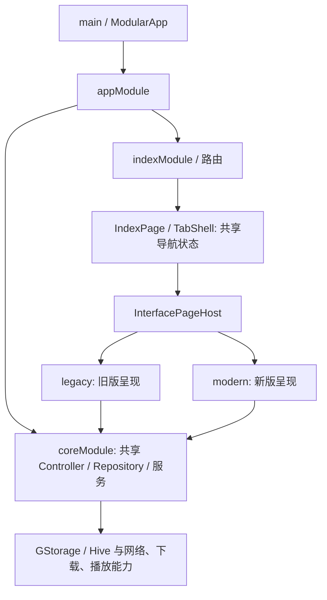

# Android 新版页面的 Flutter UI 库研究

研究日期：2026-10-10。范围：当前项目的 Android 呈现层与候选组件库；本次只研究并记录，没有安装库、修改依赖或运行候选库示例。版本和发布时间通过 pub.dev 官方 API 实查，文档与 API 冲突时以具体发布版本的 `pubspec` 为准。

## 结论与建议

**优先保留 Material 3，建立新版自己的主题与业务组件；Forui 是值得做小样验证的主要替代候选。** 这是结合当前源码和官方资料的工程判断，不是候选库已经通过本项目运行测试的结论。

原因是新旧页面切换、共享路由和业务服务已经具备，换新样式不要求换状态管理、导航框架或 Android 宿主。Material 的基础按钮、导航、输入、弹层可以通过主题与组合做出新设计；真正需要项目自己维护的，是番剧海报、继续观看、追番状态、选集、播放控制等业务组件。第三方库不能自动提供这些功能。

如果新版追求与原版明显不同的简洁样式，Forui 的触屏主题、导航、列表、表单和弹层更值得优先验证。若希望使用中文移动端设计体系，腾讯 TDesign Flutter 也应进入小样对比，但要明确其稳定版与预发布版差异，避免直接照当前开发分支示例接入。

## 当前项目接入条件

- 已核验项目 SDK 为 Flutter 3.47.6、Dart 3.13.5，Flutter 标识 `channel [user-branch]`。**版本号范围满足不等于第三方库直接兼容。**
- 当前应用根组件是 `MaterialApp.router`，开启 `useMaterial3: true`，使用动态取色、深浅主题、中文本地化。证据：[app_widget.dart](C:/Users/haige/Desktop/Playra/lib/app_widget.dart:168)、[应用根组件](C:/Users/haige/Desktop/Playra/lib/app_widget.dart:327)。
- 路由与依赖注入使用 Flutter Modular，响应式业务状态使用 MobX；应保留这些既有机制，只替换新版组件。依赖证据：[pubspec.yaml](C:/Users/haige/Desktop/Playra/pubspec.yaml:16)。
- 新页面入口已由 `InterfacePageHost` 选择旧版或新版，并为新版包裹局部主题；新主题继承用户的颜色、亮度与字体。证据：[版本呈现入口](C:/Users/haige/Desktop/Playra/lib/presentation/interface_page_host.dart)、[新版主题](C:/Users/haige/Desktop/Playra/lib/presentation/modern/modern_theme.dart)。

### 技术栈与架构

| 层次 | 当前项目实际使用 | 改新版时的边界 |
| --- | --- | --- |
| 页面 | Flutter / Dart、Material 3、动态取色 | 新版维护自己的 Widget 与主题，Android 的页面由 Flutter 绘制 |
| 路由与注入 | flutter_modular 7.1.0 | 保留现有路径、依赖注册与返回行为 |
| 状态 | mobx 2.6.0、flutter_mobx 2.3.0；主题/版本另用 ChangeNotifier | 新旧页面消费同一业务 Controller，不强制改状态框架 |
| 请求与持久化 | dio 5.11.0、hive_ce 2.19.3、hive_ce_flutter 2.3.4；Repository / GStorage | UI 库不管理收藏、历史和下载数据 |
| 已有辅助 UI | skeletonizer 2.1.3、flutter_svg 2.3.0、fl_chart 1.2.0 | 已有加载骨架、SVG 和图表能力，可继续按需复用 |
| 播放 | media_kit 为 Predidit Git fork，锁定提交 803c4a… | 播放与弹幕的项目能力须继续独立维护，不由通用 UI 库替代 |
| Android 原生宿主 | Kotlin；MainActivity 继承 AudioServiceActivity，经 intent / storage / pip MethodChannel 连接原生功能 | Kotlin 负责系统栏、存储、画中画等平台接入，不是主要页面技术 |
| 构建 | AGP 8.11.1、Kotlin 2.2.21、Gradle 8.14.5、JVM target 17 | 当前 UI 研究无需改构建工具链 |

锁定版本证据：[pubspec.lock](C:/Users/haige/Desktop/Playra/pubspec.lock)。原生与构建证据：[MainActivity.kt](C:/Users/haige/Desktop/Playra/android/app/src/main/kotlin/com/example/kazumi/MainActivity.kt)、[settings.gradle](C:/Users/haige/Desktop/Playra/android/settings.gradle)、[app/build.gradle](C:/Users/haige/Desktop/Playra/android/app/build.gradle)、[Gradle wrapper](C:/Users/haige/Desktop/Playra/android/gradle/wrapper/gradle-wrapper.properties)。

实际收藏链路为 `ModernLibraryPage → CollectController → ICollectCrudRepository / CollectCrudRepository → GStorage(Hive)`，核心依赖在根模块注册后共享。[新版追番页](C:/Users/haige/Desktop/Playra/lib/presentation/modern/pages/library_page.dart)、[收藏 Controller](C:/Users/haige/Desktop/Playra/lib/pages/collect/collect_controller.dart)、[收藏仓库](C:/Users/haige/Desktop/Playra/lib/repositories/collect_crud_repository.dart)、[根模块](C:/Users/haige/Desktop/Playra/lib/core_module.dart)。

这是已有模块化与分层实践，`pages` 目录仍混有 Controller，不能描述为严格的 Clean Architecture。当前共存骨架已隔离呈现入口，适合先重构页面，再按实际需要整理历史目录。

### Material 两种入口的过渡期

本地 SDK 的 `package:flutter/material.dart` 仍导出 SDK 内的 `src/material/*`，锁文件没有 `material_ui`；这符合 Flutter 3.47 **允许选择迁移**的正常过渡状态。证据：[本地 Material 入口](C:/Users/haige/Desktop/Playra/.tooling/flutter/packages/flutter/lib/material.dart:19)、[依赖锁文件](C:/Users/haige/Desktop/Playra/pubspec.lock)、[Flutter 官方迁移指南](https://docs.flutter.dev/release/breaking-changes/material-ui-and-cupertino-ui)。

官方指南指出：旧 `flutter/material.dart` 与新 `material_ui` 的同名 `ThemeData`、`ColorScheme` 等并非可直接互传的静态类型。兼容桥帮助子组件读取主题和本地化，却不能自动消除公开参数类型不匹配。因此不能因为本项目显示 3.47.6，就宣称最新版 Forui 或新 Material 生态已经可直接混用。[兼容桥的限制](https://docs.flutter.dev/release/breaking-changes/material-ui-and-cupertino-ui#bridge-capabilities-and-limitations)

## 版本、最低 SDK 与维护证据

下表日期为 pub.dev 发布记录的 UTC 日期；“近期发布”只说明可核查的发布活动，不代表质量保证或长期维护承诺。第三方版本对应当前查询到的稳定版；TDesign 同时列出预发布版。

| 候选 | 实查版本与发布日 | 发布包的最低 SDK 约束 | 维护事实与本项目关注点 |
| --- | --- | --- | --- |
| Flutter Material 3 | 本项目随 Flutter 3.47.6 使用 | 当前 SDK 已有；Material 3 自 Flutter 3.16 默认启用 | Google 官方设计体系；当前已有主题与组件，增量成本最低。[官方说明](https://docs.flutter.dev/release/breaking-changes/material-3-migration) |
| Forui | 0.27.4；2026-10-04 | Dart `>=3.13.0-0 <4.0.0`；Flutter `>=3.47.0-0` | 0.26 迁入 `material_ui` / `cupertino_ui`；0.27 系列持续修复语义、导航安全区和弹层行为。[发布数据](https://pub.dev/api/packages/forui)、[变更记录](https://pub.dev/packages/forui/changelog) |
| shadcn_ui | 0.57.1；2026-09-24 | Dart `>=3.11.0 <4.0.0`；Flutter `>=3.41.0` | 0.57 修复 Android 弹窗/抽屉安全区；仍使用自己的 `ShadTheme` 与本地化。[发布数据](https://pub.dev/api/packages/shadcn_ui)、[变更记录](https://pub.dev/packages/shadcn_ui/changelog) |
| shadcn_flutter | 0.0.55；2026-10-01 | Dart `>=3.13.0 <4.0.0`；Flutter `>=3.47.0` | 与 `shadcn_ui` 是不同作者的独立项目；当前主库独立于 Material，有可选 Material 配套包。[发布数据](https://pub.dev/api/packages/shadcn_flutter)、[官方说明](https://pub.dev/packages/shadcn_flutter) |
| GetWidget | 7.0.2；2026-05-24 | Dart `>=2.12.0 <4.0.0`；未显式声明 Flutter 最低版本 | 基于 Flutter 的 `GF*` 成品组件；包依赖只列 Flutter。未声明 Flutter 下限不能解释为所有 Flutter 版本均已测试。[发布数据](https://pub.dev/api/packages/getwidget)、[官方说明](https://pub.dev/packages/getwidget) |
| TDesign Flutter | 稳定 0.2.7：2026-01-21；预发布 1.0.0-alpha.1：2026-07-31 | 稳定：Dart `>=3.2.6 <4.0.0`、Flutter `>=3.16.0`；预发布：Dart `>=3.8.0 <4.0.0`、Flutter `>=3.32.0` | 腾讯官方移动端组件库；稳定版 `TD*` 与开发/预发布的 `T*` 命名存在差异，应锁定版本看对应资料。[发布数据](https://pub.dev/api/packages/tdesign_flutter)、[稳定版](https://pub.dev/packages/tdesign_flutter/versions/0.2.7)、[预发布版](https://pub.dev/packages/tdesign_flutter/versions/1.0.0-alpha.1) |

Forui 的 Getting Started 页面仍写“0.22+ 要求 Flutter 3.44+”，但当前示例已经使用 `material_ui`；最新包约束见上表，不照旧文字判断兼容。[Forui 入门文档](https://forui.dev/docs/getting-started)

## Android 体验与接入成本对比

以下成本评估是基于官方 API 和当前代码边界的推断，尚未在本项目安装运行候选库。

| 方案 | 移动端组件与交互依据 | 主题、本地化、可访问性 | 与当前 MaterialApp 的预计成本 |
| --- | --- | --- | --- |
| Material 3 + 业务组件 | 官方导航、按钮、表单、弹层与滚动组件；项目现有导航已使用这些部件 | 可继续现有 ColorScheme、动态取色和中文 delegate；Flutter 有屏幕阅读器与语义支持，最终仍需 TalkBack、大字体测试 | 低：局部 Theme 和业务 Widget 即可，不增加第二套设计系统。[Material 迁移说明](https://docs.flutter.dev/release/breaking-changes/material-3-migration)、[可访问性](https://docs.flutter.dev/ui/accessibility) |
| Forui | 官方明确触屏优先；有 touch/desktop 主题变体、底部导航、列表、日历、输入、弹层；FTappable 支持滑动跨控件交互 | 独立 FTheme，亮度需业务明确同步；FLocalizations 包含中文/香港/台湾；变更记录有语义与大字号修复 | 中：仅包裹新版子树，增加主题/本地化/弹层宿主；最新版另需验证 Material 两种入口边界。[设计原则](https://forui.dev/docs)、[主题](https://forui.dev/docs/concepts/themes)、[触控](https://forui.dev/docs/widgets/foundation/tappable)、[中文支持](https://pub.dev/documentation/forui/latest/forui.localizations/FLocalizations/supportedLocales-constant.html) |
| shadcn_ui | 有表单、选择器、日历、弹窗、Sheet；近期新增可伸缩抽屉、键盘避让和移动端菜单行为 | 独立 ShadTheme；GlobalShadLocalizations；近期有输入框 disabled 语义修复，不能据此宣称所有控件无障碍已通过 | 中：官方提供 ShadApp.custom + MaterialApp/router 组合，需整理 theme、builder、delegate；底部导航和番剧卡仍需项目组合。[接入文档](https://mariuti.com/flutter-shadcn-ui/)、[变更记录](https://pub.dev/packages/shadcn_ui/changelog) |
| shadcn_flutter | 提供独立的导航、表单和弹层生态，官方声明支持移动/桌面/Web | 自有 ThemeData 与 ShadcnLocalizations；Material 混用通过配套包；本次未完整核验所有控件的 TalkBack 行为 | 中至高：官方支持渐进混用，但需要同名类型别名和局部主题/宿主审计；不宜为新版页面替换整个应用根组件。[官方说明](https://pub.dev/packages/shadcn_flutter)、[本地化指南](https://github.com/sunarya-thito/shadcn_flutter/blob/master/packages/shadcn_flutter/skills/shadcn-flutter/guides/installation.md) |
| GetWidget | GFCard、GFCarousel、GFAvatar、GFAccordion 等可作为成品组合部件 | 官方定位可与 Material/Cupertino 同屏混用；本次没有找到足够材料证明统一中文 delegate 与完整无障碍覆盖，属于待验证 | 低至中：按需加入部件较容易；作为整套新设计系统时，要自行统一颜色、圆角、密度、文字和手势。[官方说明](https://pub.dev/packages/getwidget)、[官方文档](https://docs.getwidget.dev/) |
| TDesign Flutter | 官方移动端设计体系，覆盖输入、日历、底部标签、ActionSheet、Popup 等 | 稳定版通过 TDThemeData/主题扩展；暗色由业务切换；官方明确没有内建国际化，需要 TDResourceDelegate 接入业务翻译。本次未完成其无障碍覆盖核验 | 中：可在 MaterialApp 下加入主题扩展；但稳定版固定 image_picker 1.1.2，与本项目约束冲突，不能直接加入。预发布可继续评估，尚未实编译。[稳定版主题与国际化](https://pub.dev/packages/tdesign_flutter/versions/0.2.7)、[组件变更](https://pub.dev/packages/tdesign_flutter/changelog)、[依赖数据](https://pub.dev/api/packages/tdesign_flutter) |

本项目固定中文区域为 `zh_Hans_CN`，加入任何库都必须验证它实际选中中文控件文案，而不只检查应用自己的文字。本地证据：[当前区域设置](C:/Users/haige/Desktop/Playra/lib/app_widget.dart:337)。

TDesign 有一项**已确定的静态依赖冲突**：稳定版 0.2.7 要求 `image_picker: 1.1.2`（精确版本），而本项目直接依赖 `image_picker: ^1.2.1`，两者没有交集。因此在保留本项目依赖要求的情况下，稳定版不能直接加入。这是暂不把它作为首选的实质理由。1.0.0-alpha.1 改为 `^1.1.2`，只消除了这一项约束冲突，并不代表整体兼容已验证；它仍属于预发布版本。[官方发布依赖](https://pub.dev/api/packages/tdesign_flutter)、[本项目 image_picker](C:/Users/haige/Desktop/Playra/pubspec.yaml:88)

## 两条主要实施路线

### 路线 A：保留 Material 3，做自己的新版业务组件

建议新增组件边界放在 [新版目录](C:/Users/haige/Desktop/Playra/lib/presentation/modern/) 内，沿用 [局部主题入口](C:/Users/haige/Desktop/Playra/lib/presentation/interface_page_host.dart)。

第一批组件可为 `AnimePosterCard`、`SectionHeader`、`ContinueWatchingCard`、`LibraryStatusChip`、`EmptyState`、`EpisodeSelector`。这些是建议的业务职责，当前尚未新增这些文件。

颜色、圆角、字阶、间距统一来自新版主题；通用交互复用 Material 的 NavigationBar、按钮、输入和 BottomSheet。海报列表等业务组件接受数据与回调，不自行创建 MobX/Hive/下载实例。这样旧版保持原外观，新版也能形成明显的新设计。**推断：当前阶段成本最低、回退最直接，适合先完成首页和追番页。**

### 路线 B：Forui 作为新版基础组件

官方允许在 MaterialApp 下使用 FTheme，并提供 Material 主题近似转换；该转换是尽力映射，不保证视觉完全一致。新版应该局部接入 FTheme，不直接拿官方示例的全局主题覆盖旧版。[Forui 接入](https://forui.dev/docs/getting-started)、[主题桥接](https://forui.dev/docs/concepts/themes#material-interoperability)

需要评估：

1. 保留当前 MaterialApp.router 和 Modular 导航，在新版样式分支内添加 Forui 主题/所需宿主。
2. 将用户的深浅色、动态颜色和字体映射至 FTheme；Forui 不自动管理明暗状态。
3. 合并本地化 delegate，确认中文日期、输入菜单与弹层按钮文案。
4. 验证弹层是否跨越局部主题边界，以及 Android 返回键、键盘避让和安全区是否正确。
5. 包装自己的业务组件，只在实现内部依赖 Forui，避免把第三方类型扩散到仓库和服务。

Forui 0.25.0 的发布包仍只依赖 SDK 内 Material，最低 Flutter `3.44.0-0` / Dart `3.12.0-0`，没有 `material_ui`。它可以作为避免立即触碰 Material 入口迁移的试验备选；**不是已验证兼容的推荐固定版本**，也会缺少后续修复。若选这一路线，应按具体版本复核 API。[历史发布数据](https://pub.dev/api/packages/forui)、[0.25.0 包](https://pub.dev/packages/forui/versions/0.25.0)、[迁移变更](https://pub.dev/packages/forui/changelog)

## 开始安装前的小样验收

建议只挑一个组件方案做“搜索输入 + 海报卡 + 底部导航 + 选集弹层”的小样，仍走当前新旧样式开关。验收标准是：

- 当前 SDK 下依赖能解算、APK 能编译，旧版仍能使用。
- 深浅色、动态取色、中文字体与放大字体正确，没有布局溢出。
- 中文输入法、返回键、底部手势区、弹层滚动与键盘避让正常。
- TalkBack 能读出按钮、海报动作、选集状态；焦点可操作，触控区域足够。
- 切换两种样式不重建业务服务，不丢收藏/历史，不重复导航或播放事件。

Flutter 官方验收建议包括 TalkBack、至少 48×48 触控目标、足够对比度与大字体可用；采用任何第三方库后仍需实际测试。[Flutter 可访问性验收](https://docs.flutter.dev/ui/accessibility#accessibility-release-checklist)

目前只有源码/发布元数据/官方文档证据；**没有任何候选库在本项目的安装、编译、性能或真机测试结果**。本报告不能用作“已完成库兼容验收”的证明。

## 需要避开的混淆

- `shadcn_ui` 与 `shadcn_flutter` 是两个不同 Flutter 包，并非网页 React shadcn/ui 可直接复制进 Dart。[shadcn_ui](https://pub.dev/packages/shadcn_ui)、[shadcn_flutter](https://pub.dev/packages/shadcn_flutter)
- UI 库改变按钮、主题、表单和弹层实现，不要求把 MobX 换成 GetX，也不要求重写仓库、下载、播放器或 Android 宿主。
- TDesign 官网/仓库开发分支与稳定包可能使用不同 API；只对照锁定版本。其稳定包近期没有发布，不能只因腾讯官方身份就推断当前 SDK 无兼容问题。[稳定版发布](https://pub.dev/packages/tdesign_flutter/versions/0.2.7)、[当前仓库](https://github.com/Tencent/tdesign-flutter)
- 不用下载量、星标数或宣传截图代替移动端体验、维护证据和本项目编译结果。

## 本次变更与回退

新增文件：本报告 [flutter-ui-library-research.md](C:/Users/haige/Desktop/Playra/docs/flutter-ui-library-research.md)。用途：记录 Android 新版 UI 选型依据。影响：文档层，不改变应用和依赖。回退：删除该新增文档即可；既有页面骨架保持原状。
