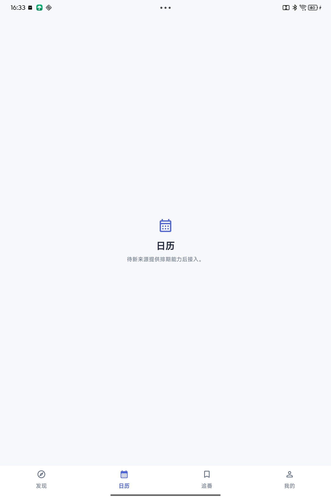
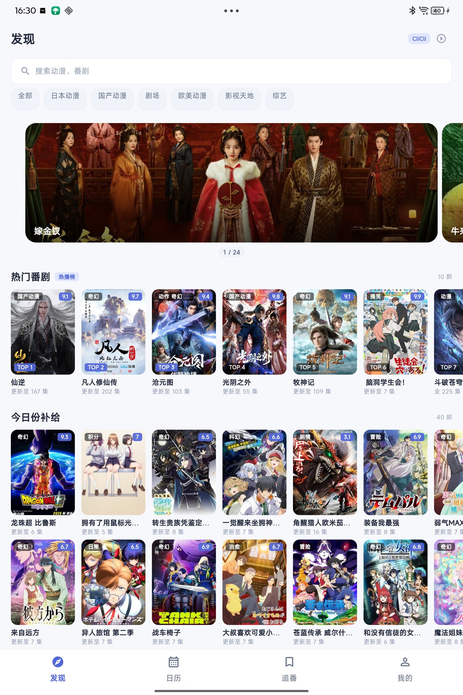
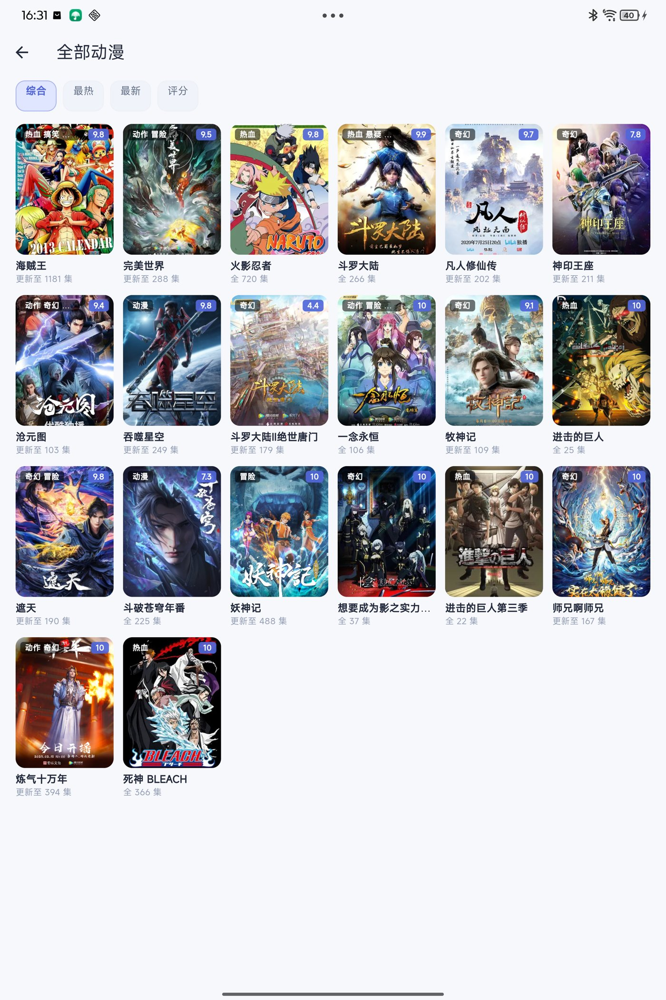
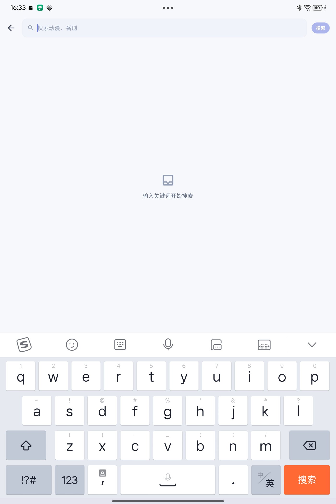
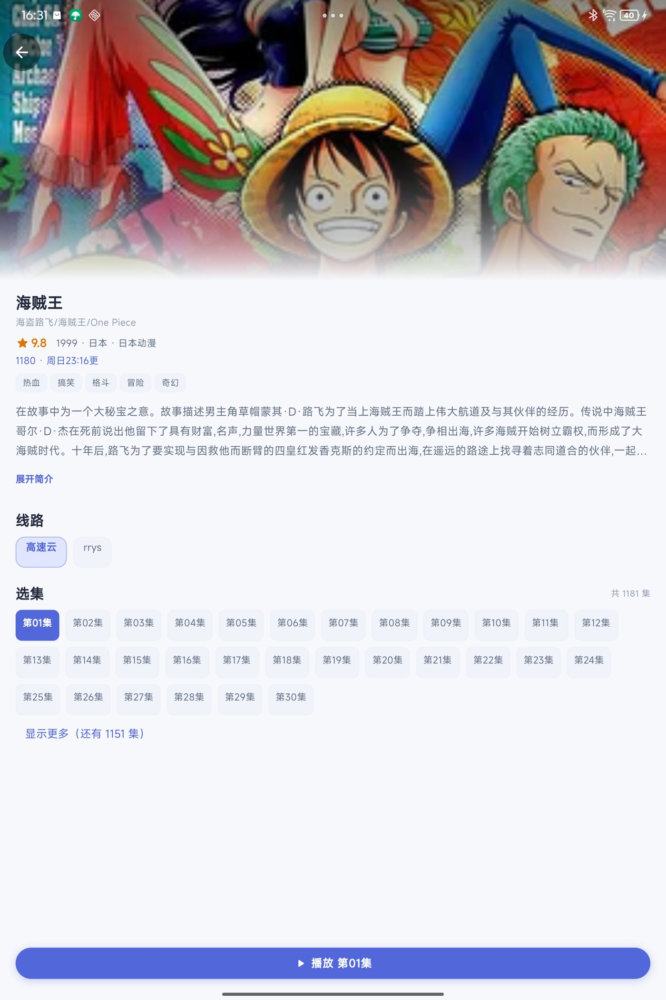
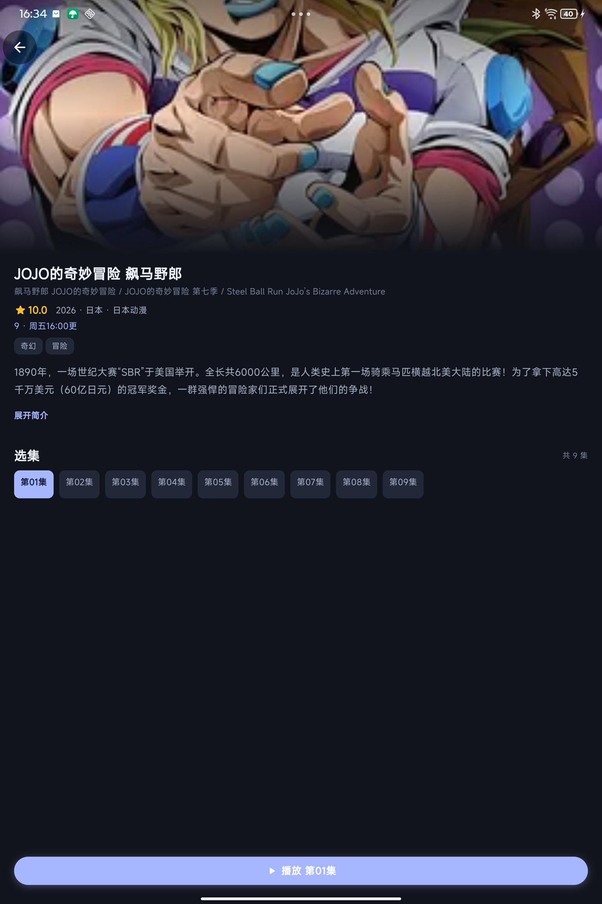
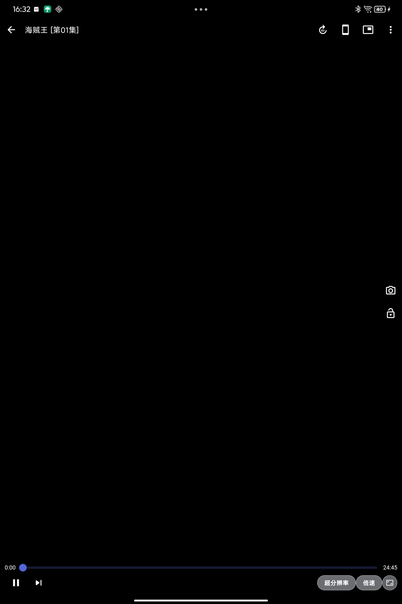
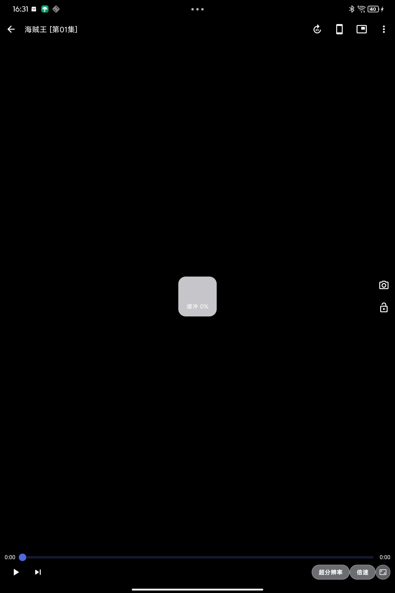
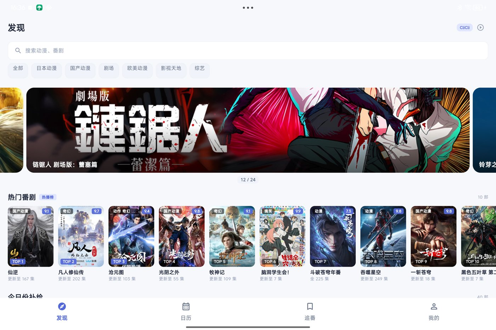

# Playra 全页面样式 Token 深度审计

> 2026-11-19 备注：本文记录旧中性蓝色 token 的审计结果；当日全局 token 已切换为淡紫编辑风，具体见 [页面设计系统延续](design/pages/page-system-20261119.md)。文中对比度结论仅适用于审计当日代码。
>
> 审计对象：`D:\project\Playra`（Flutter 3.47.6 / Material 3 / Forui 0.27.7）
> 审计日期：2026-11-16
> 真机：Lenovo TB711FU（2560×3840，480dpi，853×1280dp，Android 16）
> 构建：按当前工作区源码重新构建并安装的 debug APK（2026-11-16 16:30）
> 说明：本报告只做审计，不修改业务代码。

---

## 0. 结论速览

**总体健康度：4.6 / 10。新内容页的 token 化程度不错，但播放器体系几乎完全脱离 token；同时存在几处会直接影响可读性的 token 误用。本报告共登记 21 项问题（P0 5 / P1 8 / P2 8）。**

| 维度 | 评分 | 结论 |
| --- | ---: | --- |
| Token 资产完整度 | 6 / 10 | 颜色、间距、圆角、字号基础齐全；缺少媒体/播放器场景 token，缺少完整的文字样式 token |
| 页面执行一致性 | 5 / 10 | 发现/详情约 71% 的局部样式使用 token；播放器页仅约 9% |
| 明暗主题一致性 | 4 / 10 | 深色主题主按钮白字对比度仅 1.93:1；浅色主题辅助文字 2.54:1 |
| 可访问性（对比度/触控） | 3 / 10 | 多处小字低于 WCAG AA；按钮高度 28/32/40dp，低于 48dp 触控目标 |
| 可维护性 | 5 / 10 | 三套并行样式体系、50% 语义色字段闲置、多个重复圆角尺度 |
| 响应式 | 4 / 10 | 断点 token 定义了但未使用；平板/横屏只是把手机布局拉宽 |

### 五个最优先问题

1. **深色主题主按钮白字不可读**：`PlayraButton.primary` 强制 `Colors.white`，深色主题 `primary #A7B7FF` 上的对比度只有 **1.93:1**（应使用 `primaryForeground #182142`，对比度 8.13:1）。实拍见「详情页·深色」。
2. **浅色主题辅助文字太浅**：`foregroundSubtle #939EB5` 在 `background #F7F8FC` 上只有 **2.54:1**，但它被大量用于 10–12sp 的副标题、更新集数、加载提示，低于 WCAG AA 的 4.5:1。
3. **播放器页是 token 孤岛**：播放器相关 7,695 行代码（占 UI 代码 60%）只有 16 处 token 引用，158 处硬编码样式值；`source_player_page.dart`、`player_item_panel.dart`、`player_item.dart` 为 0 token 引用。
4. **浅色主题下播放器缓冲提示几乎看不见**：`player_buffering_overlay.dart` 使用 `tokens.background` 作为卡片底色、固定白字；浅色主题实测底色 `#C6C6CA`，白字对比度 **1.70:1**（实拍见「播放器·缓冲」）。
5. **触控目标不足**：`PlayraButton` 三档高度 28 / 32 / 40dp，`PlayraIconButton` 默认 32dp，媒体 chip 约 40dp，均低于 `PlayraLayout.touchTarget = 48`。

---

## 1. 审计范围与方法

### 1.1 代码范围

- `lib/` 共 **138 个 Dart 文件、21,520 行**（不含 `.g.dart` 生成文件）。
- 其中 UI/页面相关 **48 个文件、12,802 行**：启动壳层 6、发现/分类/搜索 5、详情 1、播放器 25、通用控件 4、旧对话框 7。
- 路由共 6 个：`/`、`/browse`、`/search`、`/detail`、`/play`、`/player`；`/` 内含 4 个底部 Tab。
- 历史说明：git HEAD 中曾有 `docs/analysis/ui-style-system-audit-20261103.zh.md`（审计的是旧版多主题/Shadcn/50+ 页面体系），该文件已在当前工作区删除；本报告只针对当前 shell 重置后的源码与 6 条路由，不复用历史结论。

### 1.2 静态审计方法

1. 读取 `PlayraTokens`、`shell_theme.dart`、`playra_forui_theme.dart` 及全部页面/控件源码。
2. 对 `lib` 全量扫描颜色字面量、`fontSize`、`BorderRadius.circular`、`SizedBox`、`Duration`、`EdgeInsets` 等样式写法。
3. 统计 token 引用与硬编码样式命中，形成 [页面覆盖矩阵](#3-页面覆盖矩阵) 与附录 CSV。
4. 人工复核播放器面板、截图面板、HUD、缓冲层等大文件；正则无法覆盖的元组常量（如 `PlayraButton` 的尺寸表）手工计入问题清单。

> 说明：下列「硬编码样式命中数」是相对风险指标，包含 `Colors.transparent`、`Colors.white`、`Colors.black` 等媒体/遮罩场景的必要常量，不代表全部都应替换为 token。

### 1.3 真机验证方法

- 重新执行 `flutter build apk --debug --target-platform android-arm64` 并 `adb install -r`，保证视觉证据与工作区源码一致。
- 逐页截图：发现、日历、追番、我的、分类、搜索（空态/输入态）、详情、播放页、播放器演示、播放器菜单/控制层。
- 主题：系统浅色 / 深色各测一轮。
- 字号：系统 `font_scale=1.0` 与 `1.3` 各测一轮。
- 方向：竖屏 853×1280dp、横屏 1280×853dp。

---

## 2. Token 资产盘点

### 2.1 六类 token 资产

| Token 家族 | 定义数量 | 主要用途 | 实际使用状况 |
| --- | ---: | --- | --- |
| `PlayraSpace` | 9 | 间距：2/4/6/8/12/16/20/24/32 | `sm/md/lg/xl` 使用最多；`section=32` 0 次 |
| `PlayraRadius` | 7 | 缩略图/控件/海报/卡片/Hero/浮层/品牌 | 7 个都有使用，但和 `PlayraTokens.radius*` 重复 |
| `PlayraType` | 11（9 字号 + 2 行高） | 10–22sp 字号、1.5/1.8 行高 | 全部有使用；但没有字重、字距、完整 TextStyle token |
| `PlayraLayout` | 15 | 断点、触控目标、输入高度、工具栏、表单/阅读宽度等 | 仅 8 个使用；`compactWidth`、`compactControl`、`listRow`、`compactToolbar`、`formWidth`、`readingWidth`、`catalogWidth` 7 个 0 引用 |
| `PlayraMotion` | 8 | 按压/状态/弹窗/面板时长与曲线 | 页面直接引用很少；`press` 0 次；按钮实际用 160ms 而非 `state=200ms` |
| `PlayraColors` | 18 | 成功/警告/危险/信息、排名、追番状态、骨架屏 | **15/18 未被当前页面消费**（只有 destructive、destructiveContainer、rankGold 被间接使用） |
| `PlayraTokens` | 32 个字段 | 明暗两套语义色 + `modern` 标记 | **16/32 字段无 UI 引用**（见 2.3） |

### 2.2 主题装配链路

```text
PlayraTokens (ThemeExtension)
   ├─ buildShellTheme() → ThemeData / ColorScheme（Material 组件）
   └─ playraForuiTheme() → FThemeData（Forui 组件）
          ↓
   Page → Theme.of(context).colorScheme / context.playraTokens
```

设计意图是对的：以 `PlayraTokens` 作为单一事实源，同时喂给 Material 和 Forui。问题在于**颜色角色没有全部映射**，以及播放器绕过了这条链路。

### 2.3 未被页面消费的 token 字段

`PlayraTokens` 的 32 个字段中，以下 **16 个没有 UI 引用**：

`success`、`successContainer`、`warning`、`warningContainer`、`info`、`infoContainer`、`rankSilver`、`rankBronze`、`watching`、`planToWatch`、`watched`、`onHold`、`abandoned`、`shimmerBase`、`shimmerHighlight`、`modern`。

原因：这些是旧版“收藏/历史/骨架屏/排名”页面留下的语义，当前空壳（README 说明旧页面已删除）没有对应界面。它们不应继续膨胀 `PlayraTokens`，应拆成可选模块或直接删除。

### 2.4 三套并行的样式体系

| 体系 | 位置 | 状态 |
| --- | --- | --- |
| 新 token 体系 | `lib/presentation/theme/playra_tokens.dart` | 发现/浏览/搜索/详情主用 |
| Forui 控件体系 | `lib/presentation/widgets/playra_controls.dart` | 按钮、对话框、表单在用；内部仍有大量硬编码 |
| 旧常量体系 | `lib/utils/constants.dart` 的 `StyleString`、`LayoutBreakpoint` | **完全无引用**：`cardSpace=8`、`safeSpace=12`、`mdRadius=10`、`imgRadius=12`、断点 600/840 与新 token 重复 |

另外 `customAppFontFamily = 'MI_Sans_Regular'` 定义了但未使用，`shell_theme.dart:30` 直接写字符串。这类重复让“改一处全局生效”的承诺失效。

---

## 3. 页面覆盖矩阵

统计口径：`TokenRefs` = `PlayraSpace/Radius/Type/Layout/Motion/Colors/Tokens` 在文件中的引用次数；`Hardcoded` = 颜色/字号/圆角/SizedBox/Duration/EdgeInsets 等字面量匹配数（含正常的透明、黑白值，仅作相对参考）。「局部占比」= TokenRefs / (TokenRefs + Hardcoded)，不是页面整体视觉质量评分。

| # | 页面 / 路由 | 主要文件 | LOC | TokenRefs | Hardcoded | 局部占比 |
| ---: | --- | --- | ---: | ---: | ---: | ---: |
| 1 | Shell 四 Tab `/` | `lib/shell/shell_page.dart` | 82 | 1 | 0 | —（主要依赖 `shell_theme`） |
| 2 | 发现 `/` | `lib/pages/discover/discover_page.dart` | 377 | 25 | 9 | 73.5% |
| 3 | 发现·Banner | `lib/pages/discover/home_banner.dart` | 236 | 17 | 11 | 60.7% |
| 4 | 发现/浏览/搜索共享组件 | `lib/pages/discover/media_widgets.dart` | 757 | 84 | 33 | 71.8% |
| 5 | 浏览 `/browse` | `lib/pages/discover/browse_page.dart` | 209 | 7 | 3 | 70.0% |
| 6 | 搜索 `/search` | `lib/pages/discover/search_page.dart` | 207 | 7 | 1 | 87.5% |
| 7 | 详情 `/detail` | `lib/pages/detail/media_detail_page.dart` | 532 | 51 | 20 | 71.8% |
| 8 | 播放 `/play` | `lib/pages/player/source_player_page.dart` | 379 | 0 | 27 | **0%** |
| 9 | 播放器主体 | `lib/pages/player/player_item.dart` | 1,534 | 0 | 10 | **0%** |
| 10 | 播放器控制面板 | `lib/pages/player/player_item_panel.dart` | 787 | 0 | 23 | **0%** |
| 11 | 播放器截图面板 | `lib/pages/player/player_screenshot_sheet.dart` | 1,025 | 2 | 41 | **4.7%** |
| 12 | 播放器调整 HUD | `lib/pages/player/player_adjustment_hud.dart` | 933 | 6 | 27 | 18.2% |
| 13 | 播放器缓冲层 | `lib/pages/player/player_buffering_overlay.dart` | 136 | 2 | 5 | 28.6% |
| 14 | 播放器演示 `/player` | `lib/pages/playback_demo_page.dart` | 149 | 6 | 3 | 66.7% |
| 15 | 占位页（日历/追番/我的） | `lib/shell/placeholder_page.dart` | 64 | 6 | 5 | 54.5% |
| 16 | Shell 主题 | `lib/shell/shell_theme.dart` | 90 | 5 | 6 | 45.5% |
| 17 | 通用控件库 | `lib/presentation/widgets/playra_controls.dart` | 1,355 | 25 | 34 | 42.4% |
| 18 | 旧对话框 | `lib/bean/dialog/dialog.dart` | 281 | 4 | 2 | 66.7% |

**分组汇总：**

| 分组 | 文件数 | LOC | TokenRefs | Hardcoded | 局部占比 |
| --- | ---: | ---: | ---: | ---: | ---: |
| 启动/壳层 | 6 | 524 | 19 | 20 | 48.7% |
| 发现/分类/搜索 | 5 | 1,786 | 140 | 57 | **71.1%** |
| 详情页 | 1 | 532 | 51 | 20 | **71.8%** |
| 播放页 | 25 | 7,695 | 16 | 158 | **9.2%** |
| 通用控件 | 4 | 1,503 | 30 | 38 | 44.1% |
| 对话框/旧组件 | 7 | 762 | 4 | 8 | 33.3% |

**关键结论：播放页占 UI 代码 60%，但只有 9.2% 的样式引用走 token；新内容页是 token 化的正面样本（71% 左右）。**

---

## 4. 逐页分析

### 4.1 Shell 与四个 Tab

相关文件：[shell_page.dart](../lib/shell/shell_page.dart)、[shell_theme.dart](../lib/shell/shell_theme.dart)、[placeholder_page.dart](../lib/shell/placeholder_page.dart)。

- `ShellPage` 结构非常干净：`Scaffold` + `SafeArea` + `IndexedStack` + `NavigationBar`。
- 底部导航：`NavigationBarThemeData` 已使用 `PlayraTokens` 的颜色、`PlayraRadius.card`、`PlayraLayout.touchTarget`；但：
  - `height: 68` 是硬编码，`PlayraLayout.toolbar=56/compactToolbar=52` 未使用；
  - 图标固定 `size: 24`，而 `PlayraLayout.icon=20`；
  - `labelTextStyle` 使用 `base.textTheme.labelSmall`（默认 11sp），没有进入 `PlayraType.small`；
  - 代码注释写“只有图标/文字换色，没有背景胶囊”，真机选中项仍会出现浅色胶囊（实测像素 `#F7F8FC`，与页面背景色相同），与注释/设计意图不一致，需要确认 `indicatorColor` 在当前 Flutter 版本的实际生效路径。
- 三个占位页：`Icon(size: 40)`、`ConstrainedBox(maxWidth: 420)` 都是硬编码；标题使用 `Theme.textTheme.headlineSmall`（M3 默认 **24sp**），而 `PlayraType.pageTitle` 是 **22sp**；同一个“页面标题”层级在发现页 22、占位页 24、AppBar 默认 22，三套字号。
- 状态栏/导航栏：`main.dart` 设置为 edge-to-edge，但 `SystemUiOverlayStyle` 只设置了透明色，没有图标明暗策略；深色/浅色主要依赖系统自动处理，详情页/播放页需要页面级手动覆盖（见 4.5/4.6）。



### 4.2 发现页

相关文件：[discover_page.dart](../lib/pages/discover/discover_page.dart)、[home_banner.dart](../lib/pages/discover/home_banner.dart)、[media_widgets.dart](../lib/pages/discover/media_widgets.dart)。

**做得好的部分**

- 页面标题 22/700、来源徽标 10/600、搜索入口 48dp、分类 chip、海报卡、SectionHeader 都使用 token 间距/字号/颜色，结构统一。
- 海报卡把封面、标题、副标题、排名/评分徽标封装为 `MediaPosterCard`，浏览页/搜索页复用，是当前项目最好的组件化范例。
- 卡片高度通过 `MediaQuery.textScalerOf` 按系统字号缩放，1.3 倍字号实测未出现裁切。

**具体问题**

| 位置 | 问题 | 证据/影响 |
| --- | --- | --- |
| 来源徽标（`discover_page.dart:274-291`） | `fontSize: PlayraType.micro(10)`，`primary` 文字放在 `primaryContainer` 上 | 浅色对比度 **3.94:1**，10sp 下低于 AA |
| Section 尾部“10 部” | `PlayraType.small(11)` + `foregroundSubtle` | 浅色对比度 **2.54:1**，实际截图文字发灰 |
| 海报副标题/更新集数 | 同上 `foregroundSubtle`、11sp | 大量信息不可读；是最明显的低对比区域 |
| Banner 渐变 | `Color(0x99000000)` / `Color(0x00000000)` 硬编码 | 缺少媒体遮罩 token；深色/浅色主题共用同一套黑渐变可以接受，但无法主题化 |
| Banner 圆点 | `width: 16/6, height: 6, borderRadius: 3` 硬编码 | 3px 半径不在 `PlayraRadius` 尺度；当 banner 数 >8 时改显示 `1 / 24` pill，说明同一状态有两套表现 |
| 卡片尺寸 | 默认 `width: 118`、`_maxExtent=140`、`gap=12` 硬编码 | 应在 `PlayraLayout`/媒体组件 token 中集中管理 |
| 海报徽标 | `padding: EdgeInsets.symmetric(horizontal:6, vertical:2)`、radius 4 | 6/2 不在 `PlayraSpace` 尺度（有 `compact=6` 但用了裸 6；垂直 2 可用 tiny） |
| 横向 strip 高度 | `mediaPosterStripHeight(context)` 内部用 `118*4/3 + ...`，118 写死 | 若未来调整卡片宽度，两处不同步 |



### 4.3 浏览页

相关文件：[browse_page.dart](../lib/pages/discover/browse_page.dart)。

- 结构简单：`AppBar(title)` + 排序 chip 行 + `MediaPosterGrid` + 页脚。
- 样式几乎全部复用 `media_widgets.dart`，本地只有 7 个 token 引用、3 个硬编码，是“薄页面”的正面案例。
- 问题在 AppBar：
  - `AppBar(title: Text(widget.args.title))` 使用 Material 默认 `titleLarge`（22sp/默认字重），没有显式 `PlayraType`；
  - 滚动时 AppBar 没有状态栏/背景过渡定制，和详情页的 SliverAppBar 视觉语言不同；
  - 返回箭头/标题间距使用 Material 默认值，不受 token 控制。
- 网格在 853dp 平板竖屏显示 6 列，卡片间距 12dp；横屏显示 10 列，密度合理但缺少最大内容宽度，左右只有 20dp 安全边距。



### 4.4 搜索页

相关文件：[search_page.dart](../lib/pages/discover/search_page.dart)、[media_widgets.dart](../lib/pages/discover/media_widgets.dart)。

- `toolbarHeight: 64` 是硬编码，`PlayraLayout.toolbar` 为 56、`compactToolbar` 为 52；同一“工具栏高度”概念存在三套值。
- 搜索输入框 `MediaSearchField` 使用 `PlayraLayout.inputHeight=48`、`PlayraRadius.control`、`surfaceRaised`、`borderSubtle`，实现正确。
- “搜索”按钮是 `PlayraButton.sm`：实际高度 **28dp**，文字 11.5sp；空输入时禁用态为 `primary@45% + 白色文字`，实测浅色主题按钮底色 `#ADB6EC`，白字对比度 **1.97:1**，几乎看不清。
- 空态：`Icon(inbox_outlined, size:36)` + `PlayraType.body(14)`，视觉正常；但 36 不在 `PlayraLayout.icon/compactIcon` 的尺度里。
- 搜索页在 `1.3×` 字号下输入框/按钮没有溢出，输入法弹出时 `adjustResize` 正常。



### 4.5 详情页

相关文件：[media_detail_page.dart](../lib/pages/detail/media_detail_page.dart)。

**结构**

- `SliverAppBar(expandedHeight = 42% 屏高, clamp 220–320)` + 封面背景 + 标题/元信息/标签/简介 + 线路/选集 + 底部播放按钮。
- 标题 20/700、副标题 12、评分 `rankGold`、标签 11、简介 14/1.8、剧集 chip 12/高度约 40dp。
- 这是 token 使用最完整的页面之一：51 个 token 引用、20 个硬编码命中。

**具体问题**

| 位置 | 问题 |
| --- | --- |
| `expandedHeight` | `MediaQuery.sizeOf(context).height * 0.42` + `clamp(220,320)`，不是 `PlayraLayout` token；横竖屏切换时 hero 高度跳变大 |
| 背景渐变 | `Colors.black.withValues(alpha:0.45)`、`Colors.transparent` 硬编码，缺少 `mediaScrim` 语义 token |
| 返回按钮 | 展开态使用 `Colors.black@45%` 圆形底、白色图标；折叠态使用 `t.foreground`；状态切换逻辑正确但颜色未 token 化 |
| 标签 | `padding 8/3`、radius `PlayraTokens.radiusSm`，8/3 不在 token 间距尺度；标签背景 `surfaceRaised` 与页面 `surface` 色差仅 1.05:1，边界全靠 `borderSubtle`（1.14:1） |
| 剧集 chip | 高度约 40dp；`minWidth: 56` 硬编码；选中态在深色主题使用 `primary` 背景 + `primaryForeground` 文字（正确），但非选中态 `surfaceRaised` 与背景接近 |
| 底部播放按钮 | `PlayraButton.lg` 实际 **40dp** 高；深色主题白字对比度 1.93:1（见 P0-1） |
| AppBar 标题 | 默认 M3 `titleLarge`（22sp），与页面标题 20sp 形成同级双标题；折叠后出现“AppBar 标题 + 内容标题”重复 |





### 4.6 播放页与播放器组件

相关文件：[source_player_page.dart](../lib/pages/player/source_player_page.dart)、[player_item.dart](../lib/pages/player/player_item.dart)、[player_item_panel.dart](../lib/pages/player/player_item_panel.dart)、[player_screenshot_sheet.dart](../lib/pages/player/player_screenshot_sheet.dart)、[player_adjustment_hud.dart](../lib/pages/player/player_adjustment_hud.dart)、[player_buffering_overlay.dart](../lib/pages/player/player_buffering_overlay.dart)。

**这是本项目最大的样式债务。**

- 播放相关 25 个文件、7,695 行，**16 个 token 引用、158 个硬编码样式命中**，局部占比 9.2%。
- `source_player_page.dart`：0 token 引用。`backgroundColor: Colors.black`、黑 54/87 渐变、白色 17/18/13sp 文本、`SizedBox 32/18/6/12/20`、`EdgeInsets.all(24)` 全部手写。
- `player_item_panel.dart`：0 token 引用。顶部/底部 scrim 高度 50/100、`Colors.black45`、`Positioned(top:25)`、进度条时间 12/16sp、22 处 `Colors.white` 全部硬编码；`超分辨率`/`倍速` 使用 `PlayraButton.ghost` 但强制白字，按钮 28/32/40 高度与 token 无关。
- `player_item.dart`：1,534 行、0 token 引用；大量手势/播放逻辑可以理解，但所有 overlay 的黑色/白色/间距也是硬编码。
- `player_screenshot_sheet.dart`：41 个硬编码样式，radius 20/16/12/6、padding 12/24、width 1120、maxHeight 840、inset 16/24 等，只有 2 个 token 引用（背景 `surfaceRaised`、一个 destructive 按钮）。
- `player_adjustment_hud.dart`：使用 `Theme.of(context).colorScheme` 的语义角色（比硬编码好），但 `surfaceContainerHighest/tertiaryContainer` 等角色在 `buildShellTheme` 中没有映射到 `PlayraTokens`，实际取的是 `ColorScheme.fromSeed` 的派生色，不是设计 token；另有 `BorderRadius.circular(20)`、`12`、黑色 28%/18% 阴影等硬编码。
- `player_buffering_overlay.dart`：唯一大量使用 token 的播放器文件，但用法错误：`color: tokens.background.withValues(alpha:0.8)` + `Text(color: Colors.white)`；**浅色主题底色约 `#C6C6CA`，白字对比度 1.70:1**，实测截图几乎看不清“缓冲 0%”。





**播放器需要单独一套 `PlayraMediaTokens`**，而不是复用页面背景色：
- `mediaScrimTop`、`mediaScrimBottom`
- `onMedia`、`onMediaMuted`
- `mediaControlSurface`、`mediaControlBorder`
- `mediaProgressTrack`、`mediaProgressActive`
- `mediaOverlayRadius`、`mediaOverlayPadding`
- `mediaStatusBarIconBrightness`

### 4.7 播放器演示页

相关文件：[playback_demo_page.dart](../lib/pages/playback_demo_page.dart)。

- 页面只用 6 个 token 引用；黑底 + 底部白条使用 `t.surface`、`t.mutedForeground`。
- 演示流 URL 使用 12sp `caption`，可读性尚可。
- 问题：黑底视频与浅色主题白色底条之间没有过渡 token；URL 文本在浅色主题白底上为 `mutedForeground`（4.99:1 可读），但视觉上像调试页面，不应作为正式页面模板。
- `PlayerItem` 的播放器控制层问题同上（0 token）。

---

## 5. 横切问题清单

### P0 — 会直接影响可读性 / 可操作性

| ID | 问题 | 位置 | 证据 | 建议 |
| --- | --- | --- | --- | --- |
| P0-1 | 深色主题主按钮白字对比度 1.93:1 | [playra_controls.dart:182](../lib/presentation/widgets/playra_controls.dart#L182) | `PlayraButton.primary` 固定 `Colors.white`，深色 `primary #A7B7FF` | 改用 `tokens.primaryForeground`（#182142，8.13:1）；禁用态另定 `disabledForeground` |
| P0-2 | 浅色辅助文字 2.54:1 | [playra_tokens.dart:215](../lib/presentation/theme/playra_tokens.dart#L215) | `foregroundSubtle #939EB5` on `background #F7F8FC`；大量 10–12sp 文本 | 改为 #657188 左右（约 4.6:1），或仅用于图标，不用于正文/元信息 |
| P0-3 | 播放器缓冲白字在浅灰底上 1.70:1 | [player_buffering_overlay.dart:104](../lib/pages/player/player_buffering_overlay.dart#L104)、[:126](../lib/pages/player/player_buffering_overlay.dart#L126) | 浅色主题实测底色 #C6C6CA、白字 | 新增 `mediaControlSurface` / `onMedia` token；缓冲卡片固定深色半透明底，白字 |
| P0-4 | 触控目标小于 48dp | [playra_controls.dart:172-175](../lib/presentation/widgets/playra_controls.dart#L172-L175)、[:311](../lib/presentation/widgets/playra_controls.dart#L311)、[media_widgets.dart:276-279](../lib/pages/discover/media_widgets.dart#L276-L279) | 按钮 28/32/40dp；IconButton 32dp；chip 约 40dp | 视觉高度可保留，但用 `MaterialTapTargetSize.padded`/外层 48dp 点击区；或统一 `PlayraLayout.touchTarget` |
| P0-5 | 禁用搜索按钮白字对比度 1.97:1 | [playra_controls.dart:181](../lib/presentation/widgets/playra_controls.dart#L181) + 透明度禁用逻辑 | 浅色截图按钮底色 #ADB6EC、白字 | 禁用态使用 `surfaceRaised`/`mutedForeground`，或 `primary` 加 `onPrimary` 保持 ≥4.5:1 |

### P1 — 体系性 / 可维护性问题

| ID | 问题 | 位置 | 说明 |
| --- | --- | --- | --- |
| P1-1 | 播放器 token 孤岛 | `lib/pages/player/` 全体 | 7,695 行、9.2% token 占比；建议先建立 `PlayraMediaTokens`，按「overlay / control / text」三类迁移 |
| P1-2 | ColorScheme 映射不完整/顺序颠倒 | [shell_theme.dart:19-24](../lib/shell/shell_theme.dart#L19-L24) | `surfaceContainerLow = t.surfaceOverlay`（最重）而 `surfaceContainerHigh = t.surfaceRaised`（较轻），与 M3 elevation 语义相反；`ColorScheme.surface` 被指到页面 `background` 而不是 Playra `surface`；`surfaceContainerHighest`、`onSurfaceVariant`、`outlineVariant`、`secondaryContainer` 等未映射 |
| P1-3 | 三套并行体系 / 死代码 | [constants.dart:4-10](../lib/utils/constants.dart#L4-L10)、[:61-64](../lib/utils/constants.dart#L61-L64) | `StyleString`、`LayoutBreakpoint`、`progressIndicatorTheme2024`、`pageTransitionsTheme2024` 全部无引用；`customAppFontFamily` 未使用 |
| P1-4 | 语义 token 大面积闲置 | [playra_tokens.dart:136-425](../lib/presentation/theme/playra_tokens.dart#L136-L425) | 16/32 字段无引用；18 个状态色中 15 个无页面消费；`modern` 字段 0 引用 |
| P1-5 | 字号/字重体系不完整 | [playra_tokens.dart:25-37](../lib/presentation/theme/playra_tokens.dart#L25-L37) | 只有 font size + 2 个 lineHeight，无 weight/letterSpacing/TextStyle；页面 26 处直接写 `FontWeight.w600/w700`；字体只声明 Regular 一个字重 |
| P1-6 | Motion token 覆盖弱 | [playra_tokens.dart:71-103](../lib/presentation/theme/playra_tokens.dart#L71-L103) | `press` 0 引用；按钮写 160ms；播放器出现 80/120/160/180/200/220/300/420/450/650/1200ms 等 11 种时长 |
| P1-7 | 响应式 token 未落地 | [playra_tokens.dart:39-68](../lib/presentation/theme/playra_tokens.dart#L39-L68) | `pagePadding/pageInset/isCompact` 0 引用；所有页面固定 20dp 边距；`compactWidth/expandedWidth` 仅 1 次使用；`formWidth/readingWidth/catalogWidth` 0 次 |
| P1-8 | 导航栏指示器与注释不符 | [shell_theme.dart:42-62](../lib/shell/shell_theme.dart#L42-L62) | 注释说无背景胶囊，实机选中项有浅色胶囊；`height:68`/`icon:24` 未使用 layout token |

### P2 — 细节一致性 / 健壮性

| ID | 问题 | 位置 | 说明 |
| --- | --- | --- | --- |
| P2-1 | `PlayraTokens.copyWith(foregroundMuted:)` 静默无效 | [playra_tokens.dart:310-343](../lib/presentation/theme/playra_tokens.dart#L310-L343) | 接受 `foregroundMuted` 参数，但 `PlayraTokens` 没有该构造参数，函数体也不使用；调用方会以为改色了，实际没有 |
| P2-2 | `PlayraTokens.fromScheme` 会混入深色默认值 | [playra_tokens.dart:242-258](../lib/presentation/theme/playra_tokens.dart#L242-L258) | 仅映射部分字段，`surfaceRaised` 等仍使用构造函数默认的深色值；若某页面脱离 `buildShellTheme` 使用，会出现浅色背景 + 深色卡片 |
| P2-3 | 边框 token 对比度不足 | [playra_tokens.dart:219-220](../lib/presentation/theme/playra_tokens.dart#L219-L220)、[:184-185](../lib/presentation/theme/playra_tokens.dart#L184-L185) | 浅色 `border/surface=1.24:1`、`borderSubtle=1.14:1`；深色 1.39/1.13；作为输入框/卡片唯一边界不满足非文本 3:1 |
| P2-4 | `PlayraBadge.destructive` 前景/背景语义反了 | [playra_controls.dart:1159](../lib/presentation/widgets/playra_controls.dart#L1159) | 用 `destructive` 当背景、`destructiveContainer` 当文字；浅色对比度 3.95:1 |
| P2-5 | 搜索工具栏高度 64 硬编码 | [search_page.dart:126](../lib/pages/discover/search_page.dart#L126) | `PlayraLayout.toolbar=56`、`compactToolbar=52` 未使用 |
| P2-6 | `PlayraDialog` 固定 pagePadding 16 | [playra_forui_theme.dart:78](../lib/presentation/theme/playra_forui_theme.dart#L78) | 页面边距为 20（`PlayraSpace.xl`），Forui 容器边距为 16，视觉上差一档 |
| P2-7 | 字号出现半像素值 | [playra_controls.dart:172-175](../lib/presentation/widgets/playra_controls.dart#L172-L175) | 按钮字号 11.5/12.5，与 `PlayraType` 的整数尺度不一致；在 1.3 倍字号下会出现非整数像素 |
| P2-8 | 占位页标题 24 vs `PlayraType.pageTitle` 22 | [placeholder_page.dart:38](../lib/shell/placeholder_page.dart#L38) | 默认 `headlineSmall` 绕过 token；页面标题层级不统一 |

---

## 6. 可访问性与主题实测

### 6.1 对比度表（WCAG）

| 组合 | 对比度 | 结论 |
| --- | ---: | --- |
| 浅色 foreground / background | 13.64 | 通过 |
| 浅色 mutedForeground / background | 4.70 | 通过（临界） |
| **浅色 foregroundSubtle / background** | **2.54** | **不通过（AA 4.5）** |
| 浅色 primary / background | 4.60 | 通过（临界） |
| 浅色 primaryForeground / primary | 4.88 | 通过 |
| **浅色 primary / primaryContainer** | **3.94** | **不通过（10–13sp 文本）** |
| **浅色 border / surface** | **1.24** | **不通过非文本 3:1** |
| **浅色 borderSubtle / surface** | **1.14** | **不通过** |
| 深色 foreground / background | 16.15 | 通过 |
| 深色 mutedForeground / background | 8.36 | 通过 |
| 深色 foregroundSubtle / background | 4.58 | 通过（临界） |
| **深色 foregroundSubtle / surface** | **4.05** | **不通过小字 4.5** |
| 深色 primaryForeground / primary | 8.13 | 通过 |
| **深色 PlayraButton 白字 / primary** | **1.93** | **不通过** |
| **浅色禁用按钮白字 / 45% primary** | **1.97** | **不通过** |
| **浅色缓冲白字 / #C6C6CA** | **1.70** | **不通过** |

### 6.2 触控目标

| 控件 | 实际高度 | 目标 |
| --- | ---: | ---: |
| `PlayraButton.sm` | 28dp | 48dp |
| `PlayraButton.md` | 32dp | 48dp |
| `PlayraButton.lg` | 40dp | 48dp |
| `PlayraIconButton` 默认 | 32×32dp | 48×48dp |
| `MediaSelectChip` | 约 40dp | 48dp |
| 搜索页“搜索” | 28dp | 48dp |
| `PlayraSwitch`/`PlayraRadio` | 48dp（有 ConstrainedBox） | 通过 |

### 6.3 字号缩放实测

- 系统 `font_scale=1.3` 下：发现页海报标题/副标题未裁切；详情页标题/简介/剧集 chip 未溢出；说明 `mediaPosterStripHeight`、`SliverGrid` 动态高度处理有效。
- 但 `PlayraButton` 的 11.5/12.5sp 半像素字号在 1.3× 下会变成 14.95/16.25 物理字号，与 `PlayraType` 的整数尺度不一致；长期应统一为整数 token。
- 播放器控制层大量 `fontSize: 12/16` 硬编码，未随系统字号缩放（IconButton 的图标也固定），在大字号下会比页面文字明显偏小。

### 6.4 横屏实测

- 853×1280dp 竖屏 → 1280×853dp 横屏：发现页海报网格从 6 列变 10 列，Banner 宽度拉满，导航栏仍在底部。
- 由于 `PlayraLayout.expandedWidth/catalogWidth` 等未使用，没有内容最大宽度；Banner 高度按 `width*0.5` clamp 220 后保持 220dp，视觉上变成很宽的横幅，内容密度和竖屏完全不同。
- 详情页/搜索页横屏未单独截图；按代码 `expandedHeight` 42% 屏高 + clamp 220–320，横屏会稳定在 320dp，仍可用但缺少专门布局。



---

## 7. 建议的目标 Token 结构

### 7.1 分层

```text
Primitive tokens（原始值）
  ├─ color.palette.*
  ├─ space.0/2/4/8/12/16/20/24/32
  ├─ radius.xs/sm/md/lg/xl/pill
  └─ type.size.* / type.weight.* / type.lineHeight.*

Semantic tokens（页面/组件使用）
  ├─ surface.background / surface.default / surface.raised / surface.overlay
  ├─ content.primary / content.secondary / content.subtle / content.disabled
  ├─ action.primary / action.primaryForeground / action.destructive...
  ├─ border.default / border.subtle / border.focus
  └─ status.success/warning/info...

Scene tokens（场景专用）
  ├─ PlayraMediaTokens：scrim/onMedia/control/progress
  └─ PlayraPlayerTokens：hud/panel/screenshot
```

### 7.2 立即修改项（1–2 天）

1. `PlayraButton.primary` 使用 `tokens.primaryForeground`；禁用态重新定义。
2. 浅色 `foregroundSubtle` 改为 `#657188` 或把 10–12sp 文本改用 `mutedForeground`。
3. `player_buffering_overlay` 改为固定深色半透明底 + `onMedia` 白字，或新增 `mediaControlSurface` token。
4. `PlayraButton` 的所有尺寸从 token 读取：增加 `buttonHeightSm/Md/Lg`、`buttonPadding*`、`buttonRadius*`、`buttonFont*`，并将可点击区域扩到 48dp。
5. 修正 `PlayraTokens.copyWith(foregroundMuted:)`，删除无效参数或真正复制 `mutedForeground`。

### 7.3 中期（1–2 周）

1. 新建 `PlayraMediaTokens` 并迁移 `player_item_panel`、`source_player_page`、`player_buffering_overlay`、`player_screenshot_sheet`、`player_adjustment_hud`。
2. 把 `buildShellTheme` 补全为完整 ColorScheme 映射，尤其 `surfaceContainerLowest/Low/High/Highest`、`onSurfaceVariant`、`outlineVariant`、`secondaryContainer`。
3. 删除 `StyleString`、`LayoutBreakpoint`、`PlayraColors` 未使用状态色、`PlayraTokens.modern`。
4. 统一 `PlayraRadius` 与 `PlayraTokens.radius*` 为单一尺度；`PlayraTokens.radius*` 标记 deprecated。
5. 建立 `PlayraTextStyles`：把页面常用 TextStyle 组合（pageTitle/sectionTitle/body/caption/meta/badge/button）定义成静态 TextStyle，页面只引用样式名。
6. 增加 `PlayraPlayerTokens` golden 测试：浅色/深色、1.0/1.3 字号、竖屏/横屏。

### 7.4 长期（持续）

1. 加一条 CI 静态检查：除 `lib/presentation/theme` 和 `player` 媒体层外，禁止新增 `Color(0x...)`、`fontSize: <number>`、`BorderRadius.circular(<number>)`、`Duration(milliseconds: <number>)`。
2. 每新增页面必须附：浅色/深色截图、1.3 字号截图、横屏截图。
3. 每季度清理一次 token：统计 0 引用字段，删除或标注 deprecated。

---

## 8. 附录

### 8.1 审计数据文件

- [Token 速查表](style-token-reference.md)：全部间距/圆角/字号/布局/动效/颜色值
- [页面覆盖矩阵 CSV](style-token-matrix.csv)
- `.analysis/token_audit_v2.json`：逐文件 TokenRefs/硬编码统计
- `.analysis/audit_v2.txt`：聚合结果
- `.analysis/screens/`：原尺寸设备截图
- `docs/assets/style-token-audit/`：本报告使用的压缩截图

### 8.2 截图索引

| 文件 | 页面 | 模式 |
| --- | --- | --- |
| `01_discover_light.jpg` | 发现页 | 浅色、1.0 字号、竖屏 |
| `02_browse_light.jpg` | 浏览页 | 浅色、1.0 字号、竖屏 |
| `03_search_empty.jpg` | 搜索页空态 | 浅色、1.0 字号、竖屏 |
| `04_detail_light.jpg` | 详情页 | 浅色、1.0 字号、竖屏 |
| `05_player_controls.jpg` | 播放器控制层 | 浅色主题下播放页 |
| `06_player_buffering.jpg` | 播放器缓冲层 | 浅色主题下缓冲 |
| `07_discover_dark.jpg` | 发现页 | 深色、1.0 字号、竖屏 |
| `08_detail_dark.jpg` | 详情页 | 深色、1.0 字号、竖屏 |
| `09_discover_landscape.jpg` | 发现页 | 浅色、横屏 1280×853dp |
| `10_placeholder.jpg` | 日历占位页 | 浅色、1.0 字号、竖屏 |

### 8.3 审计限制

- 只覆盖 Flutter UI；Web 播放器 DOM/CSS（`web/player/artplayer_controls.css`）只做了源码检查，未作为 Flutter 页面 token 审计。
- 播放器菜单/截图面板的部分状态需要真实播放/截图候选才能触发，本报告以源码审查为主，未逐一截图每个子状态。
- 硬编码计数是正则近似值，包含必要的透明/黑白常量；具体设计判断以「问题清单」中的手工复核为准。
