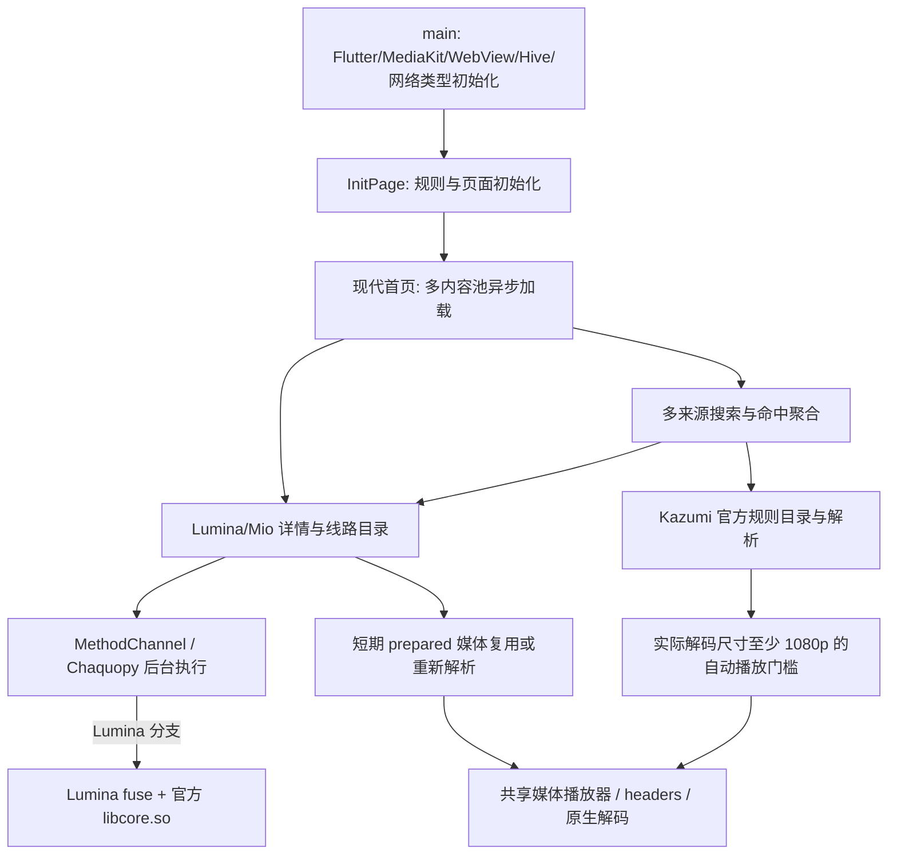

# Android 体积、启动与卡顿排查

日期：2026-10-17。工作区：`C:/Users/haige/Desktop/Playra`；基线提交 `649ab05ee152ce3610c6f5c590e7fcd81b38f11b`，开始时已有 Kazumi/Lumina 等未提交修改。本轮仅做有证据的性能优化，保留 SDK 算法、内容来源、画质门槛和播放器契约。

## 结论与测量边界

原手机安装包为 **debug/JIT**，不是适合评价最终流畅度的 release 包。原包 198,977,646 字节（189.76 MiB），同时携带 ARM32、ARM64、x86_64 及调试 Dart 内核。日志出现 JIT 和 skipped frames；相同业务代码使用 AOT profile 后，启动已明显缩短。这是实际证据支持的首要因素，但不能由此把所有 GPU 长帧、网络等待都归为 debug 问题。

设备：22081212C（diting），Android 15 / API 35，ARM64，4 KB 页；测试时 thermal status 为 0。使用物理设备，未使用模拟器。用户已明确要求清数据复测；只清理 `com.predidit.kazumi`。后续普通冷启动使用强制停止，保留应用数据。

- `am start -W -S` 的 TotalTime 是 Android 启动显示完成时间；它包含进入初始加载页，**不是首页网络内容全部就绪时间**。手动清数据后约 4.15 秒的首张截图仍为加载页，稍后内容正常显示。
- profile 帧测量使用忽略目录中的独立入口，记录前 30 秒 `FrameTiming`；宿主从启动命令前计时，5 秒后做六次相同向上滑动。另列的 `after5s` 按 Dart stopwatch ≥5 秒的回调送达时间筛选；两个时钟起点不同，回调还可能批量送达，因此它不是严格的纯滑动窗口。`firstBatchMs` 也不能当作首帧时刻。
- 分别记录 Flutter build 和 raster 耗时。超过 16.667 ms 只表示超过 60 Hz 的单阶段参考预算；它不是实际丢帧数，也不代表设备始终运行在 60 Hz。
- 网络、图片缓存和样本数存在波动。本轮少量顺序实机样本用于发现数量级变化，不能充当统计显著性的长期性能结论。
- Android `gfxinfo` 只取得一个宿主 View 帧，不适合描述这里的 Flutter FPS，因此未采用其 jank 百分比。

Flutter 官方亦要求在物理设备上用 profile 分析，debug/JIT 不用于最终性能判断，参见[性能测量](https://docs.flutter.dev/perf/ui-performance)和[包体积分析](https://docs.flutter.dev/perf/app-size)。

## 真实执行链与已存在的优化



| 位置 | 实际行为与性能含义 |
|---|---|
| `lib/main.dart:29–121` | `runApp` 前有 WebView 特性、Hive/存储和网络类型等等待。WebView 是否占主要时间尚未单独 trace，不能直接宣称它是瓶颈。Android 的下载目录恢复立即返回，不是已证实重活。 |
| `lib/pages/init_page.dart:60–116` | 等待下载模块、规则初始化，再进入默认页面。内置规则版本同步的无效持久化发生在此关键路径。 |
| `lib/presentation/modern/pages/discover_page.dart:52–105` | 首页同时启动番组与 SDK 首频道加载，随后串行预热其他频道。首屏内容到达时间受网络影响。 |
| `lib/services/source/content_search.dart:229–427` | 多来源并发返回，Dart 端合并命中、排序并通知 UI。排序 getter 被每张可见卡片重复读取，是本轮确认的重复 CPU 工作。 |
| `lib/presentation/modern/pages/sdk_player_detail_page.dart:139–798` | 读取详情、准备线路目录、解析并串行安装媒体。线路准备和实际视频播放应分别观察。 |
| `lib/services/source/sdk_playback_coordinator.dart` | 已有目录缓存、相同请求合并、短期 prepared 复用。不能简单认为每次页面准备都重复解析。 |
| `android/app/src/main/kotlin/com/example/kazumi/SourceRuntimeBridge.kt:52–102` | Python 启动/调用在后台执行，已有四个工作线程及有界队列；不能把 Python 计算直接等同主线程阻塞。原 SDK 内的锁、网络耗时仍可能占用工作线程。 |
| `lib/pages/player/controller/player_playback_controller.dart` | 当前 `enableAndroidSurfaceProducer:false`；锁定 media_kit 的 SurfaceTexture 路径依赖 Skia，本轮保持匹配的渲染后端。 |

以下优化在任务开始前已经存在：首页每帧合并通知、12 条分页、其他频道串行预热、稳定内容快照、图片按显示尺寸解码、静态骨架、惰性列表、已访问 Tab 缓存、轮播暂停条件、SDK 目录缓存和 prepared 复用。本轮没有把它们重复实现或算成新增收益。

## 本轮改动

1. **构建模式与 ABI 同步。** 构建脚本新增 `-Profile` / `-TargetPlatform`，修复指定 `-Device` 时丢失 Release 模式。Gradle 将 Flutter 的 `target-platform` 映射到 NDK `abiFilters`，先清空插件预填值再加入目标，Chaquopy 才会一起移除其他架构的 Python 资产。默认多架构构建仍保留；本机交付 ARM64 包。
2. **排除未使用的大图。** `pubspec.yaml` 将根层图片通配声明改为 61 个显式条目，六张未使用的 `modern-rank-{medal,trophy}-{first,second,third}.png` 留在源码中、仅排除打包。旧 APK 中这六项压缩后合计 9,903,783 字节（9.45 MiB）。字体、logo、当前动态资产系列均保留。
3. **搜索卡片复用结果快照。** 页面每次重建读取一次 `session.works`，卡片从快照取值，避免每创建一张卡片重排整个作品池。完成文案仍有一次长度读取，因此准确收益是“从每卡完整重排变成每次重建固定次数”，不是完全取消排序。
4. **内置规则无变化不刷盘。** 在已有串行队列内计算版本更新集合；没有更新直接返回，避免 JSON 编码、临时文件 flush 与 rename。确实升级时沿用原持久化和失败回滚，保留自定义名称、来源 ID、用户删除及自定义规则。整个 init 仍会读取和解析资产，不能称为零 I/O。

未删减 Python、`_fuse`、`libcore.so`、mpv 或字体来换体积；官方库输入摘要仍为 `26727c7b68308d3055860a71aa0c217380319ba22bc99cfb425c12e3d4e84f17`。设备上已确认 `libcore.so` 与 `liblumafuse.so` 同时映射在应用进程；映射证明库已载入，不能单独证明每条响应走了哪条算法分支。

## 打包时确认的两个问题

Flutter CLI 目标架构原先只缩减 Dart AOT，原工程固定三 ABI 使原生库/Python 留在包中。不能只加 `--target-platform` 就宣称实现单架构。项目当前的 Chaquopy 要求非空 `abiFilters`，AGP 又拒绝它与非通用 ABI splits 并用，因此本轮采用单目标构建，**不使用 `--split-per-abi`**。未来新增 product flavor 时须再次核对 ABI 并集。

两次基线 profile APK 的逻辑 ZIP 内容压缩总量仅差 903 字节，文件却相差约 10.4 MiB。实际发现旧 `libapp.so` 被 Zipflinger 改为不在中央目录中的填充，留下 10,941,505 字节空洞。通过 Gradle `cleanPackageProfile` / `cleanPackageRelease` 仅清理各变体 TaskOutputs 后重建，保留其他编译缓存；没有手动修改或重签 APK。这个问题需检查最终包，不能把增量产物文件大小都归为源码增长。R8/资源收缩原本已经启用，本轮没有将其声称为新增配置。

## 测量与验收

Release 产物、覆盖安装、初启、搜索和真实播放验收已完成。以下 profile 对照数字为原始单次样本，单位 ms。

| 条件 | 启动 TotalTime | Dart ≥5 秒送达样本数 | build p95 | raster p95 | raster 最大 | raster >16.667 ms |
|---|---:|---:|---:|---:|---:|---:|
| 未优化 profile，清数据首次 | 1674 | 256 | 6.466 | 12.866 | 43.291 | 6 |
| 优化 profile，清数据首次 | 1142 | 276 | 1.915 | 12.078 | 27.096 | 4 |
| 未优化 profile，保留数据冷启 | 1165 | 265 | 1.514 | 9.999 | 19.063 | 1 |
| 优化 profile，保留数据冷启 | 1080 | 260 | 1.457 | 4.115 | 8.310 | 0 |

首次 profile 的完整前 30 秒 raster p95 从 17.246 变为 23.095 ms，最大从 66.493 变为 69.946 ms；首次样本 5 秒后 build p95 下降，但 p99 从 9.444 变为 18.669 ms，超过 16.667 ms 的样本从 0 变为 5。长帧仍存在，尾部并非全面改善，不能只挑较好指标宣称消除卡顿；单轮差异也不能直接证明补丁造成回退。保留数据时完整阶段 raster p95 从 15.322 变为 11.267 ms。优化包首次/保留数据 PSS 分别 424,879 / 417,127 KiB，基线为 437,586 / 419,064 KiB；内存只有小幅变化，不能将 APK 大幅缩小解读为运行内存同比下降或用户数据同比减少。

优化 profile APK：74,100,370 字节（70.67 MiB），相对无空洞基线 96,444,586 字节减少 23.17%；相对原 debug 减少 62.76%。CRC、单 ARM64 原生及 Python 资产、六张图片排除、官方库摘要、加载器、无重复 core、条目间无空洞均通过实物检查。profile 并不作为最终交付，正式入口不包含其统计 Timer。

测试：新增规则持久化测试先复现 2 失败、1 通过，修复后 3 通过。随后原 7 文件 49 项通过；扩展搜索、SDK 内容/画质/起播/续播和 Kazumi 实际画质恢复等共 15 文件 **101 项通过**。三文件定向 analyze 退出 0，仅剩控制器原有两条花括号 info。构建脚本经真实 Windows PowerShell 5.1 早期互斥参数拒绝验证，修正了新增中文异常字符串在无 BOM 脚本中的默认解码解析问题；源码保持 UTF-8。

原 debug 三次冷启动：已有数据 3811 ms；命令清数据 4001 ms；用户手动清数据 4150 ms。初始 profile（未修改业务代码）清数据启动 1444 ms；带紧凑帧统计入口的同代码基线清数据为 1674 ms、保留数据为 1165 ms。

上述帧对照仅操作首页六次滑动，没有真实搜索 benchmark。源码及专项测试支持搜索快照确实减少重复排序，但这些首页指标不能量化该搜索补丁的收益；也没有把 debug→AOT 的总体变化全部归因于两处 Dart 补丁。

## 最终 ARM64 Release 包

- 文件：`build/app/outputs/flutter-apk/Playra-2.3.8-arm64-performance-20261017.apk`。
- 大小：60,559,627 字节，57.75 MiB；相对原 debug 减少 69.56%，相对优化 profile 再减少 18.27%。
- SHA256：`ddb2cabb9bcc63948cb0d274f8e177f1f47966a0210fa3ac1670598744cffb25`。
- Playra / `com.predidit.kazumi` / 2.3.8 / 20308 / minSdk24 / targetSdk36；仅 ARM64。
- 使用原有 Android Debug 测试签名构建 Release 模式；签名算法校验通过，证书 SHA256 为 `fa4ec0e036ba5760beaab14bed70e1f6d625462317b8a42d828ac7c3797927fe`。测试证书不等于启用 debug 模式，也不等于正式商店签名。
- ZIP CRC 通过，847 条目，条目间空洞 0；无 Dart debug kernel、无 profile VM service snapshot、无 `[PLAYRA-PERF]` 标记。只含 ARM64 原生/Python 资产；六张母版不在包中，其余运行图片、字体、SDK 和播放器保留；官方 core 摘要一致，加载器存在且未在 Python 包重复嵌入库。
- 脚本以正常 `lib/main.dart` 构建，Gradle 311.8 秒；覆盖安装到已连接设备成功，设备确认 `debuggable=false`。

最终包清数据首次启动 **774 ms**；保留数据冷启动 **618 ms**。启动后约 5 秒截图仍有异步推荐占位，约 15 秒时推荐图文已显示完整；不能把 774 ms 宣称为全部网络内容就绪。两轮约 15 秒时 PSS 分别 385,650 / 362,882 KiB，与前述 33 秒 profile 窗口不同，不作严格内存对照。

最终包真实 Lumina 播放验证：《宝可梦 地平线》第 1 集，自动线路 3，页面报告 **1920×1080 实际分辨率**。Android 当前应用 PID 的 `c2.qti.avc.decoder` 配置同为 1920×1080。起播截图与后续截图间隔 42.79 秒，画面推进、进度显示 **0:44**，没有只凭解析 ready 判定播放成功。其后返回首页搜索 `jojo`，首批结果能在其余来源检索时显示，最终页面显示 160 个作品、1 个来源需重试；这只验证真实搜索与列表渲染可用，不是搜索性能 benchmark，也不代表所有规则都稳定成功。

最终 Release 压缩组成：原生库 29,228,483 B，Python 资产 11,533,198 B，图片 9,396,101 B，字体 7,133,168 B，DEX 1,448,897 B，其余资源及 ZIP 结构 1,819,780 B。独立读包复核确认其余 67 个运行图片、MiSans、core、fuse、mpv 字节不变；32 个 SDK 文件的代码载荷/资源一致，其中 24 个 pyc 仅头部时间戳变化。进一步减包可研究独立 Dart 符号与保留透明度的无损图片编码，尚未测量收益，不纳入本轮承诺。

复现 Release 构建（Python 路径换成本机已准备的 CPython 3.11 可执行文件）：

```powershell
$env:PLAYRA_BUILD_PYTHON = 'C:/path/to/python311/python.exe'
./tool/build-android.ps1 -Release -TargetPlatform android-arm64 -AndroidSdk C:/Android/Sdk -JavaHome 'C:/Program Files/Java/jdk-17.0.9'
```

日常 profile 用 `-Profile`；指定设备用 `-Device <serial> -Profile` 或 `-Release`，不同时指定 `-TargetPlatform`。测试多个架构应分别指定构建目标，不给本工程叠加 ABI split。实际 APK 仍需核验；增量文件异常膨胀时先核对并窄范围清理对应 `packageProfile/packageRelease` 的任务输出，再构建，避免反复全量 clean。

## 后续候选与限制

- 搜索默认多来源并发、UI isolate 的 JSON 解码和聚合是否形成长任务，需补充真实搜索 CPU trace；本轮不改变默认来源覆盖范围。
- SDK 详情会准备多条线路；某些画质查询涉及播放解析。已有短期缓存，下一步应测未选线路的实际调用次数和耗时，再决定延迟准备策略。
- 原生 SDK 锁和固定网络超时可能占住后台线程，HTTP 连接复用也有潜在空间。涉及取消、安全传输和原算法边界，未在本轮盲改。
- 图片淡入、阴影和过滤质量可能增加 raster 时间，需要 GPU 对照。仅凭静态代码不能确定收益。
- Impeller 临时参数试验没有取得后端确认，不作为有效性能对比。切换渲染器需与播放器 SurfaceProducer 迁移及真实播放一起验证；没有证明 Impeller 更慢。
- 本机为 4 KB 页设备；官方 `libcore.so` 仍为 4 KB ELF 对齐，不能宣称支持 16 KB 页。正式签名、商店发布与所有来源长期稳定性不属于本次已验证范围。

## 修改范围与回退

| 文件 | 目的 / 影响 |
|---|---|
| `android/app/build.gradle` | 同步单架构的原生库和 Python 打包；保留此前 SO 直载改动 |
| `tool/build-android.ps1` | 明确 profile/release 模式和目标架构；兼容既有默认行为 |
| `pubspec.yaml` | 仅排除六张未使用的大图 |
| `lib/plugins/plugins_controller.dart` | 内置规则无版本变化时跳过持久化 |
| `lib/presentation/modern/pages/content_search_screen.dart` | 可见卡片复用作品列表快照 |
| `test/kazumi_startup_persistence_test.dart` | 无变化、真实升级、写盘失败三个回归场景 |
| 本记录 | 记录测量口径、证据、边界及复现方法 |

本轮前副本在 `.dart_tool/android-performance-20261017/before/`，其中 Gradle 原副本名为 `android-build.gradle`。回退仅恢复上述对应文件和移除本轮新增测试/报告，不要整仓 reset；保留用户及此前 Kazumi/Lumina 修改和脏子模块。性能原始 JSON、截图、profile 专用入口与测试 APK 均在忽略目录 `.dart_tool/android-performance-20261017/`，没有提交身份、媒体签名 URL、headers 或私有 SDK。未提交、推送或公开发布。

- DONE：启动与包体积基线、定向性能修复、101 项回归、编码/差异校验、独立审查、最终 APK/签名校验、覆盖安装、清数据初启、真实搜索和持续 1080p 播放。
- NEXT（可选）：真实搜索 CPU trace、首屏 GPU 长帧调查和低优先线路准备测量。首次帧尾部仍有波动，不能宣称全场景无卡顿；用户现已要求停止追加测试并交付本包体验。
