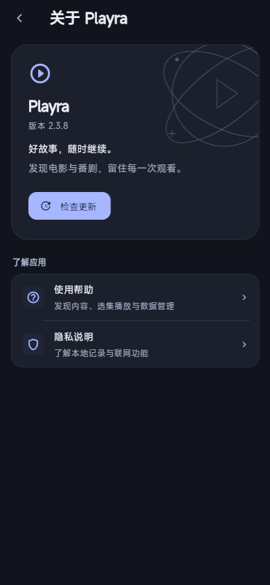
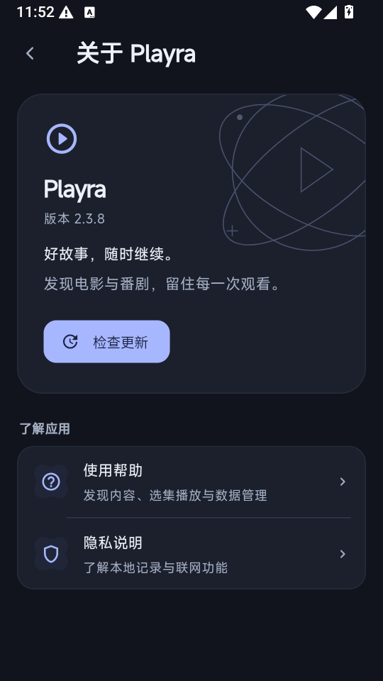

# iOS 新页面与应用信息统一

基线 `a474b579`。用户要求：iOS 与当前 Web/Android 使用同一套新页面；应用信息只呈现 Playra 品牌，移除会跳转到仓库或取得源码的公开页面入口。复杂度 L，按研究、设计、实现、验证、审查完成定向修改，不另建页面框架。

## 当前代码与设计

- `main.dart` 新版能力仅开放 Android；iOS 因 `supportsModern=false` 被强制回退旧界面。`IndexPage`、`TabShell`、`InterfacePageHost` 已共享页面和业务状态，移动标签导航已经识别 iOS，无需复制 iOS 专用页面。
- 存储中的 `androidUiStyle`、`androidModernDefaultApplied` 是已有持久化键。扩展它们在移动端的使用，不改名、不迁移收藏/历史/规则数据；iOS 首次升级保存 modern 后再写迁移完成标记，后续尊重用户选择。
- Web 预览入口已强制 modern，但正式入口此前没有启用 Web 新页面。平台策略统一开放 Web、Android、iOS，桌面原生保持原有行为。
- 关于页的“版本记录”、许可页的 GPL 外链、致谢页项目链接及更新弹窗的“查看详情”会打开 GitHub。iOS/Linux 更新兜底也会打开 release 仓库网页。
- 保留本地使用帮助、隐私说明及应用内检查更新；隐藏许可/致谢展示入口与外链，旧深链兼容返回关于页。保留仓库 LICENSE、第三方版权文件和真实项目历史，不添加“全部源码原创”等不实文案。
- 隐藏界面链接不改变公开仓库的访问权限，也不使安装包无法分析。GitHub 更新 API 与规则数据请求属于后台功能地址，不能为了去掉界面链接而删除。

## 范围与验收

允许修改：`main.dart`、`interface_style.dart`、`settings_keys.dart` 中迁移说明，`pages/about` 页面/组件/路由，`settings_module.dart` 的旧许可证深链，首次引导更新文案，更新器外部仓库跳转，相关发布/导航测试及本记录。删除旧致谢展示文件是本轮请求范围。私有 SDK、内容接口、播放规则、播放器和用户预先已有文档/子模块变化不动。

验收：平台能力与偏好持久化、iOS 平台下四标签导航及设置返回、关于页窄屏/大字号和单次更新、隐藏入口与旧深链行为、更新功能回归、Web 实际页面截图、Android 构建。Windows 无 Xcode/iOS Simulator，不能在本机生成或安装 IPA；iOS 原生签名与设备播放不得据组件测试宣称已通过。

回退：仅回退本轮提交，持久化键和既有数据格式兼容基线。

## 页面执行链路

`main.dart → InterfaceStyleController → IndexPage / TabShell → InterfacePageHost → ModernShell → 发现、日历、追番、我的`。设置由 `SettingsAppearanceHost` 接入同一套 token；播放器继续复用已有共享组件。iOS 没有单独的一套 SwiftUI 页面需要重写，原来差异来自入口的平台开关。

| 平台 | 原行为 | 本轮调整 |
|---|---|---|
| Android | 新页面能力开放，覆盖安装一次性迁移 | 保持行为与持久化键 |
| Web 预览 | 专用 main_home_preview 强制新页面 | 共用关于页变更 |
| 正式 Web | 主入口平台开关回退旧页面 | 按 Web 运行时开放新页面，使用已保存选择 |
| iOS | 主入口强制 legacy，已有现代组件未启用 | 开放现代组件并一次性设为 modern；后续尊重选择 |
| 原生桌面 | 旧页面 | 不扩展本轮范围 |

### iOS 内容能力边界

`runtime_endpoint.dart` 的内置 SDK 调用仅对 `Platform.isAndroid` 执行。iOS 返回 null，随后依赖 `PLAYRA_SOURCE_RUNTIME_URL` 的 HTTPS 服务；未配置时 `SourceRuntimeClient` 返回 `RUNTIME_UNAVAILABLE`。本轮不擅自接入测试电脑地址或复制 Android Chaquopy 到 iOS。动漫的原有 Apple WebView 与原生播放器实现继续保留。

### 应用信息边界

AboutLinkTile 现在只接受本地 route，不再提供 URL 构造器或外部打开帮助函数；旧致谢页面与注册入口移除，旧地址显示统一关于页。更新器继续使用既有后台 API 和安装包下载、校验、安装流程，但不再展示发布网页跳转；没有应用内安装流程的平台提示从原安装渠道获取更新。私有服务地址、令牌和应用标识不作为品牌内容展示。

## 验证结果

- RED：320px / 1.6 倍文字测试真实发现“版本记录”仍存在；移除后单次更新、窄屏和本地信息回归通过。
- 定向 21 项、全量 Flutter 574 项全部通过。包括 iOS 平台能力、四标签切换、设置覆盖与返回、偏好持久化、旧许可/致谢深链、本地帮助返回及更新引导。
- 修改文件静态分析无错误/警告，保留更新器 1 项既有括号风格提示；UTF-8、无 BOM/U+FFFD 和 `git diff --check` 检查通过。
- 正式 `lib/main.dart` Web Release 构建通过。实测 390×844 和 1280×900 关于页、从“我的”进入、帮助/隐私及返回；旧 `/settings/about/license` 显示 Playra 产品关于页。未找到仓库按钮、版本记录、致谢或外部打开图标。正式 Web 主标签为发现、日历、追番、我的，开发实验室不显示。
- Web 页面加载与上述本地导航没有控制台错误；真实点击检查更新时 `/api/proxy?...api.github.com.../releases/latest` 返回 HTTP 403，应用显示“检查更新失败”。这项当前代理可用性未被界面隐藏修复；没有因此打开外部仓库页面。
- Android Release 构建通过，版本 2.3.8 / 20308，继续使用现有测试签名。模拟器覆盖安装成功，从“我的”进入关于页只显示 Playra 品牌、版本、检查更新、使用帮助与隐私说明，没有许可/致谢/版本记录项。
- iOS：Dart 平台策略和组件导航已通过；原生编译、签名、安装和真实媒体播放 **BLOCKED**，原因是当前执行主机为 Windows，未提供 Xcode/iOS Simulator。未生成 IPA，未宣称设备播放已通过。

页面修复与跨平台可执行验证完成；iOS 原生验收和 iOS 影视运行服务为明确的后续条件，整体交付状态 PARTIAL。

## 修改清单

| 文件 | 目的 / 影响 |
|---|---|
| `lib/main.dart`、`interface_style.dart`、`settings_keys.dart` | 开放 iOS/正式 Web 新页，共用现有偏好键；不改数据格式 |
| `pages/about/about_page.dart`、`about_widgets.dart` | 隐藏许可/致谢和版本网页，组件只支持本地导航 |
| `product_information_page.dart`、`about_module.dart`、`settings_module.dart` | 移除旧许可展示，兼容旧深链为产品关于页 |
| `pages/about/credits_page.dart` | 删除已失去入口的仓库跳转页面 |
| `update_source_step.dart`、`auto_updater.dart` | 更新引导使用产品文案，更新 UI 不打开发布仓库 |
| 三个发布/页面测试、分析报告与截图 | 验证平台、路由、旧深链和实际界面 |

DONE：共享平台入口、关于页和更新 UI、回归、Web 与 Android 构建/界面。BLOCKED：iOS 原生验收（Windows 无 Apple 工具链）。NEXT：配置 iOS 影视 HTTPS 运行服务并在 Mac/iPhone 验证。本轮许可证文件、私有 SDK、规则与预先已有用户变更均未修改。
