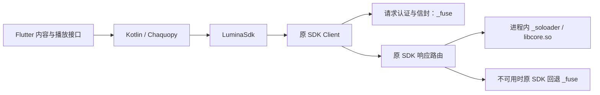

# Lumina SDK 更新与 Android 进程内 SO 直载

日期：2026-10-17。目标为当前 Playra 工作区；按用户确认先完成代码与 APK，ARM64 实机直载和播放稍后验证。

## SDK 分析与本次边界

本次为既有接入的有界更新，保持 Dart/MethodChannel/业务 JSON 契约。读取用户附件和交付 SDK 当前源码后，确认请求认证/信封仍需要 `_fuse`，新版 `_soloader` 专门将响应解密交给同一进程内 `ctypes.CDLL` 加载的官方 `libcore.so`。不重写认证、块密码、信封、解析器算法，也不增加设备桥、Unicorn 或电脑 Python 服务。

原 Android 工程已经有 `nativeLibraryDir` 传入 Python 的入口和 `_fuse` 打包，但导入白名单、APK Python 模块和 JNI 资产均缺新版 `_soloader`；因此只设置原引擎路径不足以启用官方库直载。本次没有改 Flutter 页面、来源排序或内容/播放接口。

交付 SDK 输入：`C:/Users/haige/Desktop/instruct/tv-reverse-com.tudou.tool-api/sdk/python/lumina`；其仓库 HEAD 为 `359395d664a64cb29ada63293ff83598848c7a05`，导入前核对包目录无 Git 修改。导入收据升级为 `integrationVersion=2`，共 21 个文件；除 `config.py` 接入点绑定外，其余导入字节与交付 SDK 摘要一致，设备指纹仍运行时生成和持久复用。

## Android 打包与加载

| ABI | 随包原生库 | 响应解密行为 |
|---|---|---|
| arm64-v8a | `liblumafuse.so`、官方 `libcore.so` | SDK 默认优先进程内直载，失败按 SDK 自带路由回退 |
| x86_64 | `liblumafuse.so` | 交付的官方库是 AArch64，不能原生加载；保留 `_fuse` |
| armeabi-v7a | 不含 Lumina 引擎 | 继续不登记 Lumina，保留其他来源 |

附件概述中的 x86_64 直载能力不能直接套到实际产物：`libcore.so` 经 ELF 头核对 `e_machine=183`，仅 ARM64。x86_64 引擎 `e_machine=62` 属于 `_fuse`，不能把这两个库混为一谈。

宿主在 SDK 导入及首次网络调用之前绑定：

- `LUMINA_ENGINE_PATH=<nativeLibraryDir>/liblumafuse.so`。
- `LUMINA_SOLOADER_PATH=<nativeLibraryDir>/libcore.so`，不依赖 `/data/local/tmp` 或下载库。
- `LUMINA_SOLOADER_FILES=<应用私有 runtime-cache>/soloader`，运行期可写数据与原生库分离。
- `LUMINA_DEVICE_ID` 与 `profile.DEVICE_FP` 共同使用应用私有 `device.json` 的同一个 32 位十六进制指纹。

未强行设置 `LUMINA_SOLOADER=1`，沿用原 SDK 默认开启及显式关闭语义；未开启 `LUMINA_DEVICE`。Chaquopy 仍只提取需要真实镜像路径的 `_fuse` 包，`_soloader` 编译模块直接随 Python 包加载；库独立进入 JNI 目录。对应行为依据 [Chaquopy 官方打包说明](https://chaquo.com/chaquopy/doc/current/android.html#extractPackages)和 [Android 原生库提取说明](https://developer.android.com/guide/topics/manifest/application-element#extractNativeLibs)。项目实际锁定 Chaquopy 17.0.0 / Python 3.11 / AGP 8.11.1，本次没有升级框架版本；17.0 文档 URL 本次未能打开，使用当前官方说明并以实际构建确认兼容。

## 验证结果

| 验证 | 结果与证据 |
|---|---|
| TDD 复现 | 新增测试先失败：缺失直载文件、缺少原生路径/身份绑定；另以错架构 ELF 证明旧导入器会误接收 |
| Lumina 专项 | **35 项通过**：导入/升级/缺库、算法字节保护、ABI 校验、私有路径和持久身份、原有内容/媒体边界 |
| Python 契约回归 | 排除依赖缺失旧 AniFive 包的两个测试模块，其余 **94 项通过**；CPython 3.13 与 APK 同主次版本的 CPython 3.11.14 各执行一次通过 |
| SDK 官方自检 | `SELFTEST ALL PASS`；出厂未配置接入点的自检 E2E 分支为 SKIP，真实请求另行验证 |
| SDK 固定向量 | `VECTORS ALL PASS (11/11)` |
| 官方路由门禁 | `check_soloader.py --route-only`：PASS；Windows `soloader=False`，本地回退合成信封解密正确 |
| 实际生产适配器 | 配置、4 个频道、7 条轮播、列表、搜索、详情、播放均成功；播放返回 ready、1 个真实媒体条目 |
| 真实直链 | 携带 SDK 返回 headers，Range 读取 **HTTP 206 / video/mp4 / 512 字节**，不是 HTML。只证明直链可读，不替代 Android 首帧/持续播放 |
| Dart/UI 兼容回归 | 6 个 Lumina/SDK 内容、画质、预解析、入口和换源测试文件共 **38 项通过** |
| Android APK | `tool/build-android.ps1 -AndroidSdk C:/Android/Sdk -JavaHome C:/Program Files/Java/jdk-17.0.9`，Python 3.11.14 显式指定；**debug 构建通过，Gradle 291.0 秒** |
| APK 实物检查 | ZIP CRC 通过，apksigner 验证通过；Playra / `com.predidit.kazumi` / 2.3.8 / 20308 / minSdk24 / targetSdk36；三 ABI；官方库只在 ARM64，且包内字节与 SDK 原文件一致 |
| Python 包资源 | `assets/chaquopy/app.imy` 包含 `_soloader/__init__.pyc`、`_fuse` 和镜像；没有重复打包 `_soloader/assets/libcore.so`，没有 Lumina 桌面库 |

本机真实联调能力为 `_fuse=True`、`soloader=False`；这是 Windows 回退结果，不能宣称 Android 已直载成功。SDK 自检和固定向量使用原 SDK 的测试入口；导入收据另验证应用使用的算法字节一致。

完整 Python discover 曾执行 **125 项，37 errors + 1 failure**，均涉及当前缺失的 `vendor.anifive`；其中取消测试的失败由其工作线程先因缺模块退出引起。没有禁用这些测试、伪造私有输入或把全量回归标为通过。当前默认 Kazumi 不依赖该私有包，Android 构建不受阻。

## APK 交付

- 文件：`build/app/outputs/flutter-apk/Playra-2.3.8-lumina-soloader-debug-20261017.apk`。
- 大小：198,977,646 字节（约 189.8 MiB），测试签名 `Android Debug`，不是正式发布包。
- SHA256：`46fa6f2cf145c7ea83cdd14faca6991cc0f8998b5257b0eb987fa0fe82978bd2`。
- 官方 `libcore.so`：6,839,376 字节，SHA256 `26727c7b68308d3055860a71aa0c217380319ba22bc99cfb425c12e3d4e84f17`，与 APK ARM64 条目相同。`_fuse` 库经 Android 标准符号剥离，包内摘要可能不同于输入，但源输入摘要仍受收据校验。

## 限制与后续验收

1. 用户选择稍后实机验证；本轮 adb 无设备，**安装、ARM64 `soloader=True`、实际调用和持续播放均未执行**。不能由库存在或桌面直链成功推导已在 Android 加载成功。
2. 官方 `libcore.so` LOAD 对齐为 `0x1000`（4 KB），不是 `0x4000`。16 KB 页大小兼容尚未通过，需要交付方提供兼容库并按 [Android 官方 ELF 对齐验证步骤](https://developer.android.com/guide/practices/page-sizes#elf-alignment)检查及实机验证；本次不修改官方二进制来冒充支持。
3. 真机连接后的验收应确认实际进程 ABI、页面大小、SDK `backend_capabilities()['soloader']`、同进程库映射、真实配置/目录/搜索/解析与播放器首帧/持续推进、切集和短效地址刷新；不只读取安装包或 API 200。
4. 本机 `.tooling/dev-environment.json` 不存在，因此没有改写全局/项目工具配置；构建通过现有脚本的显式路径和 `PLAYRA_BUILD_PYTHON` 完成。构建有既有 Gradle/AGP/Kotlin 即将不受支持提示，未在此任务升级这些组件。

## 修改范围与回退

| 文件 | 目的 / 影响 |
|---|---|
| `tool/source_runtime/import_lumina.py` | 原样导入新直载模块和库，收据 v2、旧收据校验升级与 ELF 架构检查 |
| `tool/source_runtime/vendor/lumina-manifest.json` | 记录新私有输入摘要和真实 ARM64 直载平台 |
| `tool/source_runtime/lumina_adapter.py` | 设置只读库路径、私有运行目录和共享持久身份，不改业务接口或 SDK 算法 |
| `android/app/build.gradle` | 输入完整性门禁、Python 加载器打包、ARM64 官方 JNI 库打包 |
| `tool/source_runtime/test_lumina.py` | 覆盖缺口、升级/失败保护与架构错误回归 |
| 构建输入、SDK 接入规范与本记录 | 更新加载链、平台边界、实际验收及未验项 |

忽略的 `tool/source_runtime/vendor/lumina/` 已恢复为本次 SDK 输入，不能提交到公开 Git。脱敏联调记录位于 `.dart_tool/lumina-soloader-20261017/live-results.json`，没有媒体签名地址、headers 或内部密钥；身份位于该忽略目录的私有状态中，不能跨设备分发。

本轮修改前副本在 `.dart_tool/lumina-soloader-20261017/before/`，基线为 `649ab05ee152ce3610c6f5c590e7fcd81b38f11b` 上已有未提交工作区。回退仅恢复本轮对应副本；新增报告可单独移除。Lumina vendor 在本轮开始时缺失，若撤回私有输入先保留当前副本，恢复旧收据后也不能声称旧输入可用。不要整仓重置，保留此前 Kazumi、用户改动和脏子模块。未提交、推送或发布。

- DONE：SDK 分析、导入/加载/打包更新、专项和契约回归、真实业务直链联调、APK 与包内容验证。
- NEXT：用户连接 ARM64 设备后做进程内直载和实际播放验收；16 KB 页面设备另行核验。
